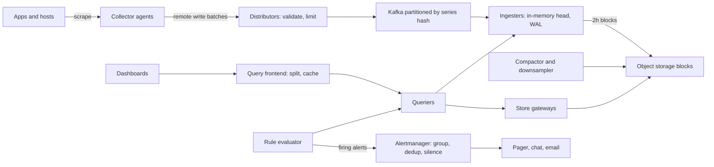

A metrics platform answers "is the system healthy right now, and what changed?" It collects numeric samples from thousands of hosts and services, stores them cheaply for months, renders dashboards in under a second, and wakes someone up when a service-level objective is at risk, without waking them for noise. Prometheus, Grafana Mimir, VictoriaMetrics, Datadog and CloudWatch all share the same core: a label-based time-series model, an append-optimised storage engine with heavy compression, and a rule evaluator feeding an alert router. The design problem is mostly about volume and cardinality.

## Requirements

Functional:

- Ingest counters, gauges and histograms from hosts, containers and applications.
- Query with label filters, aggregations and functions (rate, percentiles) over arbitrary ranges.
- Dashboards with auto-refresh.
- Alert rules evaluated continuously, routed to on-call with grouping, deduplication and silencing.

Non-functional:

- 10 million active series, 15 second resolution.
- Ingest-to-query freshness under 30 seconds.
- Dashboard queries over the last 6 hours return in under 1 second at p95.
- Retention: 15 days raw, 90 days at 5 minutes, 13 months at 1 hour.
- The alerting path must keep working when the query and dashboard tier is degraded.

## Estimates

```text
Samples/s    = 10 M series / 15 s            = about 670 K samples/s
Samples/day  = 670 K x 86,400                = about 58 B
Raw bytes    = 16 B/sample (8 B ts + 8 B val) -> 930 GB/day uncompressed
Gorilla      = about 1.4 B/sample            -> about 80 GB/day
15 days raw  = 1.2 TB, x3 replication or object storage with erasure coding
5 min rollup = 10 M x 288 points x 4 aggregates (min, max, sum, count) x 90 days -> about 1 TB compressed
Index memory = 10 M series x about 1 KB (labels, postings) = 10 GB across ingesters
```

Compression is what makes this affordable: a 10x reduction turns a petabyte-scale problem into a few terabytes. Memory for the series index, not disk, is usually the first constraint.

## API

```text
POST /api/v1/write                         (Prometheus remote-write: snappy-compressed protobuf)
POST /v1/metrics                           (OTLP)
GET  /api/v1/query?query=...&time=...
GET  /api/v1/query_range?query=...&start=...&end=...&step=60s
POST /api/v1/rules                         alert and recording rules
POST /api/v1/silences                      {matchers, starts_at, ends_at, comment}
```

Speaking Prometheus remote-write and OTLP lets existing agents (Prometheus, OpenTelemetry Collector, Grafana Alloy, Vector) send data without custom code.

## Data model

A series is a metric name plus a set of labels; each series is an ordered stream of (timestamp, float) samples.

```text
http_requests_total{service="checkout", method="POST", status="500", region="eu-west-1"}
  1762160400000  10432
  1762160415000  10447
```

The series identity is a hash of the sorted label set. An inverted index maps each `label=value` pair to a postings list of series IDs, so `{service="checkout", status=~"5.."}` becomes a set intersection.

Cardinality is the product of label values. A metric with `service` (200) x `endpoint` (50) x `status` (10) x `pod` (20) is 2 million series, and one engineer adding `user_id` turns it into hundreds of millions. Every series costs index memory, so cardinality explosion is the most common way these systems fall over. Defences: per-tenant series limits enforced at ingestion (reject new series beyond the cap, keep existing ones), a cardinality explorer showing the top labels, and guidance that unbounded values (user IDs, request IDs, raw URLs) belong in logs or traces, not metric labels.

## Push vs pull

| | Pull (Prometheus scrape) | Push (agents, OTLP, StatsD) |
|-|-------------------------|-----------------------------|
| Discovery | Server knows targets via Kubernetes or cloud discovery | Targets need only the endpoint |
| Liveness | Failed scrape gives `up == 0` for free | Silence is ambiguous: dead or idle? |
| Short-lived jobs | Can miss them | Natural fit |
| Firewalls, serverless | Hard to reach targets | Easy |
| Load control | Server sets the pace | Clients can flood you |

Large platforms do both: an agent on each node or cluster scrapes local targets (pull at the edge) and pushes batches to the central platform via remote-write. That keeps the liveness signal and service discovery while centralising storage.

## High-level design



Distributors are stateless: they authenticate, enforce rate and cardinality limits, and write to Kafka keyed by series hash so all samples for a series land on the same partition and ingester. Kafka decouples bursty writers from storage and lets ingesters replay after a crash. (Mimir and Cortex historically replicated directly to three ingesters instead; newer Mimir versions also offer a Kafka-based ingest path. Either works.)

## Deep dive 1: TSDB storage

Ingesters keep the most recent two hours of each series in an in-memory head block, backed by a WAL on local disk. Samples are compressed as they arrive using Facebook's Gorilla scheme:

- **Timestamps**: delta-of-delta encoding. Scrapes every 15 seconds produce deltas of 15,000 ms, so the delta-of-delta is usually 0 and fits in one bit.
- **Values**: XOR each float with the previous one. Slowly changing gauges and counters share most bits, so only the meaningful middle bits are stored.

The result is about 1.3 to 1.4 bytes per sample, against 16 uncompressed. Every two hours the head is cut into an immutable block (chunks plus the inverted index for that window) and uploaded to object storage. A compactor later merges blocks into larger ones (2 h to 12 h to 24 h), deduplicates replicated samples, and produces downsampled blocks.

Downsampling keeps min, max, sum and count per window rather than a single average, so you can still compute averages correctly and see spikes. Retention tiers:

| Tier | Resolution | Retention | Used for |
|------|-----------|-----------|----------|
| Head (memory) | 15 s | 2 h | Alerts, live dashboards |
| Raw blocks | 15 s | 15 days | Incident debugging |
| 5 min rollups | 5 min | 90 days | Weekly trends |
| 1 h rollups | 1 h | 13 months | Capacity planning, year over year |

Putting blocks in object storage (S3, GCS) separates compute from storage: retention becomes a storage cost question, and queriers scale independently.

## Deep dive 2: query engine

A PromQL-style query like `sum by (service) (rate(http_requests_total{status=~"5.."}[5m]))` runs in stages: resolve matchers against the inverted index to get series IDs, fetch chunks for the time range from ingesters (recent) and store gateways (older), decompress, apply `rate` per series, then aggregate.

Make it fast with:

- **Query splitting**: the frontend splits a 7-day range into 24-hour pieces, runs them in parallel and caches each piece. Only today's piece is recomputed on refresh.
- **Results cache** (Memcached) keyed by query, step and aligned time range.
- **Automatic resolution choice**: a 30-day graph with 1,000 pixels needs one point per 43 minutes, so read 1 h rollups instead of raw data.
- **Recording rules**: precompute expensive aggregations every minute into new, low-cardinality series that dashboards read directly.
- **Limits**: maximum series per query and bytes fetched, so one careless dashboard cannot exhaust queriers.

## Deep dive 3: alerting pipeline

The rule evaluator runs each alert expression every 30 to 60 seconds, for example `job:error_ratio:5m > 0.02` with `for: 5m`, which requires the condition to hold for five minutes before firing to suppress blips. Better still, alert on SLO burn rates: page if the error budget is burning 14 times faster than sustainable over both 1 hour and 5 minutes, and open a ticket for slow burns over 6 hours.

Firing alerts go to an Alertmanager-style router that:

1. **Deduplicates**: rule evaluators run in an HA pair; both send the same alert, identified by its label set, and it is delivered once.
2. **Groups**: 200 pods failing becomes one notification `service=checkout, alertname=HighErrorRate`, with a `group_wait` of 30 seconds to collect related alerts.
3. **Inhibits**: if `ClusterDown` is firing, suppress the hundred alerts it implies.
4. **Silences**: matchers with a start and end time, for maintenance, always with a comment and owner.
5. **Routes** by labels (team, severity) to PagerDuty, Slack or email, and repeats unresolved pages every few hours.

Run the alerting path on its own resources and query ingesters directly, so a heavy dashboard query load cannot delay pages. Add a dead man's switch: an always-firing alert that an external service expects to hear every minute, so you learn when the monitoring system itself is down.

## Dashboards, logs and traces

Dashboards are saved queries plus layout, stored in a small relational database. Panels refresh on an interval aligned to the step so results cache well. Metrics tell you that something is wrong; logs and traces tell you why. Link them with shared labels (`service`, `region`, `pod`) and exemplars: a histogram bucket sample carries a trace ID, so clicking a latency spike opens a slow trace. OpenTelemetry provides the common naming across all three signals.

## Scaling and bottlenecks

- **Ingester memory** scales with active series; shard by series hash and add ingesters. Series churn (pods restarting with new names) inflates the head; keep pod-level labels only where needed.
- **Hot tenants**: shuffle sharding gives each tenant a random subset of ingesters, so one tenant's explosion only affects a few nodes.
- **Kafka**: 670 K samples per second at about 50 bytes each in batches is around 35 MB/s; 64 partitions give room to grow.
- **High-cardinality queries**: enforce per-query limits and push teams to recording rules.

## Failure modes

| Failure | Effect | Mitigation |
|---------|--------|-----------|
| Ingester crash | Head data at risk | WAL plus Kafka replay; replication |
| Cardinality explosion | Ingester OOM | Per-tenant series limits at distributor |
| Object storage slow | Old queries slow | Store gateway caches for index headers and chunks |
| Query overload | Dashboards time out | Frontend queueing, per-tenant fairness, limits |
| Alertmanager down | No pages | HA cluster with gossip; external dead man's switch |
| Clock skew on agents | Out-of-order samples | Bounded out-of-order window, reject far-future samples |

## Trade-offs and pitfalls

- **Unbounded labels** are the leading cause of outages and cost overruns.
- **Averaging rollups** hides spikes; keep min and max.
- **Alerting on causes** (CPU at 80 percent) instead of symptoms (error rate, latency) creates noise and fatigue.
- **Percentiles cannot be averaged** across instances; aggregate histogram buckets, then compute quantiles, or use native histograms.
- **Monitoring the monitor** with itself fails silently; use an external heartbeat.

## Interview angle

- Do the samples-per-second and bytes-per-sample math; it shows why compression and object storage matter.
- Explain the label data model and cardinality before storage.
- Describe Gorilla encoding in one sentence each for timestamps and values.
- Separate write path, read path and alert path, and keep alerting independent.
- Mention grouping, dedup, inhibition and silences for alert noise.

## Key takeaways

- A series is a metric name plus labels; cardinality, the number of series, drives cost.
- 10 million series at 15 seconds is about 670 K samples per second and about 80 GB per day after Gorilla compression.
- Recent data lives in memory with a WAL; older data is immutable blocks in object storage, downsampled into tiers.
- Query splitting, caching, rollups and recording rules keep dashboards fast.
- Alerts flow through dedup, grouping, inhibition and silences, on a path isolated from dashboard load.
