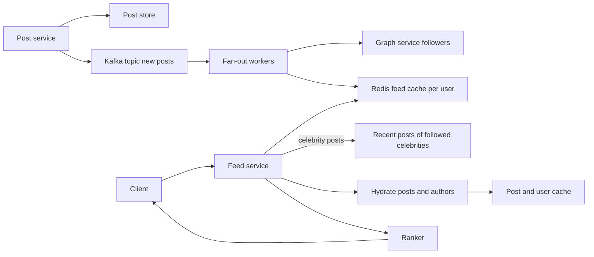

A news feed shows each user a recent, ranked list of posts from the accounts they follow. Twitter's home timeline, Instagram's feed and LinkedIn's feed are all variations. The core difficulty is the follow graph: one post may need to appear in 100 feeds or in 100 million, and users expect their feed to load in under 200 ms. The whole design hinges on when you do the work of assembling a feed: when a post is written, when a feed is read, or a mix of both.

## Requirements and estimates

Functional: publish a post, follow users, fetch a home feed with pagination, see new posts within seconds.

Assume 300 million DAU, each opening the feed 10 times a day and 10 percent posting once a day, with an average of 200 followers per user.

```text
Feed reads   = 3 B / 10^5 s       = 30,000/s avg, about 100,000/s peak
Post writes  = 30 M / 10^5 s      = 300/s avg, about 1,000/s peak
Fan-out      = 300 posts/s x 200  = 60,000 feed inserts/s avg
Feed cache   = 300 M users x 800 post IDs x 8 B = about 2 TB of IDs
```

Reads dominate writes by about 100 to 1, but fan-out multiplies each write by the follower count.

## How it works



The post service stores the post durably and publishes an event. Fan-out workers look up followers and push the post ID into each follower's feed list. At read time the feed service takes the precomputed list, merges in anything that was not pushed, hydrates IDs into full posts, ranks and returns a page.

## Fan-out on write (push)

When a user posts, write the post ID into every follower's feed immediately.

- Reads are fast: one Redis `ZREVRANGE` per feed.
- Writes are expensive: a user with 50 million followers creates 50 million inserts, which can take minutes and delays everyone else's posts.
- Wasted work for inactive followers, which can be half the graph. Skip users who have not logged in for 30 days and rebuild their feed on next login.

## Fan-out on read (pull)

Store posts only in the author's timeline. At read time, fetch recent posts from every followed account and merge.

- Writes are cheap.
- Reads are expensive: following 500 accounts means 500 lookups per feed load, then a k-way merge. At 100,000 feed reads per second that is 50 million lookups per second.
- Natural fit for accounts that post a lot but are read rarely.

## The hybrid model

Production systems combine both. Push for normal accounts, pull for accounts above a follower threshold (for example 100,000 to 1 million). At read time:

1. Read the user's precomputed feed from Redis (pushed posts).
2. Fetch recent posts from the handful of celebrities they follow; those timelines are themselves hot and cached.
3. Merge by score or time, then rank.

Because a typical user follows only a few celebrities, the pull side adds a few cache reads, not hundreds. The threshold can be dynamic: also treat accounts that suddenly go viral as pull.

## Feed cache in Redis

Store each user's feed as a sorted set of post IDs scored by timestamp or Snowflake ID, capped to a fixed length.

```text
ZADD feed:{userId} 1730620800123 post:98234
ZREMRANGEBYRANK feed:{userId} 0 -801     # keep newest 800
ZREVRANGEBYSCORE feed:{userId} (1730620000000 -inf LIMIT 0 20
```

Store IDs only, not post bodies. A post body changes (likes, edits, deletions) and duplicating it 200 times makes updates impossible. Hydrate IDs through a separate post cache using `MGET` or pipelined `HGETALL`, and filter deleted or blocked content at hydration time. Capping at 800 entries keeps memory bounded; users who scroll past that fall back to a slower pull-based path.

Fan-out workers should batch with pipelining, so one Kafka message for a post becomes a few pipelined batches of 1,000 `ZADD`s per Redis shard. Shard Redis by user ID with Redis Cluster.

## Ranking

Reverse chronological is the simplest and still an option users ask for. Ranked feeds score candidates with features such as author affinity (how often you interact with them), post age, engagement velocity, content type and negative signals like hides. A common pipeline:

1. **Candidate generation**: the merged list of a few hundred to a thousand IDs.
2. **Light scoring**: a cheap model or heuristic trims to about 100.
3. **Heavy ranking**: an ML model scores the rest.
4. **Re-ranking**: diversity rules (do not show five posts from one author in a row), ads insertion, freshness boosts.

A simple heuristic many teams start with is `score = engagement / (age_hours + 2)^1.5`, the Hacker News style decay.

## Pagination

Offset pagination breaks for feeds: new posts arriving at the top shift every offset, causing duplicates and skips. Use cursor pagination keyed on the score of the last item returned.

```http
GET /v1/feed?limit=20
-> { "items": [...], "next_cursor": "MTczMDYyMDAwMDAwMA" }

GET /v1/feed?limit=20&cursor=MTczMDYyMDAwMDAwMA
```

The cursor encodes the last timestamp or Snowflake ID (and a tiebreaker). For ranked feeds, snapshot the ranked candidate list for the session in a short-lived cache so paging is stable, and fetch "new posts" separately with a "since" cursor.

## Storage

- **Posts**: high write volume, lookup by ID and by author with time ordering. A wide-column store such as Cassandra with partition key `author_id` and clustering key `post_id DESC` fits well; sharded Postgres also works.
- **Follow graph**: two tables, `followers(user_id, follower_id)` and `following(user_id, followee_id)`, both partitioned by the first column so each direction is a single-partition scan.
- **Media**: object storage behind a CDN; posts hold only URLs.
- **Feed cache**: Redis, treated as rebuildable. If it is lost, rebuild feeds lazily from the graph and author timelines.

## Trade-offs and pitfalls

- **Pure push** melts down on celebrity posts; pure pull melts down on feed reads. Use hybrid.
- **Storing full posts in feeds** makes edits and deletes a fan-out problem of their own.
- **Ignoring deletes and blocks**: filter at hydration, because removing an ID from millions of feeds is slow.
- **Offset pagination** returns duplicates as the feed moves.
- **Hot shards**: celebrity author timelines get huge read traffic; replicate or locally cache them.
- **Fan-out lag**: monitor queue depth; a backlog means users see stale feeds.

## Interview angle

- Start with the push vs pull comparison and land on hybrid with a threshold.
- Show the fan-out multiplication in your estimate.
- Store IDs in the feed, hydrate separately.
- Explain cursor pagination and why offset fails.
- Sketch ranking as candidate generation plus scoring; do not go deep on ML unless asked.

## Key takeaways

- The design choice is when to assemble the feed: on write, on read, or hybrid.
- Hybrid pushes for ordinary users and pulls for high-follower accounts.
- Redis sorted sets of post IDs, capped and sharded by user, make reads one call.
- Rank in stages from cheap to expensive.
- Use cursor pagination and treat the feed cache as rebuildable.
