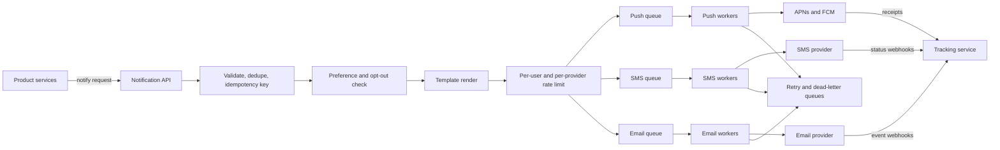

A notification system turns events like "order shipped" or "password changed" into messages on the right channel: mobile push, SMS, email or in-app. Every product team needs one, and when each team integrates with Twilio and SendGrid separately you get duplicated retry logic, no shared opt-out handling, and users receiving the same alert three times. A central platform owns providers, templates, preferences, deduplication and tracking, so product services only say "notify user 42 with template order_shipped".

## Requirements and estimates

Functional:

- Send via APNs and FCM push, SMS, email and in-app inbox.
- Template messages with localization and variables.
- Respect per-user, per-category channel preferences, quiet hours and legal opt-outs.
- Support transactional (OTP, receipts) and bulk (marketing, digests) traffic.
- Track sent, delivered, opened, clicked, bounced.

Non-functional: at-least-once delivery with no user-visible duplicates, OTPs delivered within seconds, marketing sends never delaying transactional ones.

Assume 50 million notifications per day: 35 million push, 10 million email, 5 million SMS.

```text
Average   = 50 M / 10^5 s  = 500/s
Peak      = campaign bursts of 10 M in 30 min = about 5,500/s
SMS cost  = 5 M x $0.008  = about $40,000/day
Log rows  = 50 M x 5 status events x 300 B = 75 GB/day
```

SMS cost alone justifies preference checks and dedupe before sending.

## How it works



The API accepts a request, stores it, and returns 202 immediately. Everything after that is asynchronous. Fan-out into one queue per channel isolates failures: an SMS provider outage backs up the SMS queue but push and email keep flowing.

## The request

```json
POST /v1/notifications
Idempotency-Key: order-981234-shipped
{
  "user_id": 42,
  "template": "order_shipped",
  "category": "transactional",
  "channels": ["push", "email"],
  "data": { "order_id": "981234", "eta": "2026-11-05" },
  "priority": "high"
}
```

Product services send user IDs, not phone numbers or tokens. The platform looks up contact info from a contact store (device tokens per app install, verified emails and phone numbers), which keeps PII in one place.

## Queues per channel and priority

Use separate topics or queues per channel, and separate priorities within a channel: `sms.high` for OTPs, `sms.bulk` for campaigns. Workers drain high priority first or run dedicated pools. Kafka works well for throughput and replay; SQS or RabbitMQ give per-message acknowledgements and delay queues that make retries simpler. Partition by user ID so one user's messages are processed in order.

## Templates

Store templates versioned per channel and locale, rendered with a logic-light engine (Handlebars, Liquid, Mustache):

```text
template: order_shipped  locale: en  channel: push  version: 7
title: "Your order is on the way"
body:  "Order {{order_id}} arrives {{eta | date: 'MMM d'}}."
```

Render before enqueueing so workers only deliver, and keep the rendered payload with the template version in the log for debugging. Validate variables at request time; a missing variable should fail the request, not send "Hello {{name}}".

## User preferences

Preferences are a lookup by `(user_id, category, channel)` with defaults per category:

```sql
CREATE TABLE notification_prefs (
  user_id   bigint,
  category  text,          -- marketing, social, security, billing
  channel   text,          -- push, sms, email
  enabled   boolean NOT NULL,
  PRIMARY KEY (user_id, category, channel)
);
```

Cache them in Redis since every send checks them. Rules to enforce:

- Security and legal notices (password reset, receipts) bypass marketing opt-outs but still require a valid contact.
- Quiet hours by user time zone defer non-urgent messages using a delay queue.
- Legal opt-outs (SMS STOP replies, email unsubscribe, CAN-SPAM, GDPR consent) are authoritative and must update preferences from provider webhooks.

## Dedupe and idempotency

At-least-once queues and retrying callers both create duplicates. Defend in two places:

1. **API idempotency**: store the `Idempotency-Key` with the resulting notification ID. A repeated key returns the original result.

```text
SET idem:order-981234-shipped <notification_id> NX EX 86400
```

2. **Worker dedupe**: before calling a provider, atomically mark `(notification_id, channel)` as in progress. If the worker crashes after the provider accepted the message but before acking the queue, the redelivered message sees the mark and checks status instead of resending.

Pass a provider-side idempotency key where supported, and add content-level dedupe for noisy sources, such as collapsing "X liked your photo" events within a 5-minute window into one digest.

## Retries and failure handling

Classify provider responses. Retry on timeouts, 429 and 5xx with exponential backoff and jitter (1 s, 4 s, 16 s, 60 s, capped). Do not retry permanent errors: invalid device tokens (APNs `410 Unregistered`, FCM `UNREGISTERED`), hard email bounces, or invalid numbers. Instead, disable that contact so you stop paying for failures. After the max attempts, move the message to a dead-letter queue with the error for inspection and replay.

Keep a secondary provider per channel (for example two SMS vendors) behind a circuit breaker. When the primary's error rate crosses a threshold, route traffic to the secondary. Skip retries for expired messages: an OTP that is 10 minutes old is useless, so give each message a TTL.

## Rate limiting

Two limits apply:

- **Per user**: no more than, say, 3 push notifications per hour and 1 marketing email per day. Over-notifying is the top reason users disable push entirely.
- **Per provider**: respect vendor throughput (SMS long codes are often limited to around 1 message per second per number, short codes to 100 or more per second; APNs and FCM throttle abusive senders). Token buckets in front of each provider smooth campaign bursts.

## Tracking

Write a status event for every transition: `accepted`, `suppressed` (with reason), `queued`, `sent`, `delivered`, `opened`, `clicked`, `failed`. Delivery receipts arrive via provider webhooks (Twilio status callbacks, SendGrid event webhooks); opens use a tracking pixel, clicks use redirect links. Store events in an append-only log or columnar store partitioned by day, and keep the latest status per notification in a fast table for support lookups. In-app inbox items live in their own store keyed by user, with read state.

## Trade-offs and pitfalls

- **Single shared queue** lets a marketing blast delay OTPs.
- **Synchronous provider calls** in the API couple product latency to Twilio's latency.
- **No idempotency** sends duplicates on every retry and redelivery.
- **Retrying permanent failures** wastes money and hurts sender reputation, especially for email.
- **Ignoring time zones and quiet hours** sends 3 a.m. pushes.
- **Webhook trust**: verify provider signatures on status callbacks.

## Interview angle

- Separate ingestion from delivery with queues per channel and priority.
- Show where preferences, templates and rate limits sit in the pipeline.
- Explain how idempotency keys and worker dedupe prevent duplicate sends under at-least-once delivery.
- Classify errors into retryable and permanent; mention dead-letter queues and failover providers.
- Close with tracking via webhooks and the status event model.

## Key takeaways

- A central platform owns providers, templates, preferences and tracking for every team.
- Per-channel, per-priority queues isolate failures and protect transactional traffic.
- Check preferences and dedupe before sending; SMS costs real money.
- Retry transient errors with backoff, drop and disable on permanent errors, fail over providers.
- Every message gets a status trail fed by provider webhooks.
