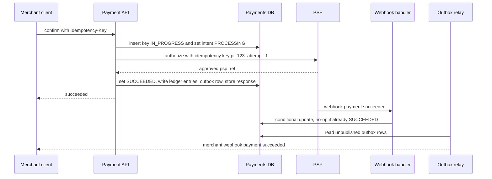

A payment system takes money from a customer and moves it to a merchant, through card networks and banks you do not control. The traffic is modest compared with a social feed, but the correctness bar is absolute: charging someone twice, losing a successful charge, or letting the books drift by one cent are all incidents. The design is shaped by three facts. External calls can time out with an unknown result, every network hop can be retried, and the only trustworthy record of money is an append-only ledger that always balances. This guide designs the payment service behind a checkout.

## Requirements

Functional:

- Merchants create a payment for an amount and currency, customers pay by card or wallet, and the merchant learns the outcome.
- Support authorise and capture (hotels, marketplaces), full and partial refunds, and payouts to merchants.
- Record every money movement in a ledger; merchants see balances and statements.

Non-functional:

- No double charges and no lost charges: every payment attempt has exactly one financial effect.
- Ledger balances exactly; daily reconciliation with each payment service provider (PSP) finds zero unexplained differences.
- Availability of 99.99 percent for payment creation; p99 checkout API latency under 2 seconds including the PSP call.
- Minimal PCI DSS scope: raw card numbers never touch the core services.

## Estimates

Assume 50 million payments per day, peaking at 10x average during sales events.

```text
Payments      = 50 M / 86,400            = about 600/s avg, 6,000/s peak
PSP calls     = about 2 per payment (auth, capture) = 12,000/s peak
Ledger writes = about 4 entries per payment          = 200 M rows/day
Ledger size   = 200 M x 200 B x 365      = about 15 TB/year, kept 7+ years
Webhooks in   = about 2 per payment                  = 100 M/day
```

Throughput is easily handled by a sharded relational database. The ledger is long-lived, so plan for partitioning by time and cold storage for old years. The design effort goes into correctness, not raw scale.

## API

```text
POST /v1/payment_intents     Idempotency-Key: 7f3c...
     {amount: 4999, currency: "USD", merchant_id, capture: "automatic"}
     -> {id: "pi_123", status: "requires_payment_method", client_secret}

POST /v1/payment_intents/pi_123/confirm   Idempotency-Key: a91e...
     {payment_method: "pm_tok_abc"}      -> {status: "processing" | "succeeded" | "requires_action"}

POST /v1/payment_intents/pi_123/capture  {amount_to_capture: 4999}
POST /v1/refunds             Idempotency-Key: ...  {payment_intent: "pi_123", amount: 1000}
POST /psp/webhooks/{psp}     signed callbacks from the PSP
```

Amounts are integers in minor units: 4999 means 49.99 USD. Currencies have different exponents: JPY has 0 decimal places, so 4999 JPY is 4,999 yen; KWD and BHD have 3. Store the currency with every amount and never use floating point. When splitting an amount (fees, partial refunds, instalments), compute shares in integers and assign the leftover minor units deterministically, for example to the last share, so the parts always sum to the whole.

## Data model

```sql
CREATE TABLE payment_intents (
  id              TEXT PRIMARY KEY,
  merchant_id     BIGINT NOT NULL,
  amount          BIGINT NOT NULL,
  currency        CHAR(3) NOT NULL,
  status          TEXT NOT NULL,
  psp             TEXT,
  psp_reference   TEXT,
  version         INT NOT NULL DEFAULT 0,
  created_at      TIMESTAMPTZ NOT NULL
);

CREATE TABLE idempotency_keys (
  merchant_id     BIGINT NOT NULL,
  key             TEXT NOT NULL,
  request_hash    BYTEA NOT NULL,
  status          TEXT NOT NULL,          -- IN_PROGRESS, DONE
  response        JSONB,
  created_at      TIMESTAMPTZ NOT NULL,
  PRIMARY KEY (merchant_id, key)
);

CREATE TABLE ledger_entries (
  entry_id        BIGINT PRIMARY KEY,
  txn_id          BIGINT NOT NULL,        -- groups entries that must balance
  account_id      BIGINT NOT NULL,        -- e.g. customer_funds, merchant_balance, fees, psp_clearing
  direction       CHAR(1) NOT NULL CHECK (direction IN ('D','C')),
  amount          BIGINT NOT NULL CHECK (amount > 0),
  currency        CHAR(3) NOT NULL,
  created_at      TIMESTAMPTZ NOT NULL
);

CREATE TABLE outbox (
  id BIGSERIAL PRIMARY KEY, topic TEXT, payload JSONB, created_at TIMESTAMPTZ, published_at TIMESTAMPTZ
);
```

The ledger is double entry: every transaction writes at least two entries whose debits equal credits per currency. A successful 49.99 USD capture with a 1.75 USD fee posts: debit `psp_clearing` 4999, credit `merchant_balance` 4824, credit `platform_fees` 175. Entries are never updated or deleted; corrections are new reversing transactions. Balances are sums over entries, cached in an `account_balances` table updated in the same transaction.

## High-level design



Card details are collected by a hosted field or SDK served from a separate, PCI-scoped vault service, which returns a token (`pm_tok_abc`). The payment API only ever sees tokens. It calls the PSP through an adapter layer that normalises different PSP APIs and error codes. State changes, ledger entries and outgoing events commit in one database transaction.

## Deep dive: the payment state machine

```text
requires_payment_method -> requires_confirmation -> processing -> succeeded
                                                        |  \
                                                        |   -> requires_action (3DS) -> processing
                                                        v
                                                     failed
succeeded -> partially_refunded -> refunded
authorized (manual capture) -> captured | canceled (auth expires after about 7 days)
```

Every transition is a conditional update:

```sql
UPDATE payment_intents SET status = 'succeeded', psp_reference = $ref, version = version + 1
WHERE id = $id AND status = 'processing';
```

If zero rows change, someone else already moved the intent, typically the webhook handler racing the synchronous response. That is fine; the second writer reads the current state and does nothing. Because the ledger write happens in the same transaction as the transition, the ledger posts exactly once per transition.

## Deep dive: idempotency end to end

Retries happen at every hop: the browser, the merchant's server, your load balancer, your service calling the PSP. Each hop needs its own idempotency.

1. **Merchant to you.** The merchant sends `Idempotency-Key`. You insert `(merchant_id, key, request_hash, IN_PROGRESS)` with a primary key. If the insert conflicts and the row is `DONE`, return the stored response. If it is `IN_PROGRESS`, return 409 "request in progress". If `request_hash` differs, return 422: the same key was reused for a different request. Keep keys for at least 24 hours.
2. **You to the PSP.** Derive a deterministic key per attempt, for example `pi_123_attempt_1`, and send it in the PSP's idempotency header. Retrying the same attempt is then safe on the PSP side. Only increment the attempt number after you know the previous attempt definitely failed.
3. **PSP to you.** Webhooks arrive at least once and out of order. Store each event id in a `processed_webhooks` table with a unique constraint and apply state changes with the conditional updates above.
4. **You to the merchant.** Outbound webhooks go through the outbox, carry a stable event id, and are retried with backoff for up to 3 days. Merchants dedupe by event id.

Combined, these give exactly-once effect: messages may be delivered many times, but each state change and ledger posting happens once.

## Deep dive: unknown outcomes and reconciliation

The hardest case: you send an authorisation and the PSP call times out after 10 seconds. The customer may or may not have been charged. Never mark it failed and never blindly retry with a new attempt key.

- Leave the intent in `processing` and return that status to the client, which shows "payment pending".
- Retry the same request with the same PSP idempotency key, or query the PSP's status endpoint by your reference, with backoff over a few minutes.
- The PSP webhook often resolves it first.
- If neither resolves it within, say, 1 hour, a resolver job escalates; daily reconciliation catches anything left.

Reconciliation is the safety net. Each day, download the PSP settlement report and match every line against your ledger by `psp_reference` and amount. Classify differences: in PSP but not ledger (lost success, post it and notify), in ledger but not PSP (likely failure misrecorded, reverse it), amount mismatch (fees or FX, investigate). Then reconcile the PSP's bank payout against the `psp_clearing` account. A mature system expects a near-zero, explained break count every day and alerts on any growth.

## Refunds and payouts

A refund is a new object with its own idempotency key and state machine (`pending -> succeeded | failed`). Check the refundable amount inside the same transaction that creates the refund: `amount <= captured - already_refunded`, with a row lock on the intent so two concurrent partial refunds cannot exceed the total. The ledger posts the reverse movement when the PSP confirms. Payouts to merchants are batched daily from `merchant_balance`, holding back a reserve for expected refunds and chargebacks.

Chargebacks arrive weeks later as PSP webhooks and in settlement reports. Model a dispute as its own object (`needs_response -> under_review -> won | lost`) that immediately posts a ledger transaction moving the disputed amount plus the dispute fee out of `merchant_balance` into a `disputes_held` account, and reverses it if the merchant wins. Because every one of these flows is just another balanced ledger transaction, merchant statements and reconciliation keep working without special cases.

## PCI scope reduction

PCI DSS applies to every system that stores, processes or transmits card numbers. Shrink that set:

- Collect card data in an iframe or SDK that posts directly to the vault or to the PSP, so merchant pages and your main API never receive the PAN.
- The vault stores encrypted PANs with keys in an HSM or cloud KMS and returns tokens.
- Only the vault and the PSP adapter (which detokenises at the last moment) are in scope; everything else handles tokens.
- Never log request bodies on card paths, and scrub 13 to 19 digit sequences in logs as a backstop.

## Scaling and bottlenecks

- **Shard by merchant_id** for intents, keys and merchant ledger accounts. Very large merchants get dedicated shards.
- **Hot ledger accounts** such as `platform_fees` receive a write per payment. Split them into N sub-accounts and sum on read, or post fee entries in periodic batches.
- **PSP rate limits and outages**: route by health and cost across multiple PSPs, with per-PSP circuit breakers. Failover changes which PSP handles new attempts, never retries a pending attempt on a different PSP.

## Failure modes

- **Crash after PSP success, before DB commit**: intent stays `processing`; the webhook or status poll moves it to `succeeded`.
- **Outbox relay down**: merchant webhooks delay but are not lost.
- **Duplicate merchant request in parallel**: the idempotency primary key makes one win; the other gets 409.
- **Clock or FX rate errors**: rates are snapshotted per transaction and stored with the entries.

## Trade-offs and pitfalls

- **Floats for money** produce rounding drift; use integer minor units everywhere.
- **Marking timeouts as failed** leads to customers charged for orders you cancelled.
- **Updating balances in place without a ledger** makes reconciliation impossible.
- **Sending events after commit without an outbox** loses them when the process dies between the two.
- **Synchronous merchant webhooks** in the payment path let a slow merchant server slow your API.

## Interview angle

- Start with the state machine and where retries happen.
- Explain idempotency at each hop, including the PSP attempt key.
- Show a double-entry posting with real numbers.
- Handle the timeout case explicitly; interviewers always ask.
- Mention reconciliation and PCI tokenisation.

## Key takeaways

- Money is integer minor units plus a currency code, split with deterministic remainder handling.
- Idempotency keys at every hop plus conditional state transitions give exactly-once effect over at-least-once delivery.
- An append-only double-entry ledger, written in the same transaction as state changes, is the source of truth.
- Unknown outcomes stay pending until the PSP, a webhook, or reconciliation resolves them.
- Tokenisation keeps raw card data inside a small vault and out of PCI scope for everything else.
