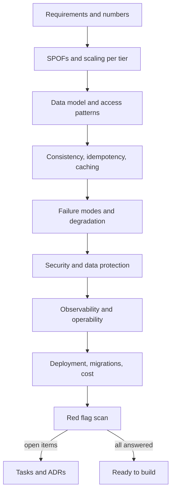

A design document feels finished long before it is. The diagram looks complete, the components have names, and nobody has asked what happens when the cache is cold, the queue backs up or a user asks to be deleted. This checklist is the set of questions a strong reviewer would ask. Run it against your own design before anyone else sees it, and again before you start building. For each question there is a short description of what a good answer looks like; if your answer is "we haven't thought about it", that is the finding.

## How to run the review

Go through the groups in order, because early answers feed later ones: you cannot judge scaling without numbers, or failure handling without knowing which data must be consistent. Mark each item as answered, accepted risk (with a reason), or open. Open items become tasks or ADRs.

## 1. Requirements coverage

| Question | Good answer |
|---|---|
| Does every functional requirement map to an API, event or job? | A table FR → endpoint/event, with no orphans in either direction. |
| Are NFRs numbers? | Availability %, p99 per key operation, peak QPS read and write, retention, RPO/RTO. |
| Are assumptions written down? | "Assumed 1M DAU, 5x peak, 50:1 read/write", with an owner to validate. |
| Is out-of-scope explicit? | A short list, so nobody designs for it by accident. |
| Do the estimates justify the architecture? | Storage and QPS math shown; complex components appear only where numbers demand them. |

## 2. Single points of failure

| Question | Good answer |
|---|---|
| What happens if any one instance dies? | At least two instances per stateless tier across zones; traffic drains via health checks in seconds. |
| What happens if the primary database dies? | Replica in another zone, automated failover, measured failover time (often 30 to 120 s), clients reconnect. |
| Is there a hidden SPOF? | DNS provider, a single NAT gateway, one secrets store, a cron box, a shared Redis, a single region, one person who knows how to deploy. |
| What about third parties? | Timeouts, circuit breakers and a degraded mode for payment, email, maps, identity providers. |

## 3. Scaling each tier

| Question | Good answer |
|---|---|
| Which tier saturates first at 10x? | Named, with the metric that shows it (for example primary write IOPS at 70%). |
| Are services stateless? | Sessions in a store or signed tokens, uploads in object storage, no local disk state. |
| How do reads scale? | Cache hit rate target, replicas, CDN for cacheable responses. |
| How do writes scale? | Single primary headroom stated; partition key chosen if sharding is planned, with hot-key analysis. |
| How do you handle bursts? | Autoscaling with warm capacity, queues to buffer work, load shedding at the edge. |
| Are there unbounded operations? | Every list endpoint paginates; fan-outs and batch sizes are capped. |

## 4. Data model and indexes

| Question | Good answer |
|---|---|
| Is every access pattern listed with its index? | Query → index → expected rows → frequency, for each one, including admin and reporting queries. |
| Is the store choice justified by patterns? | Relational for transactions and joins; document or key-value for single-key access at scale; search engine for full text. |
| How big does each table get in 3 years? | Row counts and size; partitioning or archiving plan for the largest. |
| Are uniqueness and integrity enforced in the database? | Unique constraints and foreign keys where correctness depends on them, not just application checks. |
| Can the schema evolve? | Additive changes, expand-and-contract migrations, versioned event schemas. |

## 5. Consistency and idempotency

| Question | Good answer |
|---|---|
| What consistency does each feature need? | Stated per feature: strong for money and inventory, read-your-writes for profile edits, eventual for counters. |
| Can a retried request cause a duplicate? | Idempotency keys on create/payment endpoints, stored with the result for 24 hours or more. |
| Are message consumers idempotent? | Dedup by message ID or natural key; at-least-once delivery assumed. |
| Is the database write and the event publish atomic? | Transactional outbox or change data capture, never "write then publish and hope". |
| How are concurrent updates handled? | Conditional updates, optimistic version columns or row locks on contested rows. |
| Do multi-service workflows compensate? | A saga with defined compensating actions and a timeout for stuck steps. |

## 6. Caching and invalidation

| Question | Good answer |
|---|---|
| What is cached, where, for how long? | Each cache with key format, TTL, size and expected hit rate. |
| How is it invalidated? | Delete on write, short TTL, or versioned keys; stale window acceptable to the product. |
| What happens on a cold cache or cache outage? | Database can survive the miss rate, or request coalescing and gradual warmup protect it. |
| Is there stampede protection on hot keys? | Single-flight locks, jittered TTLs, or serve-stale-while-revalidate. |
| Is personal data cached safely? | Per-user keys, no shared CDN caching of authenticated responses. |

## 7. Failure modes and degradation

| Question | Good answer |
|---|---|
| Does every network call have a timeout? | Yes, set from measured p99, with inner timeouts shorter than outer ones. |
| Are retries bounded? | Exponential backoff with jitter, a retry budget, only for idempotent or retry-safe operations. |
| What does the user see when a dependency is down? | A specific degraded mode: cached data, feature hidden, request queued, clear error. |
| What happens when a queue backs up? | Lag alert, consumer autoscaling, dead-letter queue, maximum age before dropping or escalating. |
| What is the blast radius of a bad deploy or a bad tenant? | Canary rollout, feature flags, per-tenant rate limits, cells or bulkheads for isolation. |
| Have you tested it? | Failover drills and fault injection planned, not just asserted. |

## 8. Security

| Question | Good answer |
|---|---|
| How are users and services authenticated? | OIDC/OAuth for users, short-lived tokens, mTLS or signed tokens between services. |
| Where is authorization enforced? | In the service owning the resource, checking ownership on every object access (no IDOR). |
| Where do secrets live? | A secrets manager with rotation; none in code, images or environment files in git. |
| Is data encrypted? | TLS everywhere in transit; at rest via managed keys; field-level encryption for highly sensitive data. |
| Is personal data mapped and deletable? | A data inventory; erasure covers database, replicas, caches, search, logs and backups (or crypto-shredding). |
| Is input untrusted everywhere? | Validation at the edge, parameterized queries, size limits, rate limits on auth and expensive endpoints. |
| Is access audited? | Admin actions and sensitive reads logged to append-only storage. |

## 9. Observability

| Question | Good answer |
|---|---|
| Is every NFR an SLO with an alert? | Availability and latency SLOs with burn-rate alerts that page a human. |
| Can you trace a request end to end? | Distributed tracing with a correlation ID propagated through services and queues. |
| Are the golden signals covered per service? | Latency, traffic, errors, saturation dashboards. |
| Are logs structured and safe? | JSON logs with request IDs, no passwords, tokens or full card numbers. |
| Do you know the business is working? | Business metrics (bookings per minute, checkout success rate) alerting on anomalies. |

## 10. Deployment and migrations

| Question | Good answer |
|---|---|
| How does code reach production? | CI pipeline, immutable artefacts, rolling or blue-green deploys with automated rollback on SLO breach. |
| Are schema migrations safe while old code runs? | Expand-and-contract: add column, dual write, backfill, switch reads, remove old column later. |
| How are long backfills run? | Batched, throttled, resumable, observable. |
| Is infrastructure reproducible? | Infrastructure as code, environments created from the same templates. |
| Can you roll back data changes? | Backups restored and timed in a drill; point-in-time recovery enabled. |

## 11. Cost

| Question | Good answer |
|---|---|
| What does it cost per month at launch and at 10x? | An estimate per major component, plus a unit cost (per user or per 1,000 requests). |
| What are the big hidden costs? | Cross-AZ and cross-region transfer, NAT gateway traffic, log ingestion, idle provisioned capacity. |
| Is anything over-provisioned for the numbers? | Multi-region, Kafka or a service mesh only where requirements justify them. |
| Are there guardrails? | Budgets and anomaly alerts, autoscaling maximums, log retention limits. |

## 12. Operability

| Question | Good answer |
|---|---|
| Who owns each component and gets paged? | Named team per service with an on-call rotation. |
| Are there runbooks for top failures? | Database failover, queue backlog, dependency outage, bad deploy, each with steps and dashboards. |
| Can common tasks be done without code changes? | Feature flags, config reload, admin tools with audit logging. |
| Can a new engineer understand it? | A current diagram, ADRs for key decisions, a local dev setup. |

## Common red flags

- **"We'll add caching later"** while the p99 budget already does not fit.
- **A shared database** written by several services, so nobody owns the schema.
- **Synchronous chains** of four or more services on the user request path.
- **"Exactly-once"** claimed without idempotent consumers and an outbox.
- **Distributed transactions** across services where a saga or a single owning service would do.
- **No numbers anywhere** in the document.
- **Microservices and Kafka for v1** of a product with a few thousand users.
- **Cron on a single VM** doing critical work with no alerting when it fails.
- **Unbounded queries**, retries or fan-outs.
- **Personal data in logs, analytics and search** with no deletion story.

## Trade-offs and pitfalls

- **Treating the checklist as mandatory features** leads to over-engineering; "accepted risk because traffic is low" is a valid answer.
- **Reviewing only the happy path** misses the incidents you will actually have.
- **Reviewing once** lets the design drift; re-run the checklist when requirements or scale change.
- **Answering with component names** ("we use Kubernetes") is not an answer to "what happens when an instance dies".

## Interview angle

- In the last 5 to 10 minutes, walk your own design against SPOFs, scaling, failure modes and security unprompted.
- Name the first bottleneck at 10x and what you would do.
- Mention idempotency and the outbox whenever you publish events from a write.
- Close with observability: which SLOs and alerts prove the design works.

## Key takeaways

- Run the review in order: requirements, SPOFs, scaling, data, consistency, caching, failures, security, observability, deployment, cost, operability.
- Every answer should be concrete: a number, a mechanism or an explicit accepted risk.
- Most real outages come from missing timeouts, hidden SPOFs, unsafe migrations and cache stampedes.
- Security and data deletion must be designed, not bolted on.
- Open items become tasks or ADRs before building starts.
