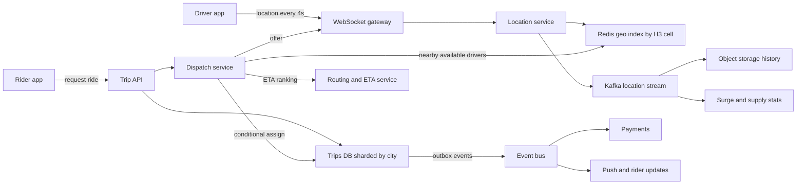

A ride-sharing service connects a rider who wants to go somewhere with a nearby driver who is free right now. Most of the system is ordinary CRUD, but three parts are not: a firehose of driver GPS updates that must be queryable by location within a second, a dispatch loop that offers a trip to drivers one at a time and must never assign the same driver twice, and a trip lifecycle that keeps two phones and the backend in agreement over flaky mobile networks. This guide designs it for a large city-scale deployment and then shows how it splits into regions.

## Requirements

Functional:

- Riders request a ride from A to B, see a price estimate and an ETA, and track the driver live.
- Drivers go online, receive trip offers, accept or decline, navigate and complete trips.
- Trips move through a clear lifecycle and end with payment and ratings.
- Prices rise when demand exceeds supply in an area (surge).

Non-functional:

- Location freshness: a driver's position on the server is at most 5 seconds old.
- Match latency: a rider sees an assigned driver within 10 seconds at p95 when supply exists.
- A driver is never assigned two active trips; a trip never has two drivers.
- Availability of 99.99 percent for request and dispatch; a regional outage must not affect other regions.

## Estimates

Assume 5 million drivers worldwide, 1 million online at peak, and 20 million trips per day.

```text
Location updates = 1 M online / 4 s          = 250,000 writes/s at peak
Update payload   = about 100 bytes            -> 25 MB/s ingress
Trips            = 20 M / 86,400              = about 230/s avg, 1,000/s peak
Rider tracking   = 1 M active trips x 1 push/4 s = 250,000 pushes/s
Hot index size   = 1 M drivers x about 200 B  = 200 MB, fits in memory
Location history = 25 MB/s x 86,400           = about 2 TB/day raw
```

The numbers tell you the shape: trips are a small transactional workload that a sharded relational database handles easily, while location is a huge write stream of short-lived data that must never touch a disk-bound database on the hot path. The live index is small enough to sit in memory; only the history goes to cheap storage.

## API

Mobile apps hold a persistent WebSocket (or MQTT) connection for push and use HTTPS for commands.

```text
POST /v1/rides/estimate     {pickup, dropoff}            -> {price_quote_id, price, eta}
POST /v1/rides              {price_quote_id}  Idempotency-Key -> {trip_id, status: "REQUESTED"}
POST /v1/rides/{id}/cancel
WS   driver -> server       {lat, lng, heading, speed, ts}   every 4 s
WS   server -> driver       {offer_id, trip_id, pickup, expires_in: 15}
POST /v1/offers/{id}/accept | /decline
POST /v1/trips/{id}/arrived | /start | /complete
WS   server -> rider        {driver_location, eta, status}
```

The price quote is signed and short-lived (2 minutes) so the price the rider agreed to is the price charged, even if surge changes a second later.

## Data model

```sql
CREATE TABLE trips (
  trip_id       BIGINT PRIMARY KEY,
  city_id       INT NOT NULL,
  rider_id      BIGINT NOT NULL,
  driver_id     BIGINT,
  status        TEXT NOT NULL,      -- REQUESTED, DISPATCHING, ACCEPTED, ARRIVED, IN_PROGRESS, COMPLETED, CANCELLED
  version       INT NOT NULL DEFAULT 0,
  quote_id      TEXT NOT NULL,
  fare_minor    BIGINT,
  currency      CHAR(3),
  requested_at  TIMESTAMPTZ NOT NULL,
  updated_at    TIMESTAMPTZ NOT NULL
);

CREATE TABLE driver_state (
  driver_id      BIGINT PRIMARY KEY,
  status         TEXT NOT NULL,     -- OFFLINE, AVAILABLE, OFFERED, ON_TRIP
  current_trip   BIGINT,
  version        INT NOT NULL DEFAULT 0
);
```

Trips are sharded by `city_id`, because almost every query and every transaction is local to one city. Live location lives in Redis, not in these tables. Location history is appended to Kafka and lands in object storage in Parquet for ETA model training, fraud checks and fare disputes.

## High-level design



The WebSocket gateway terminates millions of long-lived connections and is otherwise stateless; it keeps a mapping of `driver_id -> gateway node` in Redis so any service can send a message to a specific phone. The location service validates updates (drop jumps faster than 200 km/h, drop out-of-order timestamps) and writes them to the geo index and to Kafka. Dispatch reads the index, ranks candidates by road ETA, sends offers and commits the assignment in the trips database. All side effects downstream, such as notifications, receipts and payments, hang off events published through a transactional outbox.

## Deep dive: the geo index

You need "available drivers within 3 km of this point, sorted roughly by distance" in a few milliseconds while 250,000 positions per second change underneath.

Use a hierarchical cell system. H3 divides the earth into hexagons; resolution 9 cells are about 0.1 km² (edge about 170 m), resolution 7 about 5 km². Geohash works too, but its rectangles distort with latitude and neighbours are less uniform; hexagons have six equidistant neighbours, which makes "ring k around this cell" a clean query.

The index is a Redis set per cell plus a hash per driver:

```text
SADD  cell:r9:8928308280fffff  driver:42          -- membership
HSET  drv:42 lat 12.97 lng 77.59 ts 1762160000 status AVAILABLE cell 8928308280fffff
EXPIRE drv:42 30                                   -- vanishes if the phone goes silent
```

On each update the location service computes the new cell; if it changed, it does `SREM` from the old set and `SADD` to the new one in a single pipeline. Most updates do not change cell, so the common case is one `HSET`. To find candidates, dispatch computes `gridDisk(pickupCell, k)` for k = 1, 2, 3 (7, 19, 37 cells), reads those sets, filters by status and freshness, and stops expanding once it has 10 to 20 candidates.

Shard Redis by city (or by H3 resolution 4 parent cell for big cities) so a query touches one shard. At 250,000 writes per second globally, a single city of 50,000 online drivers generates 12,500 writes per second, which one Redis primary absorbs comfortably. The index is rebuildable: if a node dies, drivers repopulate it within one 4 second update cycle, so you do not need persistence on these nodes, only a replica for fast failover.

Straight-line distance is only a filter. The final ranking uses road ETA from the routing service, because a driver 400 m away across a river can be 15 minutes away.

## Deep dive: dispatch and no double-booking

Dispatch for one trip runs as a small state machine:

1. Find candidates and rank by ETA, then by factors like acceptance rate and heading.
2. Atomically reserve the top driver: move them from `AVAILABLE` to `OFFERED` so no other trip can offer to them.
3. Push the offer with a 15 second timeout.
4. On accept, commit the assignment. On decline or timeout, release the driver to `AVAILABLE` and try the next candidate.
5. After 3 to 5 offers or 60 seconds, widen the radius or tell the rider no drivers are available.

The reservation and the assignment are where double-booking is prevented. Use conditional updates, not read-then-write:

```sql
-- reserve
UPDATE driver_state SET status = 'OFFERED', current_trip = $trip, version = version + 1
WHERE driver_id = $driver AND status = 'AVAILABLE';
-- 0 rows updated: someone else got this driver, try the next one

-- accept, in one transaction
UPDATE driver_state SET status = 'ON_TRIP'
WHERE driver_id = $driver AND status = 'OFFERED' AND current_trip = $trip;
UPDATE trips SET status = 'ACCEPTED', driver_id = $driver, version = version + 1
WHERE trip_id = $trip AND status = 'DISPATCHING';
```

If either update affects zero rows, roll back and treat the accept as stale: the offer expired or the rider cancelled. Keeping `driver_state` and `trips` in the same city shard makes this a single-shard transaction. A Redis `SET driver:42:lock trip_id NX PX 20000` works for the reservation step if you need it faster, but the database update is the source of truth for the final assignment.

Batch matching improves global efficiency. Instead of greedily matching each request on arrival, collect requests in a 2 second window per area and solve a small assignment problem across all pending riders and free drivers, minimising total pickup ETA. It reduces average wait in dense areas at the cost of a slight delay.

## Deep dive: trip state machine and pushes

```text
REQUESTED -> DISPATCHING -> ACCEPTED -> ARRIVED -> IN_PROGRESS -> COMPLETED
     \             \            \           \
      +-------------+------------+-----------+--> CANCELLED (with reason, fee rules)
```

Every transition is a conditional update on `(trip_id, status, version)` so two phones racing (driver taps "start" while rider taps "cancel") resolve deterministically: whichever commits first wins, the other gets a 409 and the current state. Each transition writes an outbox row in the same transaction; a relay publishes it to the event bus, and the push service fans it out to both apps.

Pushes over WebSocket are best effort. Apps must resync with `GET /trips/{id}` on reconnect and treat the server as authoritative. Messages carry the trip `version` so the app ignores stale ones that arrive out of order. When the app is backgrounded and the socket is dead, fall back to APNs/FCM for the important transitions (driver assigned, driver arrived).

## ETA, pricing and surge

ETA comes from a routing engine over a road graph with live speeds derived from the location stream, corrected by a model trained on past trips. Pricing is `base + per_km x distance + per_min x duration`, multiplied by a surge factor.

Surge is computed per H3 resolution 7 cell every 30 to 60 seconds by a stream job that counts open requests versus available drivers. A ratio of 1.5 requests per driver might map to 1.3x. Smooth it over time and across neighbouring cells so prices do not flicker, cap it, and lock it into the signed quote. Surge is an eventually consistent read model; it does not need transactions.

## Scaling and bottlenecks

- **Regional cells.** Deploy the full stack per region (for example, per country or metro cluster) with its own Redis, trips shards and Kafka. A city is homed in exactly one cell. Global services (accounts, payments ledger, ratings) are separate and are called asynchronously where possible. A cell outage affects only its cities.
- **WebSocket gateway.** At 50,000 to 100,000 connections per node, 2 million connected apps need 20 to 40 nodes per region with headroom. Use connection draining on deploys so phones reconnect gradually rather than in a storm.
- **Hot spots.** Stadium exits and airports concentrate thousands of requests in a few cells. Batch matching and queue-based airport lots handle this better than per-request greedy matching.
- **Kafka partitions** keyed by `driver_id` keep one driver's updates ordered.

## Failure modes

- **Geo index node loss**: replica promotes; worst case the index is empty for 4 seconds and refills.
- **Driver phone disconnects mid-offer**: the offer timer expires and the reservation is released by the dispatcher, not by the phone.
- **Dispatcher crashes holding reservations**: reservations carry an expiry; a sweeper returns `OFFERED` drivers older than 30 seconds to `AVAILABLE`.
- **Rider double-taps request**: the `Idempotency-Key` returns the same `trip_id`.
- **Payments down at trip end**: trip completes anyway; the `TripCompleted` event is retried by the payments consumer, which charges idempotently by `trip_id`.

## Trade-offs and pitfalls

- **Storing live location in the primary database** melts it; keep it in memory and stream history.
- **Greedy nearest-driver matching** looks fine in a demo and wastes supply at scale.
- **Offering one trip to several drivers at once** is faster but forces you to cancel losers and annoys drivers; sequential offers with short timeouts are the common default.
- **Trusting client timestamps and positions** invites GPS spoofing; validate speed and plausibility server side.
- **Global strong consistency** for location is unnecessary; strong consistency is only needed for assignment.

## Interview angle

- Do the 250,000 writes per second calculation first; it justifies the in-memory index.
- Name the cell system (H3 or geohash) and explain the ring query.
- Show the conditional update that prevents double-booking.
- Draw the trip state machine and explain races between the two apps.
- Mention regional cells and that payments are an asynchronous handoff.

## Key takeaways

- Location is a high-rate, short-lived stream; keep the live view in Redis keyed by H3 cell and archive history.
- Dispatch reserves a driver atomically, offers with a timeout and commits assignment with a conditional transaction.
- Every trip transition is a versioned conditional update plus an outbox event.
- Surge and ETA are eventually consistent read models; assignment is the only strongly consistent part.
- Shard by city and deploy in regional cells so failures and hot spots stay local.
