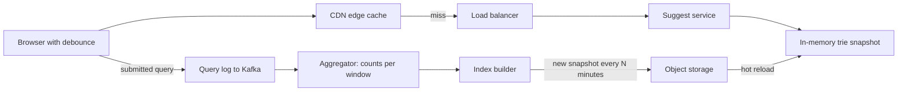

Autocomplete looks trivial, but at scale it is a latency problem disguised as a search problem. Every keystroke is a request: 10 million daily users typing 20 characters per query across 5 queries a day generate about 1 billion prefix lookups per day, roughly 12,000 per second on average and 3 to 5 times that at peak. Each response must arrive in under about 100 ms or the suggestions lag behind the cursor. The standard design separates a slow, offline pipeline that decides what to suggest from a fast, read-only path that serves precomputed answers.

## Requirements and estimates

Given a prefix, return the top 5 to 10 completions ranked by popularity, optionally filtered by locale, with p99 under 100 ms and freshness measured in minutes to hours. Slightly stale is acceptable; slow is not.

Storage is small: the top 10 million queries at 25 bytes each are about 250 MB, and even with trie overhead and top-k lists the index fits in a few GB of RAM. That shapes the design: replicate for throughput, shard only when the dataset or update rate demands it.

## How it works

Two paths run independently. The **data collection path** logs completed searches, aggregates them into frequency counts per time window, and periodically builds a new index. The **query path** looks up a prefix in that index, which is immutable between builds, and returns a precomputed list.



## The trie with top-k per node

A trie stores strings character by character, so queries sharing a prefix share a path. A naive lookup walks to the prefix node and then traverses its whole subtree, which for "s" means millions of entries.

The fix is to store the answer at each node. During the build, every node caches its top k completions (k around 10) by score. A lookup becomes O(length of prefix) to walk down, then O(1) to read the list. The cost is memory: each node holds k references, and a query of length L appears in up to L nodes' lists. Capping prefix length at 20 to 30 characters and storing references or IDs instead of full strings keeps this manageable.

```js
class Node {
  constructor() { this.children = new Map(); this.top = []; } // top: [{q, score}]
}

function insert(root, query, score, k = 10) {
  let node = root;
  for (const ch of query.slice(0, 30)) {
    if (!node.children.has(ch)) node.children.set(ch, new Node());
    node = node.children.get(ch);
    node.top.push({ q: query, score });
    node.top.sort((a, b) => b.score - a.score);
    if (node.top.length > k) node.top.length = k;
  }
}

function suggest(root, prefix) {
  let node = root;
  for (const ch of prefix.toLowerCase()) {
    node = node.children.get(ch);
    if (!node) return [];
  }
  return node.top.map((e) => e.q);
}
```

The trie is rebuilt offline and swapped in atomically, so the read path needs no locks. Many teams skip a literal trie and store a flat `prefix -> top-k list` map in a key-value store, which uses more memory but is trivial to shard.

## Data collection pipeline

Logging every keystroke is noisy; log submitted queries instead (plus clicked suggestions). Events go to Kafka, and a stream or batch job aggregates counts per query per hour. The score usually blends recent and historical popularity with exponential decay, for example `score = sum(count_h * 0.9^age_in_hours)`, so trending terms rise quickly and old spikes fade.

Before building the index, the pipeline drops queries below a minimum count (say 5 searches a week), strips personal data like emails and phone numbers, and applies a blocklist for offensive terms, because anything in the index will be shown to millions of users. A builder then generates the trie or prefix map, writes a versioned snapshot to object storage, and suggest servers download and hot-swap it every 15 to 60 minutes.

## Caching at every layer

Autocomplete is extremely cacheable because responses depend only on the prefix and locale, and popular prefixes follow a steep power law.

- **Browser**: cache responses in memory per session and send `Cache-Control: private, max-age=3600`. Backspacing from "syst" to "sys" should not hit the network.
- **CDN**: make the endpoint a GET with the prefix in the URL, such as `/suggest?q=sys&locale=en-US`, and set `Cache-Control: public, s-maxage=300`. One- and two-character prefixes then hit the edge nearly 100 percent of the time.
- **Server**: the trie itself is the cache; an LRU on top of it is rarely needed.

Personalisation breaks CDN caching, so fetch the global list from the CDN and merge recent personal searches on the client.

## Reducing request volume on the client

Debounce input so a request fires only after the user pauses for 100 to 200 ms, and cancel in-flight requests that are no longer relevant so a slow response for "sy" cannot overwrite the result for "sys".

```js
let timer, controller;
input.addEventListener('input', (e) => {
  clearTimeout(timer);
  timer = setTimeout(async () => {
    controller?.abort();
    controller = new AbortController();
    const q = e.target.value.trim();
    if (q.length < 1) return render([]);
    const res = await fetch(`/suggest?q=${encodeURIComponent(q)}`, { signal: controller.signal });
    render(await res.json());
  }, 150);
});
```

Debouncing alone often cuts request volume by 50 to 70 percent.

## Sharding and replication

Start with full replicas, each holding the complete index. When the index outgrows one box, shard by prefix. Splitting by first character is uneven (far more queries start with "s" than "x"), so derive shard boundaries from the actual traffic distribution, for example "a" to "ap", "aq" to "bz", and so on, stored in a shard map the router consults. Each shard still runs multiple replicas. With a prefix-to-list map, hashing each prefix key also works.

## Off-the-shelf alternatives

**Redis sorted sets** give a quick implementation of the prefix map. Store one sorted set per prefix with scores as popularity:

```js
// Build: for each prefix of each query
await redis.zadd(`ac:${prefix}`, score, query);
await redis.zremrangebyrank(`ac:${prefix}`, 0, -11); // keep top 10
// Serve
const suggestions = await redis.zrevrange(`ac:${prefix}`, 0, 9);
```

Reads are O(log N), updates can be incremental with `ZINCRBY`, and Redis Cluster shards by key, but memory grows with the number of prefixes.

**Elasticsearch completion suggester** uses an in-memory finite state transducer per segment, built for weighted prefix lookup, with fuzzy matching and context filters such as locale. It is pragmatic when you already run Elasticsearch and need typo tolerance. For infix matching, use `search_as_you_type` fields or edge n-grams.

## Trade-offs and pitfalls

- **Freshness versus cost**: frequent rebuilds are expensive, daily ones miss breaking news; a small real-time trending layer merged at query time bridges the gap.
- **Memory blow-up** from top-k lists at every node; cap depth and store IDs.
- **Uneven shards** if you split alphabetically without measuring traffic.
- **Unsafe suggestions** are a reputational risk; filtering belongs in the pipeline with a fast manual override path.
- **Out-of-order responses** on the client without aborting stale requests.
- **POST requests or auth headers** on the endpoint silently disable CDN caching.

## Interview angle

- Split offline aggregation from online serving early, and show the index fits in memory.
- Explain top-k caching in the trie and why it makes lookups O(prefix length).
- Discuss caching layers and debouncing as the main levers for QPS, then sharding by prefix with skew in mind.
- Mention Redis sorted sets or the Elasticsearch completion suggester as build-versus-buy options.

## Key takeaways

- Precompute top-k completions per prefix offline; the read path should do almost no work.
- Aggregate submitted queries with time decay, filter them, and publish versioned snapshots.
- Browser cache, CDN cache and debouncing remove most of the traffic before it reaches servers.
- Replicate first, shard by traffic-balanced prefix ranges when needed.
- Redis sorted sets and Elasticsearch completion suggesters are solid alternatives to a custom trie.
