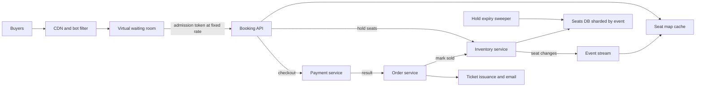

A ticket booking system sells a fixed number of specific seats to people who all want them at the same moment. Most of the year it is a quiet catalogue. Then a major concert goes on sale and 2 million people arrive in the first minute for 50,000 seats. The system has to show availability fast, let each buyer hold a few seats while they pay, never sell one seat twice, release abandoned holds quickly, and keep bots from buying everything. This guide designs for that flash-sale peak, because a design that survives it handles every ordinary day trivially.

## Requirements

Functional:

- Browse events, venues and showtimes; view a seat map with live availability.
- Select up to 8 seats, hold them for a fixed time, pay, and receive tickets.
- Support general admission (count only) and reserved seating (specific seats).
- Release seats automatically when a hold expires or payment fails.

Non-functional:

- Zero oversell: each seat is sold at most once, under any failure.
- Hold duration of 10 minutes; seats return to sale within seconds of expiry.
- Handle 2 million concurrent users at on-sale for one event without the rest of the site degrading.
- Seat map loads in under 300 ms at p95; availability may lag by a few seconds.
- Fairness: arrival order is roughly respected and bots are throttled.

## Estimates

```text
Hot event        = 50,000 seats, 2 M users in the first 10 minutes
Seat map reads   = 2 M users x 1 refresh / 5 s  = 400,000 reads/s if unthrottled
Hold attempts    = bounded by admission rate     = about 2,000/s from the queue
Bookings         = 50,000 seats / 4 per order    = 12,500 orders, mostly in 15 minutes
Normal day       = 1 M tickets/day across all events = about 12 orders/s
Seat rows        = 100,000 events live x 20,000 seats = 2 B rows, about 200 GB
```

Write volume is small; even the hottest sale is only a few thousand seat changes per second. The problem is contention, with millions of people aiming at the same few thousand rows, and read amplification from people refreshing the seat map. The waiting room turns an unbounded crowd into a controlled rate the inventory service can absorb.

## API

```text
GET  /v1/events/{id}/seatmap          -> {sections, seats: [{id, status}], version}
POST /v1/events/{id}/holds            Idempotency-Key  {seat_ids: ["A-12","A-13"]}
                                      -> {hold_id, expires_at} | 409 {unavailable: ["A-13"]}
DELETE /v1/holds/{hold_id}
POST /v1/holds/{hold_id}/checkout     Idempotency-Key  {payment_method}
                                      -> {order_id, status}
GET  /v1/queue/{event_id}/status      -> {position, eta_seconds, admitted, token}
```

Hold and checkout require a signed admission token from the waiting room during on-sales.

## Data model

```sql
CREATE TABLE seats (
  event_id     BIGINT NOT NULL,
  seat_id      TEXT NOT NULL,           -- "SEC101-R5-S12"
  price_tier   INT NOT NULL,
  status       TEXT NOT NULL,           -- AVAILABLE, HELD, SOLD
  hold_id      UUID,
  held_until   TIMESTAMPTZ,
  order_id     BIGINT,
  version      INT NOT NULL DEFAULT 0,
  PRIMARY KEY (event_id, seat_id)
);

CREATE TABLE holds (
  hold_id      UUID PRIMARY KEY,
  event_id     BIGINT NOT NULL,
  user_id      BIGINT NOT NULL,
  expires_at   TIMESTAMPTZ NOT NULL,
  status       TEXT NOT NULL            -- ACTIVE, CONVERTED, EXPIRED, RELEASED
);

CREATE TABLE orders (
  order_id     BIGINT PRIMARY KEY,
  hold_id      UUID UNIQUE NOT NULL,
  user_id      BIGINT NOT NULL,
  amount_minor BIGINT NOT NULL,
  currency     CHAR(3) NOT NULL,
  status       TEXT NOT NULL            -- PENDING_PAYMENT, CONFIRMED, FAILED
);
```

Shard by `event_id`. Every hold, every seat update and every availability read for an event stays on one shard. General admission sections use a counter row `(event_id, section, capacity, sold, held)` instead of one row per seat.

## High-level design



The CDN and waiting room absorb the crowd. Admitted users read the seat map from a cache and place holds through the inventory service, the only component allowed to change seat status. Checkout calls payment, and on success the order service converts the hold into a sale. A sweeper releases expired holds.

## Deep dive: holding seats without oversell

There are three common ways to stop two buyers taking the same seat.

| Approach | How | Behaviour under contention |
|---|---|---|
| Pessimistic lock | `SELECT ... FOR UPDATE` on seats, then update | Correct, but buyers queue on row locks; long transactions block everyone |
| Optimistic with version | Read version, `UPDATE ... WHERE version = $v` | Correct, but most attempts fail and retry on hot seats |
| Atomic conditional update | `UPDATE ... WHERE status = 'AVAILABLE'` in one statement | Correct, short, no read first; losers learn immediately |

For seat holds the conditional update is the best fit. It is one short statement per request, it never holds a lock across a network round trip, and a loser simply gets 409 and picks another seat:

```sql
UPDATE seats
SET status = 'HELD', hold_id = $hold, held_until = now() + interval '10 minutes', version = version + 1
WHERE event_id = $event
  AND seat_id = ANY($seat_ids)
  AND (status = 'AVAILABLE' OR (status = 'HELD' AND held_until < now()))
RETURNING seat_id;
```

If the number of returned rows is less than the number requested, roll back the transaction so the buyer never holds a partial set, and return which seats were taken. The `held_until < now()` clause means an expired hold is reclaimable immediately even if the sweeper has not run yet. The sweeper is only for keeping the seat map tidy and for marking `holds` rows expired.

For general admission, the same idea applies to a counter:

```sql
UPDATE ga_inventory SET held = held + $n
WHERE event_id = $e AND section = $s AND sold + held + $n <= capacity;
```

**Redis alternative.** You can hold seats in Redis with `SET seat:{event}:{seat} {hold_id} NX EX 600`, using a Lua script to take all requested seats or none. It is very fast and the TTL handles expiry. The risk is that Redis is not your system of record; a failover with async replication can lose recent holds and let a seat be held twice. If you use Redis for holds, the final sale must still be a conditional update in the database (`WHERE status <> 'SOLD'`), so the worst case is a confused buyer at checkout, never a double sale.

## Deep dive: the waiting room

Without admission control, 2 million people hammer the hold endpoint, the database spends its time rejecting conflicts, and the site falls over for everyone. A virtual waiting room converts a spike into a steady stream.

1. Before the sale opens, users land on a static queue page served from the CDN. At open time, each gets a random position (randomising arrivals in the pre-queue removes the advantage of refreshing at the exact second), and late arrivals join the back in order.
2. The queue service, backed by a Redis sorted set keyed by position, admits users at a rate the inventory service can sustain, for example 2,000 per second, adjusted by observed checkout throughput and seats remaining.
3. Admitted users receive a signed token (JWT with `event_id`, `user_id`, `exp` of 15 minutes). The booking API rejects hold and checkout calls without a valid token.
4. Clients poll queue status every 10 to 30 seconds from the CDN edge, so polling never reaches the origin heavily.
5. When inventory is gone, the queue stops admitting and tells everyone still waiting.

Admitting only as many users as can realistically buy also improves user experience: fewer people reach the seat map only to find everything taken.

## Deep dive: payment inside the hold window

The hold must outlive the payment. With a 10 minute hold and a payment that can take 30 seconds including 3D Secure, the sequence is:

1. Checkout creates an order `PENDING_PAYMENT` keyed by `hold_id` (unique, so a double click creates one order) and extends the hold by 5 minutes once, so a buyer who started paying at minute 9 is not cut off.
2. Call the payment service with the order id as idempotency key.
3. On success, in one transaction: `UPDATE seats SET status = 'SOLD', order_id = $o WHERE hold_id = $h AND status = 'HELD'`, set the order `CONFIRMED`, mark the hold `CONVERTED`, and write an outbox event for ticket issuance.
4. If the seats update affects fewer rows than expected (the hold expired and someone else took a seat), the order is not confirmed: refund the payment automatically and tell the buyer.

Authorising the card first and capturing only after the seats are marked sold avoids the refund path in most cases. Payment results that time out with an unknown outcome keep the order pending and the hold extended until the payment service resolves them.

## Read path: seat availability

The seat map is read thousands of times more than it is written. Serve it from a cache, not the database:

- The inventory service publishes seat changes to an event stream. A projector keeps a compact bitmap or per-section summary in Redis (50,000 seats as 2 bits each is about 12 KB).
- The seat map endpoint returns the cached snapshot with a version, cached at the CDN for 1 to 2 seconds during on-sales. At 400,000 requests per second, a 2 second CDN TTL means the origin sees a few requests per second per edge location.
- For large venues, show section-level counts first and load individual seats only when the user zooms into a section.

Availability is allowed to be slightly stale because the hold operation is authoritative. A user who clicks a seat that just went gets a fast 409 and a refreshed map.

## Bots and rate limiting

- Require login and a verified phone or payment method before joining the queue for high-demand events; one queue position per account.
- Rate limit per account, per device fingerprint and per IP (with care for shared NAT): for example 1 hold request per second and 8 seats per account per event.
- Use bot detection at the edge (behavioural signals, challenge pages) and invisible challenges before admission.
- Ticket limits are enforced at checkout in the database, not just in the UI: count the seats in the user's pending and confirmed orders for the event inside the order transaction.

## Scaling and bottlenecks

- **One hot event on one shard** is expected and fine: a few thousand short conditional updates per second is well within one PostgreSQL or MySQL primary on good hardware. Give hot events a dedicated shard before the sale.
- **Hot seats**: the best seats get hundreds of attempts at once. Conditional updates make losers fail fast; consider offering "best available" selection, which the server assigns, to spread demand.
- **Everything else** (search, event pages, accounts) is isolated from the on-sale path so a flash sale does not degrade the rest of the site.

## Failure modes

- **Booking API crashes after holding seats**: the hold expires by itself; no seat is stuck.
- **Payment succeeds, confirmation fails**: the outbox and a reconciliation job retry the seat conversion; if seats are gone, refund.
- **Redis queue node loss**: positions are rebuilt from a durable log of queue joins, or users are re-randomised with an apology; inventory remains correct either way.
- **Clock skew between app servers**: compare `held_until` against the database's `now()`, never the app server clock.

## Trade-offs and pitfalls

- **Long database transactions spanning user think time** lock seats for minutes; hold with a status and expiry instead.
- **Holds in Redis as the only record** risk oversell after a failover.
- **No waiting room** turns a sale into a denial of service on your own database.
- **Exact real-time seat maps** for millions of viewers are expensive and unnecessary.
- **Partial holds** confuse buyers; take all requested seats or none.

## Interview angle

- Quantify the spike and say the problem is contention, not volume.
- Write the conditional `UPDATE ... WHERE status = 'AVAILABLE'` and explain why it beats locking here.
- Explain hold TTL and lazy reclamation via `held_until < now()`.
- Describe the waiting room with admission tokens and a controlled rate.
- Walk through payment inside the hold window, including the refund edge case.

## Key takeaways

- Seat status with a hold expiry, changed only by atomic conditional updates, prevents oversell without long locks.
- A waiting room converts millions of simultaneous users into a rate the inventory service can sustain.
- The seat map is a cached, slightly stale projection; the hold call is the source of truth.
- Payment happens inside an extendable hold, and the final sale is a conditional update with a refund fallback.
- Bots are handled with accounts, per-identity limits and edge challenges, with limits enforced in the database.
