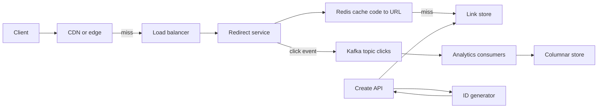

A URL shortener maps a long URL to a short code like `sho.rt/3kTq9Za` and redirects anyone who visits the code. It looks trivial, which is why it is a classic interview opener: the interesting parts are generating unique short IDs at scale without coordination bottlenecks, serving a heavily read-skewed workload with low latency, and choosing redirect semantics that do not destroy your analytics. This guide walks through the design the way you would present it.

## Requirements

Functional:

- Create a short link for a long URL, optionally with a custom alias and expiry.
- Redirect `GET /{code}` to the long URL.
- Show click analytics per link to its owner.

Non-functional:

- Redirect latency under 50 ms at p99 from the edge, availability of 99.99 percent for redirects.
- Codes are not guessable in sequence (to avoid enumeration of private links).
- Links never silently point somewhere else once created.

## Estimates

Assume 100 million new links per month and a 100:1 read-to-write ratio.

```text
Writes  = 100 M / (30 x 10^5 s)   = about 40/s avg, 200/s peak
Reads   = 40 x 100                 = 4,000/s avg, 20,000/s peak
Storage = 100 M x 12 months x 5 yr = 6 B links
Row     = about 500 bytes          -> 3 TB, plus replicas and indexes
Code length: 62^7 = 3.5 trillion   -> 7 base62 chars is plenty
```

Writes are tiny. Reads are the load, and they are cacheable because a link's target almost never changes.

## How it works



The create path validates the URL, gets a unique ID, encodes it, writes the row and returns the short link. The redirect path looks up the code in cache, falls back to the database, returns a redirect and emits a click event asynchronously so analytics never slows the redirect.

## ID generation

Base62 uses `[0-9a-zA-Z]`. Seven characters give 62^7, about 3.5 trillion codes; eight give about 218 trillion.

```js
const ALPHABET = "0123456789abcdefghijklmnopqrstuvwxyzABCDEFGHIJKLMNOPQRSTUVWXYZ";
function toBase62(n) {
  let s = "";
  do { s = ALPHABET[Number(n % 62n)] + s; n /= 62n; } while (n > 0n);
  return s;
}
```

The question is where the number comes from.

**Central counter with range allocation.** A single sequence (a Postgres sequence, a Redis `INCR`, or a ZooKeeper/etcd node) hands each app server a block of, say, 10,000 IDs. Servers encode locally and only return for a new block when exhausted. This is simple and collision-free, and losing a server only wastes its unused range. Raw counters produce sequential codes, so scramble them with a reversible permutation (a Feistel network or multiply by a large odd constant modulo 62^7) to prevent enumeration.

**Snowflake-style IDs.** A 64-bit ID made of a 41-bit millisecond timestamp, 10-bit worker ID and 12-bit sequence gives 4,096 IDs per millisecond per worker with no coordination beyond assigning worker IDs. The downside is length: a 64-bit value is up to 11 base62 characters. Good when you already run a Snowflake service, less good when short codes matter.

**Hash and truncate.** Take the first 7 characters of base62(SHA-256(longUrl + salt)). Identical URLs can dedupe naturally, but collisions are guaranteed eventually, so you insert with a unique constraint and on conflict retry with a different salt. By the birthday bound, collisions become frequent once you store a few million codes in a 7-character space, so each insert needs a check. Workable, but the counter approach is cleaner.

**Custom aliases** go through the same unique index; reject on conflict. Keep them in the same keyspace and reserve words like `api`, `admin`, `login`.

## Redirects: 301 vs 302

| Status | Meaning | Effect |
|--------|---------|--------|
| 301 Moved Permanently | Browsers and proxies may cache indefinitely | Fewer hits to you, lost click counts, cannot change target |
| 302 Found / 307 Temporary | Not cached by default | Every click reaches you, accurate analytics, editable links |
| 308 Permanent | Like 301 but preserves method | Rarely needed for GET redirects |

Most commercial shorteners use 302 (or 301 with `Cache-Control: private, max-age=...` for a short window) because analytics is the product. If cost matters more than analytics, 301 offloads traffic to browser caches.

```http
HTTP/1.1 302 Found
Location: https://example.com/very/long/path?utm_source=x
Cache-Control: private, max-age=0
```

## Caching

The access pattern is extremely skewed: a small share of links take most clicks, and new links are hottest. A read-through Redis cache keyed by code with a TTL of hours to days catches most traffic. At 20,000 peak reads per second and a 90 percent hit rate, the database sees 2,000 reads per second, which a primary plus replicas handles easily. Cache negative results (unknown codes) briefly to blunt scanners. For extra headroom, an edge cache or CDN can serve 302 responses with a short `s-maxage` for very hot links.

## Storage choice

The data model is a key-value lookup:

```sql
CREATE TABLE links (
  code        varchar(10) PRIMARY KEY,
  long_url    text NOT NULL,
  owner_id    bigint,
  created_at  timestamptz NOT NULL DEFAULT now(),
  expires_at  timestamptz
);
CREATE INDEX ON links (owner_id, created_at DESC);
```

At 3 TB over five years, Postgres with hash partitioning or a sharded setup works and gives you the unique constraint for free. A wide-column or key-value store such as DynamoDB or Cassandra fits equally well and scales horizontally without effort, at the cost of weaker secondary queries ("list my links"). Either is defensible; say which access patterns drive the choice.

## Analytics

Never count clicks with an `UPDATE links SET clicks = clicks + 1` on the redirect path: it turns a cached read into a contended write. Instead publish a click event (code, timestamp, IP-derived country, user agent, referrer) to Kafka, and have consumers aggregate into a columnar store such as ClickHouse or BigQuery, plus pre-aggregated per-minute counters for dashboards. Delivery is at-least-once, so tolerate small double counts or dedupe by event ID.

## Abuse and safety

- Check new URLs against malware and phishing lists (for example Google Safe Browsing) and rescan periodically, since targets change.
- Rate-limit creation per API key and IP; require accounts for bulk creation.
- Provide an interstitial warning page or takedown flag that the redirect service honors from cache.
- Block redirects to your own domain to avoid loops, and validate scheme (`http`, `https` only).

## Trade-offs and pitfalls

- **Sequential codes** leak volume and allow enumeration; always permute counter output.
- **301 by default** silently kills analytics and makes mistakes permanent in browser caches.
- **Synchronous click writes** make the hot path depend on the slowest component.
- **Hash truncation** without a collision check eventually maps two URLs to one code.
- **Unbounded cache** of every link wastes memory; LRU with TTL fits the skewed distribution.

## Interview angle

- Do the estimate early: it shows writes are trivial and reads dominate.
- Present at least two ID strategies and pick one with a reason.
- Explain 301 vs 302 in terms of caching and analytics.
- Keep analytics off the redirect path with a queue.
- Mention abuse handling; interviewers often probe it.

## Key takeaways

- 7 base62 characters cover 3.5 trillion links.
- Range-allocated counters plus a reversible permutation give short, unique, non-sequential codes.
- 302 keeps analytics and editability; 301 trades them for less traffic.
- A read-through cache absorbs the skewed read load; the database is a simple key-value lookup.
- Clicks flow through a queue into an analytics store, never into the link row.
