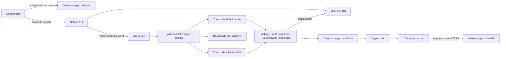

Video platforms are dominated by one number: bytes delivered. Uploads, metadata and comments are an ordinary web app; serving tens of terabits per second to every device and network is not. The design splits into an asynchronous **ingest pipeline** that turns one upload into dozens of streamable renditions, and a **delivery path** where almost every byte comes from a CDN cache near the viewer. This guide designs a YouTube-like on-demand platform, then covers live streaming.

## Requirements

Functional:

- Creators upload videos up to 12 hours or 256 GB, resuming after network failures.
- Viewers watch on web, mobile and TV with quality adapting to their bandwidth.
- Video pages show title, description, view count and likes; search and a recommended feed.
- Optional live streaming; premium content protected with DRM.

Non-functional:

- Playback starts in under 2 seconds at p90, rebuffering under 0.5 percent of watch time.
- Uploaded videos playable within minutes for short clips, with higher qualities added later.
- 99.99 percent availability for playback; uploads can tolerate brief degradation.
- Delivery cost per hour watched as low as possible, because it dominates the bill.

## Estimates

- 100 million daily viewers watching 60 minutes each: 100 million hours a day, about 4.2 million concurrent streams on average and around 10 million at evening peak.
- Average delivered bitrate of 3 Mbps: peak egress about 30 Tbps, and roughly 135 PB delivered per day. At a large-volume CDN price of $0.01 per GB that is $1.35 million a day, which is why the biggest platforms build their own CDNs and push AV1.
- Uploads: 500,000 videos a day averaging 10 minutes and 1 GB as uploaded: 500 TB a day of originals. Transcoded renditions across codecs add roughly the same again, so about 1 PB of new storage per day before tiering.
- Transcoding one 10-minute video into 6 resolutions and 2 codecs costs a few CPU-hours (AV1 far more): tens of thousands of cores, ideally spot instances.

## API

```
POST /v1/uploads                          -> { uploadId, partSize, presignedPartUrls[] }
PUT  <presigned part URL>                 (client uploads parts directly to object storage)
POST /v1/uploads/{uploadId}/complete      -> { videoId, status: "processing" }
GET  /v1/videos/{videoId}                 -> metadata + manifest URL + status
GET  https://cdn.example.com/v/{videoId}/master.m3u8   (HLS) or manifest.mpd (DASH)
POST /v1/videos/{videoId}/events          (player heartbeats: play, progress, quality, rebuffer)
```

## Data model

- **Videos** (Postgres or Vitess/Spanner sharded by `video_id`): id, owner, title, description, status (`uploading`, `processing`, `ready`, `failed`), duration, visibility, published_at, available renditions.
- **Channels and subscriptions**: relational, sharded by user.
- **View and like counters**: separate counter store, not columns updated in the videos row.
- **Watch history and player events**: Kafka into a data lake and a wide-column store for per-user history.
- **Media**: originals and renditions in object storage under `/{videoId}/{codec}/{height}p/seg_00042.m4s`.

## High-level design



## Deep dive 1: resumable upload and the transcoding DAG

**Upload.** A 20 GB file over a home connection will be interrupted. Use S3 multipart or the tus protocol: parts (S3 allows up to 10,000 of 5 MB to 5 GB) go directly to object storage via presigned URLs, in parallel, retried individually. The client persists `uploadId` and finished parts so it can resume after a crash. API servers never touch video bytes. On completion the service verifies the checksum and emits `video.uploaded`.

**Transcoding as a DAG.** Processing is a directed acyclic graph of tasks run by a workflow engine (Temporal, AWS Step Functions, or an in-house scheduler on Kubernetes):

1. **Inspect** with ffprobe (codec, resolution, duration); reject corrupt files; run safety and copyright fingerprinting in parallel.
2. **Split** into 10 to 60 second chunks at keyframe (GOP) boundaries so they encode independently.
3. **Encode** every chunk at every rung in parallel across hundreds of workers; a 2-hour film takes minutes.
4. **Package** segments and manifests; generate thumbnails and captions.
5. **Publish**: flip status to `ready`, notify the creator.

Produce 360p and 720p H.264 first so the video is playable quickly, then higher rungs, and AV1 only for videos popular enough to repay the CPU. Tasks are idempotent, keyed by `(videoId, rendition, chunk)`, so spot interruptions just retry.

**Codecs and the ladder.** H.264 plays everywhere. VP9 and HEVC save around 30 to 40 percent bandwidth at equal quality, and AV1 saves roughly another 20 to 30 percent over them, but encoding is much slower and older devices lack hardware decoders. A typical H.264 ladder:

| Rendition | Resolution | Bitrate (H.264) |
| --- | --- | --- |
| 240p | 426 x 240 | 300 kbps |
| 360p | 640 x 360 | 700 kbps |
| 480p | 854 x 480 | 1.2 Mbps |
| 720p | 1280 x 720 | 2.5 Mbps |
| 1080p | 1920 x 1080 | 5 Mbps |
| 2160p | 3840 x 2160 | 16 Mbps |

Netflix's **per-title encoding** picks the ladder per video using a quality metric such as VMAF: a cartoon looks perfect at 1080p and 2 Mbps, grainy action needs 6.

## Deep dive 2: HLS, DASH and adaptive bitrate

Streaming is just HTTP file downloads. Each rendition is cut into segments of 2 to 6 seconds, and a manifest lists them. **HLS** (Apple, `.m3u8` playlists) is required on iOS and Safari; **MPEG-DASH** (`.mpd`) is common elsewhere. With **CMAF** (fragmented MP4) both manifests reference the same segment files, halving storage and cache footprint.

```
#EXTM3U
#EXT-X-STREAM-INF:BANDWIDTH=800000,RESOLUTION=640x360,CODECS="avc1.4d401e,mp4a.40.2"
360p/index.m3u8
#EXT-X-STREAM-INF:BANDWIDTH=2800000,RESOLUTION=1280x720,CODECS="avc1.4d401f,mp4a.40.2"
720p/index.m3u8
#EXT-X-STREAM-INF:BANDWIDTH=5500000,RESOLUTION=1920x1080,CODECS="avc1.640028,mp4a.40.2"
1080p/index.m3u8
```

The **player** runs adaptive bitrate (ABR): it tracks throughput and buffer level and picks the rendition for each next segment. Buffer-based algorithms (BOLA in dash.js) avoid rebuffers better than throughput estimates alone. Fast start comes from a conservative first rung and prefetching the manifest and first segment on hover.

## Deep dive 3: CDN delivery and cost

Every segment URL is immutable and cacheable for a year, so the CDN does the heavy lifting.

- **Tiered caching**: edge caches in hundreds of cities, a regional origin shield that collapses misses, and object storage as the origin. Popular content achieves 95 to 99 percent edge hit rates.
- **Long tail**: rarely watched videos miss at the edge; the shield collapses those misses, and lifecycle rules move cold renditions to cheaper storage classes.
- **Pre-positioning**: Netflix's Open Connect appliances sit inside ISP networks and are filled overnight with what each region is predicted to watch, so peak traffic never crosses the internet backbone.
- **Multi-CDN**: steer traffic across providers by measured performance and price.
- **Signed URLs or tokens** on manifests (short expiry) stop hotlinking and enforce geo restrictions while still letting segments cache.

Cost levers: better codecs, per-title encoding, cache hit ratio, ISP-embedded caches, and skipping renditions nobody watches.

## View counts, metadata and recommendations

**Metadata** is read-heavy: cache video pages in Redis and at the CDN, shard by `video_id`.

**View counts** must never be `UPDATE videos SET views = views + 1`: a viral video would receive 50,000 updates per second on one row. Players send heartbeat events to Kafka; a stream job validates them (minimum watch time, deduplication per user and session, bot filtering) and aggregates per video per minute, writing increments to a sharded counter store. The displayed count is eventually consistent, refreshed every few seconds to minutes, and that is acceptable. Exact counts for creator payouts come from the batch pipeline over the full event log.

**Recommendations** are two-stage: **candidate generation** retrieves a few hundred videos from millions using embeddings and co-watch signals, then a **ranking model** scores them on predicted watch time and satisfaction. Models train offline; features update from the event stream into a low-latency feature store.

## Live streaming differences

Live inverts the pipeline: no time to transcode a finished file. The broadcaster pushes RTMP or SRT (or WebRTC via WHIP) to an ingest server, which transcodes the ladder in real time and emits segments as they are produced; the manifest is continuously updated.

| Mode | Typical glass-to-glass latency | Use |
| --- | --- | --- |
| Standard HLS/DASH, 6 s segments | 15 to 30 s | Broadcasts, sports at scale |
| LL-HLS / LL-DASH with partial segments | 2 to 5 s | Interactive streams, chat alongside |
| WebRTC | under 500 ms | Auctions, calls, betting, co-streaming |

LL-HLS publishes partial segments of a few hundred milliseconds with blocking playlist reloads. WebRTC needs SFU servers holding a stateful connection per viewer, far costlier than CDN-cached HTTP. Live manifests cache for a second or less, and big events spike concurrency within minutes.

## DRM

Premium content is encrypted with **Common Encryption (CENC)**, so one set of CMAF segments is AES-encrypted and works with all three DRM systems: **Widevine** (Chrome, Android), **FairPlay** (Apple) and **PlayReady** (Windows, many TVs). The player fetches a license from a license server, which checks entitlement (subscription, region, concurrent stream limit) and returns the content key bound to the device's secure decryption module. Hardware-backed security levels gate 4K. DRM raises the bar for casual copying; it does not stop screen capture, so watermarking is added for high-value releases.

## Scaling and bottlenecks

- **Egress** is the bottleneck and the cost; everything about segment design serves the cache hit ratio.
- **Transcoding** is bursty and parallel; use autoscaled spot capacity with chunk-level retries.
- **Storage** grows by about a petabyte a day; lifecycle policies are mandatory.

## Failure modes

- **Transcode worker killed**: the chunk task retries elsewhere; idempotent keys make it safe.
- **Origin outage**: CDN serves cached segments with stale-if-error; new and long-tail videos fail first.
- **CDN degradation in a region**: multi-CDN steering moves traffic within minutes.

## Trade-offs and pitfalls

- **Encoding every codec for every video** wastes CPU on the long tail; encode expensive codecs by popularity.
- **Long segments** improve compression and cache efficiency but hurt start time and live latency.
- **Proxying uploads through API servers** wastes bandwidth; upload directly to storage.
- **Synchronous view counting** creates hot rows; aggregate events in a stream.

## Interview angle

- Split the problem into ingest (async, CPU-heavy) and delivery (CDN, bandwidth-heavy) early.
- Estimate egress in Tbps and cost per day; it justifies every delivery decision.
- Explain segments, manifests and client-side ABR.
- Describe the transcoding DAG with parallel chunk encoding and fast first renditions.

## Key takeaways

- Upload with resumable multipart directly to object storage; the API never handles bytes.
- Transcode as a parallel DAG of GOP-aligned chunks, cheapest playable renditions first.
- HLS and DASH serve CMAF segments over plain HTTP; the player adapts bitrate.
- The CDN, with origin shield and pre-positioning, carries almost all traffic and cost.
- View counts flow through a stream pipeline, never into the video row.
- Live trades caching efficiency for latency: HLS 15 to 30 s, LL-HLS 2 to 5 s, WebRTC under a second.
