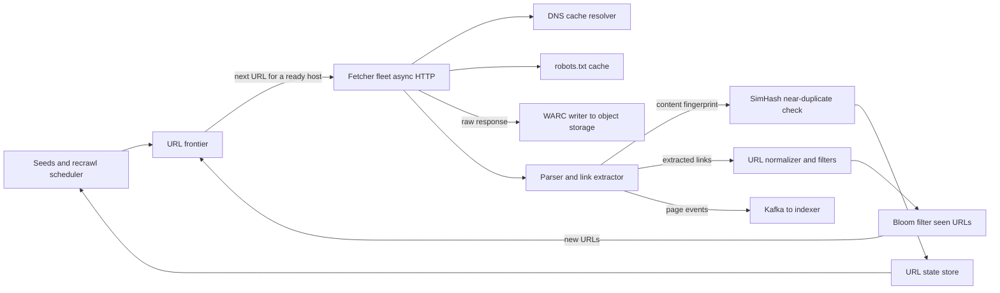

A web crawler starts from a set of seed URLs, downloads each page, extracts its links and repeats, forever. The loop fits on a whiteboard. What makes a real crawler hard is that it runs against millions of servers you do not own: it must stay polite to each of them, spend its limited fetch budget on pages that matter, avoid downloading the same thing twice under different URLs, and survive infinite calendars, spam farms and servers that hang for minutes. This guide designs a crawler for search indexing at 1 billion pages per month.

## Requirements

Functional:

- Crawl HTML pages starting from seeds, following links, and store raw pages and extracted metadata for an indexer.
- Respect `robots.txt` and crawl-delay; identify with a clear user agent.
- Recrawl pages based on how often they change and how important they are.
- Skip duplicate URLs and near-duplicate content.

Non-functional:

- Throughput of 1 billion fetches per month, sustained.
- Never more than 1 concurrent connection and a default of 1 request per second per host unless the host allows more.
- Horizontally scalable; losing a node loses at most a few minutes of work.
- Robust to malicious or broken servers: timeouts, size limits, trap detection.

## Estimates

```text
Fetch rate      = 1 B / (30 x 86,400 s)          = about 400 pages/s avg, plan for 1,000/s
Avg page        = 100 KB HTML (compressed about 25 KB)
Bandwidth       = 1,000 x 100 KB                  = 100 MB/s = 800 Mbit/s peak
Raw storage     = 1 B x 25 KB compressed          = 25 TB/month, 300 TB/year
Links extracted = about 50 per page               -> 50 B candidate URLs/month
Frontier        = several billion known URLs x about 100 B = a few hundred GB
Concurrency     = 1,000 pages/s x 2 s avg latency = 2,000 in-flight fetches
```

The interesting number is in-flight fetches. With a 2 second average including slow servers, you need about 2,000 open connections at once. That is a handful of machines using async I/O, not hundreds. The constraint that actually shapes the design is politeness: 1,000 pages per second at 1 request per second per host means you must be crawling at least 1,000 distinct hosts at every moment, and the frontier has to interleave them.

## API

A crawler is a pipeline, not a user-facing service, but it has a control API for operators and downstream consumers:

```text
POST /v1/seeds              {urls: [...], priority}
GET  /v1/hosts/{host}       -> {robots, crawl_delay, last_fetch, error_rate, queue_depth}
PUT  /v1/hosts/{host}/policy {max_rps, blocked}
Kafka topic crawled-pages   {url, final_url, status, fetched_at, content_hash, simhash, blob_key}
```

The indexer consumes `crawled-pages`; it never calls the crawler synchronously.

## Data model

```text
url_state (wide-column store, key = sha1(normalized_url))
  url, host, first_seen, last_fetched, next_fetch_at, priority,
  last_status, content_hash, simhash, change_count, fetch_count

host_state (key = host)
  robots_txt, robots_fetched_at, crawl_delay_ms, ip, dns_expires_at,
  next_allowed_at, consecutive_errors

page_blobs (object storage)
  s3://crawl/2026/11/03/<shard>/<warc-file>   -- WARC files, about 1 GB each
```

Pages are written in WARC (Web ARChive) files that bundle thousands of responses with their headers, which is far cheaper than one object per page.

## High-level design



The frontier hands fetchers a URL only when its host is allowed to be hit again. Fetchers resolve DNS from a local cache, check robots rules, download with strict limits and hand the body to storage and the parser. The parser extracts links, which are normalised, filtered, checked against the seen-URL filter, and fed back to the frontier. The content fingerprint decides whether the page is a duplicate worth indexing.

## Deep dive: the URL frontier

The frontier has two jobs that pull in opposite directions: priority (crawl important pages first) and politeness (do not hammer any host). The classic structure, from the Mercator crawler, uses two layers of queues.

1. **Front queues by priority.** A prioritiser assigns each URL a score from signals like PageRank-style link authority, host quality, depth from seed and freshness need. URLs go into one of, say, 16 priority queues. A selector pulls from higher queues more often (weighted, not strict, so low priority work still progresses).
2. **Back queues by host.** Each back queue holds URLs for exactly one host. A min-heap keyed by `next_allowed_at` tells the fetcher which host is ready next. When a fetcher finishes a request to `example.com`, it sets `next_allowed_at = now + max(crawl_delay, 10 x last_response_time)` and pushes the host back into the heap. Slow servers automatically get hit less often.

Keep a few times more back queues than fetcher threads (for example 3 per thread) so there is always a ready host. When a back queue empties, refill it from the front queues, routing each URL to its host's queue.

Partition the frontier by host hash across frontier nodes, for example 32 partitions. All URLs for one host live on one node, so politeness is enforced locally without distributed locks. Each node keeps the head of each queue in memory and the tail on local disk (RocksDB or append-only segment files), because billions of URLs do not fit in RAM.

## Deep dive: dedup of URLs and content

**URL normalisation** comes first: lowercase scheme and host, remove default ports, resolve `../`, drop fragments, sort query parameters, strip known tracking parameters like `utm_*` and session ids. Many sites also declare `<link rel="canonical">`, which you should honour after fetching.

**Seen URLs.** Checking 50 billion candidate links a month against the URL store would be 20,000 lookups per second of mostly negative answers. A Bloom filter answers "definitely not seen" from memory. Sized for 10 billion URLs at a 1 percent false positive rate, it needs about 9.6 bits per element, roughly 12 GB, which shards across frontier nodes by host hash. A false positive means occasionally skipping a new URL, which is an acceptable loss for a crawler. Positives that matter (deciding recrawl) go to the URL state store.

**Content dedup.** Exact duplicates are caught by a SHA-256 of the normalised body. Near-duplicates, such as the same article with a different ad block or timestamp, need SimHash: tokenise the visible text into shingles, hash each to 64 bits, sum weighted bit vectors, and take the sign of each position. Pages whose 64-bit SimHash differs by 3 bits or fewer are treated as near-duplicates. To find candidates quickly, split the fingerprint into 4 blocks of 16 bits and index each block; two fingerprints within 3 bits must agree exactly on at least one block. Near-duplicates are still recorded but not sent to the indexer, and the host's duplicate rate feeds its quality score.

## Deep dive: fetchers, DNS and robots

Fetchers are async HTTP clients (for example, Go or Rust with thousands of concurrent requests per process). Hard limits protect them:

| Limit | Typical value |
|---|---|
| Connect timeout | 5 s |
| Total fetch timeout | 30 s |
| Max body size | 10 MB, truncate beyond |
| Max redirects | 5 |
| Accepted types | `text/html`, optionally PDF |

**DNS** is a hidden bottleneck. Standard resolvers are slow and synchronous in many libraries, and 1,000 fetches per second becomes hundreds of lookups per second. Run a local caching resolver per fetcher host and keep resolved IPs in `host_state` honouring TTL with a floor of a few minutes. Also apply politeness per IP, not just per host, because thousands of small sites can share one shared-hosting IP.

**robots.txt** is fetched per host before any other URL, cached for about 24 hours, and parsed into allow and disallow rules plus `Crawl-delay`. A 404 for robots means everything is allowed; a 5xx or timeout means treat the site as fully disallowed for now and retry later. Fetchers check rules from the cache in memory, never with a network call per URL.

## Recrawl scheduling

Recrawling dominates mature crawlers: most fetches are revisits, not new pages. Estimate each URL's change rate from history. If a page changed in 3 of its last 10 fetches spaced a day apart, its change rate is roughly 0.3 per day. Schedule the next fetch at an interval that balances change rate and importance:

```text
interval = clamp(base / (importance x change_rate), 1 hour, 90 days)
```

Use conditional requests (`If-Modified-Since`, `If-None-Match`); a `304 Not Modified` costs almost no bandwidth. News homepages end up every few minutes, a stale personal blog every few weeks. Sitemaps with `<lastmod>` give direct hints.

## Traps and spam

- **Infinite spaces**: calendars with "next month" links forever, faceted search with every filter combination. Cap URLs per host per crawl cycle (for example 100,000 for unknown hosts), cap path depth (about 15 segments), and cap URL length (about 2,000 characters).
- **Repeating path segments** like `/a/b/a/b/a/b/` are a strong trap signal.
- **Soft 404s**: pages that return 200 for every path. Fetch a random nonsense URL on the host; if it returns 200 with similar content, treat similar pages as errors.
- **Link farms and spam**: low quality hosts get lower priority and lower budgets, computed from link graph analysis and content quality signals.
- **Hostile servers** that drip bytes forever are cut off by the total timeout.

## Scaling and bottlenecks

- **Fetchers** scale linearly; 2,000 in-flight fetches fit on 4 to 8 machines, with more for headroom and geographic spread.
- **Frontier** scales by host partitions; a single huge host (Wikipedia, a major news site) is bounded by its own politeness, not by your hardware.
- **Parsing** is CPU heavy (HTML parsing, text extraction, JS rendering for some pages). Run it as a separate pool consuming from a queue; render JavaScript only for hosts that need it, since a headless browser costs 10 to 50 times a plain fetch.
- **Storage** writes are large sequential WARC appends to object storage, which is cheap and fast.

## Failure modes

- **Fetcher crash**: URLs it leased return to the frontier after a lease timeout (for example 5 minutes).
- **Frontier node loss**: its partition reloads from disk and the URL state store; a small window of new URLs may be rediscovered later.
- **Host outage**: exponential backoff on `consecutive_errors`, then park the host for hours.
- **Bad deploy that ignores robots**: keep a global kill switch and per-host block list; complaints from site owners are a real operational risk.

## Trade-offs and pitfalls

- **One global FIFO queue** ignores politeness and gets you blocked within hours.
- **Checking every URL against the database** wastes I/O; a Bloom filter in front absorbs the negatives.
- **Exact hashes only** miss the vast near-duplicate web.
- **Uniform recrawl intervals** waste budget on static pages and miss fast-changing ones.
- **JavaScript rendering everywhere** multiplies cost; do it selectively.

## Interview angle

- Do the 400 to 1,000 pages per second math and derive in-flight connections and distinct hosts.
- Draw the two-layer frontier: priority front queues, per-host back queues, heap by next allowed time.
- Size the Bloom filter and explain why false positives are acceptable.
- Explain SimHash and Hamming distance for near-duplicates.
- Name at least three crawler traps and a defence for each.

## Key takeaways

- Politeness, not bandwidth, shapes a crawler; partition by host so it is enforced locally.
- The frontier combines priority front queues with per-host back queues and a ready-time heap.
- Normalise URLs, filter them with a Bloom filter, and dedup content with SHA-256 plus SimHash.
- Cache DNS and robots.txt aggressively; never make a network call per URL for either.
- Recrawl by estimated change rate and importance, using conditional GETs.
