YouTube is the best single system to study if you want to see how a real application fits together, because it contains almost every pattern in the book in one product. It has a write-heavy, CPU-heavy asynchronous pipeline (uploads and transcoding), the largest read path on the internet (playback through CDNs embedded inside ISPs), classic OLTP features (channels, playlists, subscriptions), social features with hot keys (likes and comments on a viral video), a firehose of events (view heartbeats), machine learning in the request path (home feed and search), real-time fan-out (live chat), money (ads and payouts) and policy enforcement (copyright and safety). This guide follows the step-by-step playbook: scope and numbers first, then the API and data, then the architecture, then deep dives, then failure modes and evolution. Where YouTube's internals are public we say so; where they are not, we design with generic, justified components and name a comparable choice you could actually deploy. If you can explain every box in this design and why it is there, you can design almost any consumer application.

## Requirements

Actors: **viewers** (anonymous or signed in), **creators**, **advertisers**, **moderators** and internal systems (training, analytics, payouts). Platforms: web, Android and iOS, smart TVs and consoles, and embedded players.

### Functional requirements

- **Upload**: videos up to 12 hours or 256 GB, resumable, with title, description, thumbnail, visibility (public, unlisted, private, scheduled) and monetisation settings.
- **Watch**: adaptive quality, seeking, captions and resume-where-you-left-off on any device.
- **Search** over titles, descriptions, captions and channels, with autocomplete.
- **Home feed and recommendations**, plus an "up next" list beside every video.
- **Subscriptions** with a subscriptions feed and optional new-upload notifications.
- **Likes and dislikes**: one reaction per user per video; dislike counts hidden publicly but visible to the creator (YouTube's 2021 change).
- **Comments with replies**: threads sorted "Top" or "Newest", with edit, delete, pin and creator hearts.
- **Notifications** via push, email and the in-app bell.
- **Live streaming with live chat**, including paid Super Chat messages.
- **Channels, playlists**, "Watch later" and "Liked videos".
- **Watch history** with pause and auto-delete controls.
- **Creator analytics**: views, watch time, retention and revenue, near real time and verified daily.
- **Monetisation**: pre-roll and mid-roll ads, revenue sharing.
- **Moderation**: Content ID, policy classifiers, human review, age restriction, appeals.

Out of scope for depth: Music, Shorts ranking, Premium billing and the advertiser UI; they reuse the same building blocks.

### Non-functional requirements

Each quality word becomes a number. Availability is set per feature, because a broken comment box is an annoyance while broken playback is an outage.

| Feature | Availability (monthly) | Latency target | Consistency |
| --- | --- | --- | --- |
| Playback (segments from CDN) | 99.99% (about 4 minutes down a month) | time-to-first-frame p50 under 1 s, p90 under 2 s; rebuffer ratio under 0.5% | immutable content, trivially consistent |
| Watch page metadata | 99.95% | API p99 under 200 ms at the BFF | eventual (seconds) for counts |
| Search and home feed | 99.95%, degrade to non-personalised | p99 under 300 ms (search), 400 ms (home) | eventual |
| Upload ingest | 99.9% | short clips playable within 2 to 5 minutes | strong for upload state |
| Likes and comments | 99.9%, degrade to read-only | write ack p99 under 300 ms | read-your-own-writes for the actor, eventual for everyone else |
| Live ingest and playback | 99.95% per stream | glass-to-glass 2 to 5 s (low latency), 10 to 30 s (normal) | ordered within a stream |
| Live chat | 99.9% | message visible to viewers p99 under 1 s | per-room order, best effort |
| Creator analytics | 99.5% | real-time view count within 1 minute; verified numbers within 24 to 48 h | eventual, then exact |
| Payments and payouts | 99.95% | batch | strong, double-entry |

Durability for uploaded originals and published renditions is effectively "never lose a video" (eleven nines from erasure-coded, multi-region object storage). Watch history and personal data must honour GDPR export and erasure. Cost is a first-class requirement: delivery bandwidth is the largest line item, so every delivery decision is judged in cost per hour watched.

## Estimates

The playbook says estimation decides which problems are real. YouTube's public figures (500 hours uploaded per minute, more than a billion hours watched per day, over 2 billion monthly users) give us anchors. We assume 1 billion daily active users.

```text
USERS
  MAU 2 B, DAU 1 B (assumption); 10 video starts per DAU per day

UPLOADS
  500 h of video uploaded per minute          = 720,000 h/day ≈ 8.3 h of video per second
  average upload 10 min                       ≈ 4.3 M uploads/day ≈ 50/s avg, ~150/s peak

STORAGE PER DAY
  originals at ~5 Mbps avg  = 2.25 GB per hour  x 720k h   ≈ 1.6 PB/day
  ladder multiplier:
    H.264 240p..1080p  0.3+0.7+1.2+2.5+5   ≈ 10 Mbps total
    VP9   240p..1080p  (about 35% smaller) ≈ 6.5 Mbps total
    => 16.5 Mbps of renditions per 5 Mbps of original ≈ 3.3x
  renditions ≈ 5.3 PB/day; originals + renditions ≈ 7 PB/day logical
  erasure coding (1.5x overhead) ≈ 10.5 PB/day raw ≈ 3.8 EB/year before tiering and pruning

TRANSCODING COMPUTE
  ~2 core-hours per content-hour for the H.264 ladder, ~8 for VP9, AV1 far more
  720k h x 10 core-h ≈ 7.2 M core-hours/day ≈ 300,000 cores busy around the clock

EGRESS
  1 B hours watched/day  -> average concurrency = 1e9 / 24 ≈ 42 M streams; peak ≈ 2x ≈ 85 M
  average delivered bitrate 2.5 Mbps (mobile-heavy mix)
  average egress ≈ 42 M x 2.5 Mbps ≈ 105 Tbps; peak ≈ 210 Tbps
  bytes per day ≈ 1e9 h x 1.125 GB/h ≈ 1.1 EB/day

WATCH PAGE READS
  10 B starts/day / 86,400 s ≈ 116 k/s avg, peak 3x ≈ 350 k/s
  ~10 backend reads per page (metadata, channel, counts, comments head, up next, ads)
  -> ~3.5 M internal RPC/s at peak, >95% must be cache hits

LIKES
  5% of starts -> 500 M reactions/day ≈ 5.8 k/s avg, ~20 k/s peak
  one viral premiere: design for 20 k likes/s on a single video_id

COMMENTS
  writes: 1% of starts -> 100 M/day ≈ 1.2 k/s avg, ~4 k/s peak
  reads:  30% of watch pages load comments -> 3 B/day ≈ 35 k/s avg, ~100 k/s peak

VIEW HEARTBEATS
  85 M concurrent x 1 event / 30 s ≈ 2.8 M events/s peak (1.4 M/s avg)
  ~400 B each -> ~1.1 GB/s at peak, ~50 TB/day into the event log before compression

LIVE
  ~10 M concurrent live viewers platform-wide at peak; largest single stream 5 M
  chat: 2% of 5 M viewers send 1 msg/min -> 100 k msgs/min ≈ 1,700 msgs/s inbound
  naive fan-out: 1,700 x 5 M = 8.5 B deliveries/s  -> impossible; must sample and batch
```

Three conclusions fall straight out of these numbers. First, **egress dominates everything**: 1.1 exabytes a day means delivery must come from caches inside ISP networks, and every percentage point of codec efficiency saves petabytes per day. Second, **transcoding is a large, parallel, interruptible batch workload**: 300,000 cores is a reason to use cheap preemptible capacity and, at YouTube's scale, custom hardware (YouTube has publicly described its Argos video transcoding chip). Third, **counters and events are a hot-key problem, not a storage problem**: likes and views must never be a `count = count + 1` on one row.

## The complete architecture

Before deep dives, here is every component and how they connect. Read it left to right: clients reach the edge, the edge reaches the API layer, the API layer calls core services, services read and write data stores and emit events, and the async pipeline and analytics stack consume those events.

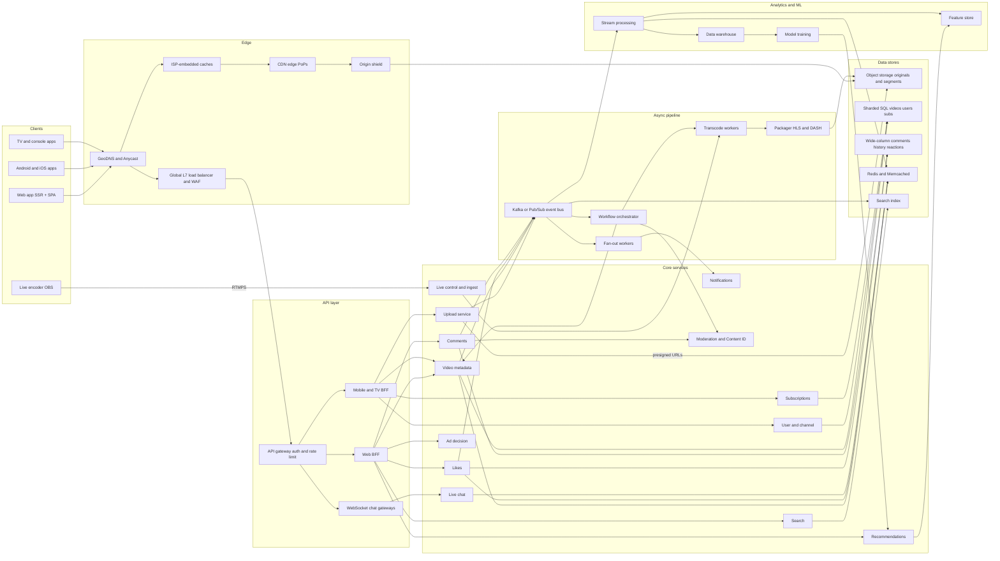

Every box exists because a requirement or an estimate demands it. The table is the "components and why" step of the playbook.

| Component | Responsibility | Technology choice | Why |
| --- | --- | --- | --- |
| GeoDNS and Anycast | Steer each client to the nearest healthy edge and API region | Anycast IPs plus DNS steering by resolver location | Latency is distance; failover without client changes |
| ISP-embedded caches | Serve popular segments from inside the viewer's ISP | YouTube publicly runs Google Global Cache; comparable: Netflix Open Connect, or a commercial CDN | Peak egress of 200+ Tbps cannot cross the backbone affordably |
| CDN edge and origin shield | Cache segments and manifests; collapse misses | Own edge fleet or multi-CDN (Akamai, Fastly, CloudFront) with a shield tier | 95%+ hit ratio keeps origin load tiny |
| Global L7 load balancer and WAF | TLS, HTTP/2 and HTTP/3 termination, DDoS filtering | Google Front End publicly; comparable: Envoy, Cloud Load Balancing | One hardened entry point for all API traffic |
| API gateway | Authentication, rate limits, routing, request quotas | Envoy or a managed gateway with a Redis-backed limiter | Cross-cutting concerns in one place |
| BFF per client | Aggregate 10+ backend calls into one screen-shaped response | Node.js or Go services, gRPC to backends | Web, mobile and TV need different payloads |
| Video metadata service | Titles, status, visibility, rendition lists, channel videos | Sharded MySQL via Vitess (YouTube built Vitess) or a Spanner-like store | Relational data with strong per-row consistency, huge read volume |
| Upload service | Create upload sessions, presign URLs, validate completion | Stateless service over object storage multipart | Video bytes never pass through API servers |
| Object storage | Originals, renditions, thumbnails, captions | Colossus/GCS publicly at Google; comparable: S3 | Exabyte scale, erasure coding, lifecycle tiers |
| Event bus | Durable, partitioned event log for every state change | Kafka or Google Pub/Sub | Decouples writers from many consumers; replayable |
| Workflow orchestrator | Run the transcoding DAG with retries | Temporal, Step Functions, or an in-house scheduler | Long-running, multi-step jobs need state and retries |
| Transcode workers | Encode chunks to every codec and rung | ffmpeg with x264, libvpx-vp9, SVT-AV1 on preemptible VMs or hardware encoders | 300k cores of interruptible work |
| Packager | Produce CMAF segments, HLS and DASH manifests | Shaka Packager or Bento4 | One set of segments for both protocols |
| Likes and comments services | Reactions, threads, moderation hooks | Go or Java services over wide-column stores | Hot keys and high write fan-in |
| Counters | Like, view and comment counts | Redis with sharded counters, flushed to durable store | Absorb 20k increments/s on one video |
| Search | Inverted index, ranking, autocomplete | Google's own index publicly; comparable: Elasticsearch or Vespa | Full-text retrieval in 300 ms |
| Recommendations | Candidate generation, ranking, re-ranking | Two-tower retrieval plus deep ranking model, ANN index (ScaNN, FAISS) | Personalised feed in under 400 ms |
| Feature store | Fresh user and video features for models | Bigtable or Redis online store plus warehouse offline store | Same features at training and serving |
| Notifications | Push, email, in-app bell, preferences | Workers over APNs, FCM and an email provider | Fan-out off the request path |
| Live ingest and transcode | Accept RTMPS, transcode in real time, package low-latency segments | Ingest servers near streamers, GPU or hardware encoders | Latency budget of a few seconds |
| Chat gateways and service | WebSocket connections, room fan-out | Go or Elixir gateways, Redis or Pub/Sub for room channels | Millions of open sockets per stream |
| Stream processing | Dedupe views, aggregate counters and analytics | Flink, Dataflow or Kafka Streams | Exactly-once aggregation of billions of events |
| Data warehouse | Verified analytics, payouts, training data | BigQuery publicly at Google; comparable: Snowflake, ClickHouse | Petabyte SQL over the event log |
| Moderation and Content ID | Fingerprinting, classifiers, review queues | Audio and video fingerprint index plus ML classifiers | Legal and policy obligations |
| Ad decision | Select ads per impression, VAST responses | Real-time auction service | Revenue in a 100 ms budget |

## Frontend

The client is half of YouTube's performance story. Time-to-first-frame, rebuffering and perceived snappiness are mostly decided on the device.

### Web

The watch page must be indexable and fast on a cold load, so the first request is **server-rendered**: HTML with title, description, thumbnail, structured data for search engines and an inline JSON blob of initial data, so the page paints before JavaScript runs. YouTube's own web client uses web components (Polymer, later Lit) with server-provided initial data; in your app the comparable choice is React with SSR (Next.js), hydrating into a single-page app.

After hydration, navigation is client-side: clicking a recommendation fetches only JSON for the next watch page. **Code splitting** keeps the first bundle small; player, comments, live chat and the upload studio load on demand. **Prefetching** does the rest: hovering a thumbnail fetches its watch JSON and manifest, and the player can preload the first two seconds so playback starts almost instantly on click.

### Mobile, TV and the player

Android, iOS and TV apps share the backend but get BFF responses tuned for screen and memory. Android uses ExoPlayer (now AndroidX Media3, created at Google), iOS uses AVPlayer, and the web uses Media Source Extensions (MSE) plus Encrypted Media Extensions (EME) for DRM; hls.js, dash.js and Shaka Player implement the same logic in open source.

The player's core loop is **adaptive bitrate** (ABR): before each segment request it picks a rendition from measured throughput and buffer level. A typical policy targets 30 seconds of forward buffer, drops quality below 10 seconds, steps up only after throughput exceeds the next rung by 30% for several segments, and never steps up while the buffer shrinks. Buffer-based algorithms (BOLA in dash.js) avoid oscillation. **Startup quality** is deliberate: start a rung or two below the bandwidth remembered from the last session, then climb. Back-buffer is trimmed to about 30 seconds to bound memory on TVs.

### State, optimistic UI and offline

Client state splits into a **server cache** (metadata, comment and feed pages in a query cache such as React Query, stale-while-revalidate) and **UI state** (player, panels). **Optimistic UI** makes likes instant: the icon flips and the count adds one immediately, the request carries an idempotency key, and only a non-retryable error rolls it back. A new comment appears as pending until acknowledged. Feeds and comments use **infinite scroll** with opaque cursors and list virtualisation. **Offline downloads** store one rendition's segments encrypted on the device with a license that re-validates online, typically every 48 hours for paid content.

### How the client talks to the backend

Request-response traffic goes to the BFF as JSON or Protobuf over HTTPS, increasingly HTTP/3 (QUIC, which Google deployed heavily for YouTube); browsers may use gRPC-web. Segments come straight from CDN hostnames, never through the API. Live chat uses a **WebSocket**, and telemetry is batched into beacons.

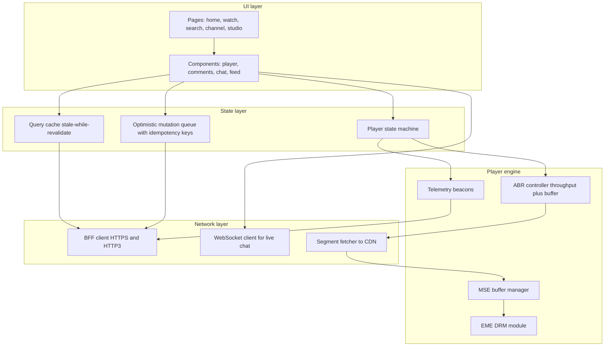

## API layer

All non-media traffic enters through a **global load balancer** that terminates TLS close to the user, then an **API gateway** that authenticates, applies rate limits and routes to a **BFF** (backend for frontend) per client family. The BFF calls a dozen backend services in parallel over gRPC with a strict deadline (for example 150 ms), assembles a screen-shaped response, and drops optional parts (like the "up next" list) rather than failing the page if one backend is slow.

**Authentication** uses the Google account: browsers hold a secure, httpOnly session cookie; mobile apps use OAuth 2.0 with OpenID Connect, keeping a one-hour access token and a refresh token in the device keystore. The gateway validates tokens without a database hit and passes a verified user id downstream. Third-party apps use the public YouTube Data API with OAuth scopes and per-project quota units.

**Rate limiting** is layered: per-IP and per-account token buckets in Redis shared by all gateway instances (for example 10 comments and 60 likes per minute per account), per-endpoint global limits to protect backends, and abuse scores that tighten limits for suspicious accounts.

| Method | Path | Purpose |
| --- | --- | --- |
| POST | /v1/uploads | Create an upload session; returns uploadId, part size and presigned part URLs |
| POST | /v1/uploads/{uploadId}/complete | Finalise multipart upload; creates the video in `processing` |
| PATCH | /v1/videos/{videoId} | Edit title, description, visibility, thumbnail |
| GET | /v1/watch/{videoId} | BFF watch page: metadata, manifest URL, counts, channel, up next, ad slots |
| GET | /v1/videos/{videoId}/manifest | Signed HLS or DASH manifest URL for this viewer |
| PUT | /v1/videos/{videoId}/reaction | Set reaction to like, dislike or none (idempotent) |
| GET | /v1/videos/{videoId}/comments?sort=top&cursor= | Page of top-level comments |
| POST | /v1/videos/{videoId}/comments | Post a comment or reply (Idempotency-Key header) |
| DELETE | /v1/comments/{commentId} | Delete own comment, or creator removes one |
| PUT | /v1/channels/{channelId}/subscription | Subscribe or unsubscribe, with notification level |
| GET | /v1/search?q=&cursor= | Search results |
| GET | /v1/suggest?q= | Autocomplete suggestions |
| GET | /v1/feed/home?cursor= | Personalised home feed page |
| POST | /v1/events | Batched player heartbeats and QoE events |
| POST | /v1/live/broadcasts | Create a live broadcast; returns stream key and ingest URLs |
| GET | /v1/live/{broadcastId}/chat/connect | Upgrade to WebSocket for live chat |

Reactions use `PUT` with the desired final state rather than a toggle, which makes retries harmless: sending "like" twice still means "liked".

## Upload and processing pipeline

### Resumable upload

The client calls `POST /v1/uploads` with size and checksum. The upload service records an upload session, starts an object storage multipart upload and returns presigned URLs for the parts (16 MB parts, so a 4 GB file is 256 parts). The client uploads four to six parts in parallel **directly to object storage**, retries individual parts, and remembers completed parts so it can resume after a crash. Presigned URLs expire after an hour and are refreshed on demand. On `complete`, the service verifies part ETags and the checksum, writes the video row as `processing`, and publishes `video.uploaded`. API servers never touch video bytes. YouTube's public Data API uses a comparable resumable protocol.

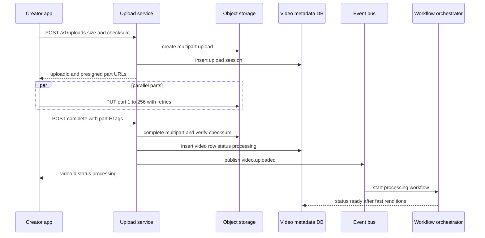

### The transcoding DAG

The workflow orchestrator runs a directed acyclic graph of idempotent tasks, each keyed by `(video_id, task, rendition, chunk)` so retries and duplicate events are safe:

1. **Probe** with ffprobe (codecs, resolution, frame rate, HDR, duration); reject corrupt files.
2. **Split** into roughly 10-second chunks at keyframe (GOP) boundaries so chunks encode independently.
3. **Encode** every chunk at every rung in parallel. A fast path makes 360p and 720p H.264 first so the video is live in minutes; the full H.264 and VP9 ladders follow; AV1 is added only once a video is popular, since it costs several times more CPU for roughly 30% fewer bytes than VP9.
4. **Audio**: AAC and Opus at two or three bitrates, loudness-normalised.
5. **Thumbnails**: sample frames, score them for sharpness and faces, offer three candidates.
6. **Captions**: speech-to-text produces WebVTT automatic captions.
7. **Content ID**: audio and video fingerprints matched against rights holders' references.
8. **Safety classifiers** over sampled frames, audio and metadata.
9. **Package** chunks into 2 to 6 second CMAF segments, with HLS and DASH manifests referencing the same files.
10. **Publish**: flip status, warm caches, index, notify subscribers.

A 2-hour film in 720 chunks at 12 rungs is 8,640 independent tasks; across a few thousand preemptible workers it finishes in minutes, and a preempted task simply retries elsewhere.

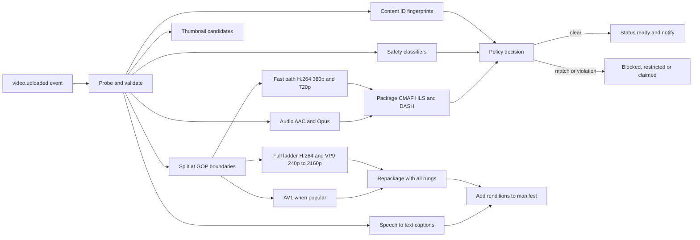

### The publish state machine

The video row's `status` column is the single source of truth, and transitions are conditional updates (`UPDATE videos SET status='ready' WHERE video_id=? AND status='processing'`) so duplicate workflow events cannot move a video backwards.

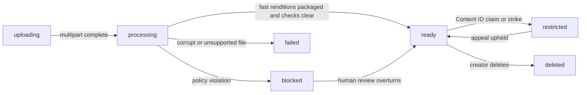

On reaching `ready` with public visibility (or at the scheduled time), the video service emits `video.published`. Consumers index it for search, add it to recommendation candidate pools, update the channel's video list, and trigger subscriber notifications.

## Playback and the watch path

### Watch page request flow

When a viewer opens `/watch?v=dQw4w9WgXcQ`, the BFF fetches metadata, channel, counters, the comments head, up next and ad slots in parallel. Metadata comes from Memcached or Redis (60-second TTL, above 99% hit ratio for popular videos); up next has a 120 ms budget. The response carries a **signed manifest URL**: an HMAC token encoding video id, a 6-hour expiry, allowed region and any entitlement. The player then fetches the manifest and segments from the CDN hostname DNS chose for this viewer.

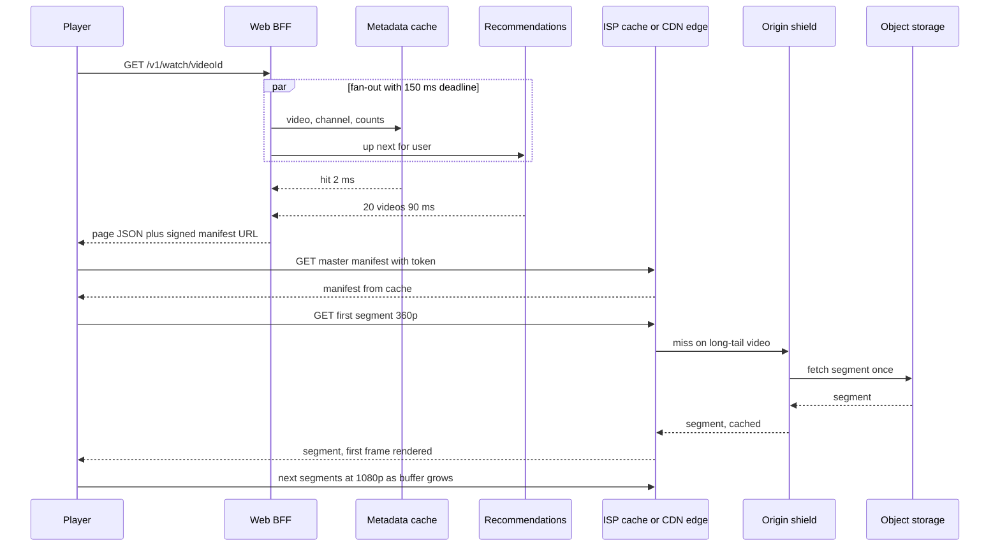

### CDN tiers and placement

Delivery has four tiers. **ISP-embedded caches** (YouTube publicly operates Google Global Cache nodes inside ISP networks) serve popular content from inside the viewer's own network, cheaper for both sides and free of peering bottlenecks. **Edge PoPs** in major metros cache a broader set. A regional **origin shield** collapses concurrent misses into one origin fetch. The **origin** is object storage. Popular content reaches 98 to 99% edge hit ratios; the long tail (most videos, little watch time) is served from the shield.

**Popularity-based placement** uses predicted regional demand (recent views, subscriber counts, upload velocity) to pre-position new uploads from big channels into ISP caches before notifications fire, and keeps only lower rungs of long-tail videos at the edge. Segment URLs are immutable (`/v/{videoId}/{codec}/{height}/seg_00042.m4s`) and cacheable for a year; only manifests and tokens vary.

### ABR switching, signed URLs and DRM

Renditions share keyframe alignment, so the player can splice 720p segment 41 after 1080p segment 40 without a glitch. Tokens are validated at the edge with a shared key, never by calling the origin. Paid content is encrypted with Common Encryption (CENC); a license server checks entitlement and returns keys to the device's DRM: Widevine (Chrome, Android), FairPlay (Apple), PlayReady (Windows, many TVs). Hardware security levels gate HD and 4K.

### Time-to-first-frame optimisations

A p50 under one second budgets roughly 100 ms for connection (reuse and QUIC 0-RTT), 150 ms watch JSON, 50 ms manifest, 300 ms first segment and 50 ms decode. What wins: manifest URL inline in the server-rendered page, prefetch on hover, a low starting rung with short first segments, the init segment bundled with the manifest, warm edges for trending videos, and starting after 1 to 2 seconds of buffer instead of 10.

## Data model and databases

The playbook says to list access patterns first and choose stores from them. The heaviest patterns are: get video by id (hundreds of thousands per second), list a channel's videos, check "did I like this", page a video's comments, append and read a user's watch history, increment counters, and fan out new uploads to subscribers.

| Data | Store | Shard key | Why |
| --- | --- | --- | --- |
| Videos, channels, users, playlists | Sharded MySQL via Vitess (YouTube built Vitess publicly) or a Spanner-like store | video_id, channel_id, user_id | Relational fields, transactions on a row, secondary lookups via lookup tables |
| Subscriptions graph | Sharded SQL, two copies | subscriber_id and channel_id | "My subscriptions" and "channel's subscribers" are both hot |
| Reactions | Wide-column (Bigtable, Cassandra, ScyllaDB) | hash(video_id, user_id) | Point reads and idempotent upserts at 20k/s |
| Comments | Wide-column | video_id plus bucket | Append-heavy, read in order per video |
| Watch history | Wide-column | user_id | Per-user append and reverse-time scans |
| Counters | Redis plus durable counter table | video_id plus shard | Hot increments |
| Search index | Inverted index cluster | document-partitioned shards | Full text |
| Features and embeddings | Online feature store plus ANN index | entity id | Low-latency model inputs |
| Media | Object storage | video_id prefix | Exabytes of immutable blobs |
| Events | Kafka or Pub/Sub, then warehouse | video_id or user_id | Replayable firehose |

```sql
-- Vitess keyspace "videos", sharded by video_id
CREATE TABLE videos (
  video_id        CHAR(11)      PRIMARY KEY,          -- base64url of a random 64-bit id
  channel_id      BIGINT        NOT NULL,
  title           VARCHAR(100)  NOT NULL,
  description     TEXT,
  status          ENUM('uploading','processing','ready','blocked','restricted','failed','deleted') NOT NULL,
  visibility      ENUM('public','unlisted','private','scheduled') NOT NULL,
  duration_ms     INT,
  default_lang    VARCHAR(8),
  age_restricted  BOOLEAN       NOT NULL DEFAULT FALSE,
  monetised       BOOLEAN       NOT NULL DEFAULT FALSE,
  renditions      JSON,                               -- [{"codec":"vp9","h":1080,"kbps":4200}, ...]
  publish_at      TIMESTAMP     NULL,
  created_at      TIMESTAMP     NOT NULL,
  updated_at      TIMESTAMP     NOT NULL
);

-- Keyspace "channels", sharded by channel_id: serves the channel page without a cross-shard scan
CREATE TABLE channel_videos (
  channel_id   BIGINT    NOT NULL,
  published_at TIMESTAMP NOT NULL,
  video_id     CHAR(11)  NOT NULL,
  visibility   TINYINT   NOT NULL,
  PRIMARY KEY (channel_id, published_at DESC, video_id)
);

-- Subscriptions, written twice (same transaction pattern via outbox, or two keyspaces)
CREATE TABLE subscriptions_by_user (           -- sharded by subscriber_id
  subscriber_id BIGINT, channel_id BIGINT, notify_level TINYINT, created_at TIMESTAMP,
  PRIMARY KEY (subscriber_id, channel_id)
);
CREATE TABLE subscribers_by_channel (          -- sharded by channel_id, used for fan-out
  channel_id BIGINT, subscriber_id BIGINT, notify_level TINYINT,
  PRIMARY KEY (channel_id, subscriber_id)
);
```

```text
Wide-column tables (Bigtable-style row keys or Cassandra partition/clustering keys)

user_video_reaction
  row key:   hash8(video_id, user_id) | video_id | user_id
  columns:   reaction (LIKE | DISLIKE | NONE), updated_at, client, abuse_score

reactions_by_user                         -- powers the "Liked videos" playlist
  row key:   user_id | reverse_ts | video_id

comments_by_video
  partition: (video_id, bucket)           -- bucket = month for normal videos, hash 0..63 for hot ones
  cluster:   thread_id DESC               -- time-ordered 64-bit id
  columns:   author_id, text, created_at, edited_at, state, reply_count, pinned, hearted

replies_by_thread
  partition: thread_id
  cluster:   reply_id ASC

watch_history
  partition: user_id
  cluster:   watched_at DESC, video_id
  columns:   position_ms, device, duration_watched_ms   -- TTL from user's auto-delete setting

video_counters (durable copy of the Redis counters)
  row key:   video_id | shard (0..N)
  columns:   views, likes, dislikes, comments
```

**Caching layers** are chosen per data type, with TTLs that match how stale each can be:

| Data | Cache | TTL | Invalidation |
| --- | --- | --- | --- |
| Video metadata | Memcached or Redis, plus in-process LRU for the top 10,000 videos | 60 s (in-process 5 s) | Delete on edit event |
| Watch page JSON for anonymous viewers | CDN and BFF cache | 30 s | Time-based |
| Counts (views, likes, comments) | Redis | written continuously, read with 5 to 30 s staleness | Stream job writes |
| Comments first page per sort | Redis | 30 s for Top, 5 s for Newest | Time-based, author sees own comment via client merge |
| "Did I like this" | Redis bitmap or set per hot video, else DB point read | 10 min | Write-through on reaction |
| Home feed page | Redis per user | 5 to 15 min | Regenerated on refresh |
| Search results for popular queries | Redis | 5 min | Time-based |
| Manifests | CDN | 6 h for VOD, 1 s for live | Versioned URLs |

## Likes management

Likes look trivial and are a perfect miniature of the whole design: idempotent writes, deduplication, hot keys, approximate counters and abuse.

### Data model and the idempotent API

The source of truth is one row per `(video_id, user_id)` holding the current reaction. It answers "did I like this?" with a point read and deduplicates: a user contributes at most one like. The API is `PUT /v1/videos/{id}/reaction {"reaction":"LIKE"}`. The service writes the new value with a conditional write against the previous one and computes the **delta**: none to like is `likes +1`; like to dislike is `likes -1, dislikes +1`; like to like is nothing. Because the API sets a final state instead of toggling, a retry produces no second delta.

Partitioning by `video_id` alone would put every like of a viral video on one partition. Since the only queries are point lookups, the row key is prefixed with a hash of `(video_id, user_id)`, spreading a hot video across all tablets. "Liked videos" lives in a second table keyed by user.

### The write path and counters

The reaction row is written synchronously so the user's like persists, then a `reaction.changed` delta event goes to the bus. Counting happens off the request path:

1. A counter consumer, partitioned by `video_id`, aggregates deltas in memory for one to two seconds.
2. It applies them to **Redis sharded counters** (`likes:{videoId}:0..63`); reads sum the shards, or a job maintains a summed key every second.
3. Every 10 to 30 seconds totals flush to the durable `video_counters` table; the event log can rebuild everything.

A premiere at 20,000 likes per second becomes one increment per second per consumer partition. The displayed count lags by seconds and is rounded ("1.2M"), so small inaccuracies are invisible, and the client merges its own optimistic +1 for read-your-own-writes.

**Dislikes** flow identically; the BFF just omits the public count while creator analytics and ranking still use it.

**Anti-abuse**: gateway rate limits; an abuse score from account age, device signals and behaviour; suspicious reactions stored but excluded from public counts until a fraud job clears them; and batch recounts from the reaction table to strip bot waves. The per-user row is strongly consistent, the aggregate eventual, and the batch job authoritative for analytics.

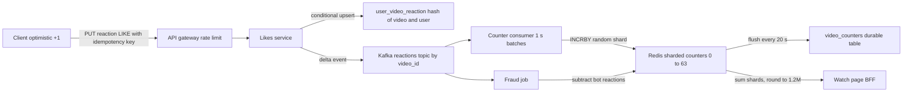

## Comments management

### Threaded model and storage

Threads live in `comments_by_video`, partitioned by video and clustered by a time-ordered id, so "Newest" is one ordered range scan; replies live in `replies_by_thread`, so opening a thread is one partition read. A month bucket bounds partition size; videos with comment storms switch to hash buckets (0 to 63) that the reader merges.

**Pagination** uses opaque cursors encoding the last clustering key (`thread_id` for Newest, `(score_bucket, score, thread_id)` for Top), never offsets, which would scan 50,000 rows on a hot video and shift as comments arrive.

**Top versus Newest**: Newest reads the base table. Top reads `comments_top_by_video`, materialised by a **ranking job** scoring likes, replies, creator hearts, author reputation, recency decay and toxicity. Hot videos re-rank every minute, cold ones hourly.

### Write path and moderation

1. **Synchronous**, within 300 ms: authenticate, rate limit, validate length (up to 10,000 characters), apply the creator's blocked words and users, and run a light spam model (links, repeats, known signatures). Clear spam is rejected or shadow-held.
2. Write with state `visible` or `held` and publish `comment.created`.
3. **Asynchronous**: heavier toxicity and spam models score it within seconds; high-risk comments flip to `held for review`, hidden publicly but visible to the author, for review in YouTube Studio or by moderators.

**Creator tools**: pin one comment (a video-level attribute returned first), heart, hide a user, require approval, or turn comments off. **Counts** use the likes counter pipeline. **Edits** keep the id and set `edited_at`; **deletes** write a tombstone so reply threads stay intact and caches and indexes propagate the removal. `comment.created` also notifies the creator (batched: "12 new comments") and, for replies, the parent author.

**Comment storms** (a premiere at 5,000 comments per second): writes spread over hash buckets, Newest is served from a Redis list of the latest 500 thread ids refreshed every second, Top is cached for 30 seconds, and clients fetch "new comments" in batches.

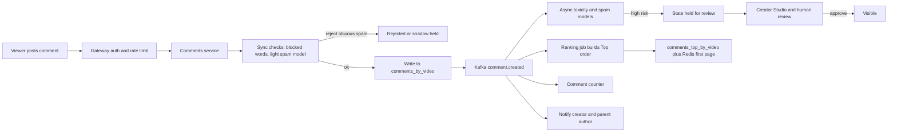

## Views counting and analytics

The player sends **heartbeat events** (play start, progress every 10 to 30 seconds, quality switches, rebuffers, end) in batched beacons to `POST /v1/events`. A thin collector validates the schema and writes to the event bus, partitioned by `video_id` for counting and duplicated to a `user_id` partitioned topic for history and personalisation.

A **stream processing** job (Flink, Dataflow or Kafka Streams) turns raw events into views:

- **Qualify**: a view counts only after a minimum watch time (YouTube does not publish the exact rule; around 30 seconds is the commonly cited heuristic).
- **Dedupe**: one view per `(viewer or device, video, session window)`, using a keyed state store with a TTL, so refresh-spamming does not count.
- **Fraud filtering**: drop events from known bot networks, data-centre IPs, impossible watch patterns and scripted players; suspicious views are held back from public counts.
- **Aggregate**: per-video per-minute increments are written to the Redis counters, giving a **real-time approximate count** visible within about a minute.

The raw and cleaned events also land in a **batch warehouse** (BigQuery publicly at Google; Snowflake or ClickHouse elsewhere) partitioned by day. Nightly jobs produce the **verified count** and creator analytics: watch time, retention curves, traffic sources, demographics and revenue. When the batch result differs from the real-time number, the batch wins and the counter is corrected. This **lambda-style split** (fast and approximate, then slow and exact) is the standard answer whenever a number is both shown live and used for money.

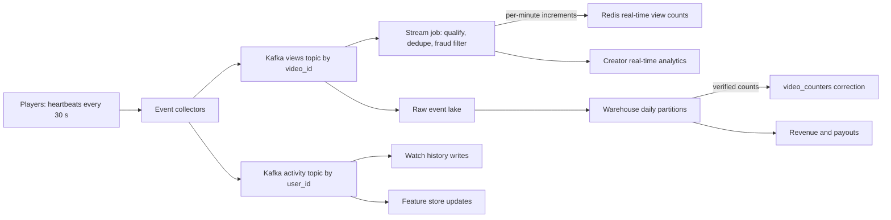

## Search

The indexing pipeline consumes `video.published`, `video.updated` and caption-ready events and builds a document per video: title, description, tags, channel name, automatic captions, language, duration, and quality signals such as view velocity and satisfaction. The **inverted index** maps terms to posting lists of video ids, sharded by document (each shard holds a slice of videos and is replicated), so a query fans out to all shards and merges the top results. New videos appear within minutes through a small real-time index merged with a large base index rebuilt periodically.

Ranking is two-stage: retrieve a few thousand candidates by text relevance (BM25-like scoring plus semantic embedding retrieval for queries like "how to fix a squeaky door"), then rank with a model using relevance, freshness, engagement, watch-time satisfaction and personalisation, with safety demotion for borderline content. **Autocomplete** is served from a prefix trie or sorted prefix table built from popular queries per language and region, filtered for policy, cached heavily, and answered in under 50 ms per keystroke.

## Home feed and recommendations

The home feed is the largest consumer of compute in the request path. YouTube's 2016 paper on deep neural networks for recommendations describes the public outline: **candidate generation**, then **ranking**.

**Candidate generation** pulls about a thousand videos from billions in under 50 ms from several sources: a **two-tower model** (a user tower embeds history, searches and context, a video tower embeds content and engagement, and an approximate nearest neighbour index such as ScaNN or FAISS finds the closest videos), subscription uploads, co-watch neighbours, regional trending, and fresh uploads needing exploration traffic.

**Ranking** scores each candidate with a deeper model over hundreds of user, video, context and cross features, predicting several objectives (click, expected watch time, like, satisfaction, dismissal) combined into one score. **Re-ranking** applies rules: at most two videos per channel in the first row, freshness boosts, no repeats of recently shown items, and policy demotion.

The **feature store** keeps online features (recent watches, channel affinities, engagement counters) updated from the stream within seconds, and an offline copy for training, so both use the same definitions. The **training loop** retrains daily or continuously on logged impressions and outcomes, validates through A/B tests, and ships new models and embedding indexes.

**Latency budget** for a 400 ms home feed: 20 ms feature fetch, 50 ms candidate retrieval (parallel sources), 150 ms ranking (batched GPU or TPU inference on 1,000 candidates), 20 ms re-ranking, 60 ms metadata hydration from cache, and the rest as headroom. If ranking times out, the BFF serves a cached previous feed or a non-personalised trending list.

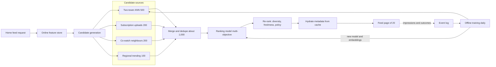

## Subscriptions and notifications

Subscriptions are stored twice: by subscriber (for "my subscriptions" and the subscriptions feed) and by channel (for fan-out). A subscribe writes the first table, then an outbox event updates the reverse table and increments the subscriber counter, keeping the two eventually consistent within seconds.

On publish, a fan-out job pages through `subscribers_by_channel`. **Channels under about 100,000 subscribers** get **fan-out on write**: the video id goes into each subscriber's inbox, plus a notification job for bell-"all" subscribers. **Huge channels** would mean tens of millions of writes per upload, so their uploads are merged into subscription feeds at read time (**fan-out on read**), and notifications go out in **batched, rate-limited waves** over several minutes. Segments are pre-positioned into ISP caches before the first wave so the spike lands on warm caches.

The **notification service** routes jobs to push (APNs, FCM), email and the in-app bell (a per-user wide-column list with a Redis unread counter). It applies **preferences** (per channel all, personalised or none; quiet hours), **deduplication** by a deterministic key per video and user, and **rate limits** (a handful of upload pushes per user per day, the rest collapsed into a digest). Opens are logged to tune what is worth sending.

## YouTube Live

Live inverts the VOD pipeline: there is no finished file and the latency budget is seconds. It has two independent paths, video and chat, which share only the broadcast id.

### Ingest and real-time transcoding

The creator creates a broadcast and receives a **stream key** and ingest URLs. The encoder (OBS, hardware, or the mobile app) pushes **RTMP or RTMPS**, YouTube's standard ingest protocols (it also accepts HLS ingest; SRT and WebRTC via WHIP are common elsewhere). Anycast steers it to an **ingest server near the streamer**, which checks the key and forwards over the private backbone to a **live transcoder**. That transcoder produces a real-time ladder (1080p60, 720p60, 480p, 360p, 240p, 144p) with aligned keyframes every 2 seconds, on GPUs or hardware encoders because software VP9 or AV1 at 1080p60 cannot keep up.

### Packaging, latency modes and CDN

The packager emits **CMAF** chunks in three latency modes (YouTube's own option names):

- **Normal latency**, about 15 to 30 seconds: 2 to 6 second segments and a deep buffer, most robust on poor networks.
- **Low latency** (5 to 10 seconds) and **ultra-low latency** (2 to 5 seconds): LL-HLS partial segments or LL-DASH chunked transfer, splitting 2-second segments into 200 to 500 ms chunks pushed as encoded, with blocking playlist reloads.

On the **CDN**, live has no long tail: every viewer wants the same newest segments, so hit ratios are excellent, but manifests change every second or two and cache for under a second. The danger is 5 million players requesting a new segment at once; **request collapsing** at edge and shield turns that into one upstream fetch per PoP, and big events get pre-warmed capacity.

The **DVR window** lets viewers rewind (up to 12 hours on eligible streams). When the stream ends, segments are re-packaged as VOD (streams up to 12 hours archive automatically), and the VOD pipeline later adds captions, better encodes and AV1.

**Failure handling**: encoders send to a **primary and a backup ingest URL**, and the packager stitches the timeline on failover. A brief encoder disconnect shows a "waiting" slate instead of ending the broadcast, which ends only after a timeout or explicit stop. Popular streams get a hot standby transcoder.

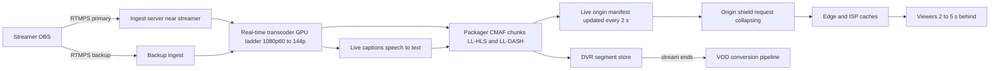

### Live chat

Live chat is pub/sub with rooms of millions. Clients hold a **WebSocket** to **chat gateways** (hundreds of thousands of connections each). The **chat service** authenticates each message, applies **slow mode** (say one message per 30 seconds per user), member-only mode, blocked words and a fast spam model, assigns a per-room sequence number, appends it to a chat log (wide-column by broadcast and time bucket, replayed with the VOD later), and publishes it to the room channel.

Fan-out is hierarchical: one publish to a room topic, sharded into sub-channels (for example 64) for huge rooms; each gateway subscribes only to rooms its clients joined. At 1,700 messages per second for 5 million viewers, delivering everything is pointless, since nobody reads 1,700 lines a second, so a **"Top chat"** stream filtered and sampled to 10 to 20 messages per second is the default and full "Live chat" is opt-in. Gateways **batch** one frame per client every 250 to 500 ms, turning billions of deliveries per second into a few million frames.

**Moderation** combines automatic filters with creator-appointed moderators who delete, time out or ban; a delete is broadcast as an event that removes the message on every client. **Super Chat** is a paid message: the payment is confirmed idempotently and written to the ledger first, then the chat service injects a highlighted message pinned for a time proportional to the amount.

The **concurrent viewer count** comes from playback heartbeats feeding a per-broadcast HyperLogLog or sharded counter with a 60-second expiry, published every 10 to 30 seconds.

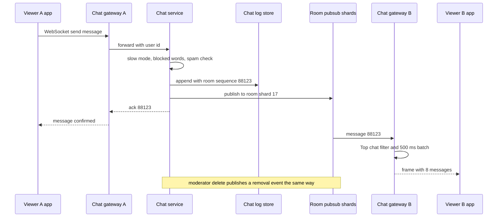

## Ads and monetisation

When the watch page loads, the BFF asks the **ad decision service** whether this view gets an ad. It checks eligibility (monetised video, viewer not on Premium, frequency caps), runs an auction over campaigns matching the context (category, region, device, consented signals) and returns a **VAST** response with the creative, tracking URLs and skip rules, within about 100 ms. Pre-roll ads can be stitched client-side (**CSAI**: the player switches to the ad's own stream, then back) or server-side (**SSAI**: ad segments are inserted into the content manifest, which resists ad blockers and plays smoothly on TVs, but needs per-viewer manifests). Impressions, quartile completions and clicks are logged as events and deduplicated like views.

Money flows into a **double-entry ledger**: each billable impression debits the advertiser and credits a revenue account, and the creator's share (YouTube's published share for long-form ad revenue is 55% to the creator) accrues to their balance. Monthly payout jobs run from the verified warehouse data, not real-time counters, and every payout is idempotent per creator per period.

## Moderation, safety and copyright

**Content ID** compares fingerprints of every upload against a reference database supplied by rights holders. Audio fingerprints (spectrogram landmarks) and video fingerprints (perceptual hashes of keyframes) are indexed so a match can be found even when the upload is cropped, re-encoded or sped up. A match triggers the rights holder's chosen policy: block, monetise (ad revenue goes to the rights holder) or track. Matching runs during processing for new uploads and continuously as new references are added, which means a published video can be claimed later.

**Policy classifiers** run over frames, audio transcripts, thumbnails, titles and comments to flag violence, adult content, hate, spam and misinformation. High-confidence violations are blocked automatically; borderline ones go to **human review queues** prioritised by predicted harm and reach (a video gaining views fast is reviewed first). Reviewers apply decisions with policy labels that feed back into training. Outcomes include removal, a strike against the channel, **age restriction** (sign-in required, verified 18+, no embedding), limited ads, or reduced recommendation. **Appeals** route to a different reviewer and can restore the video, and every action is recorded in an audit log for transparency reporting and legal requests.

## Cross-cutting concerns

### Security

The BFF authorises every video read: **private** videos need the owner or a share-list entry; **unlisted** videos need only the id, which is why ids are random 64-bit values; age-restricted videos need a verified account. Since segments bypass the API, protection relies on **signed tokens** with short expiry and region binding, validated at the edge with a rotating key, plus DRM for paid content. Internal traffic uses mutual TLS, and creator account takeover is countered with mandatory two-factor authentication for monetised channels and alerts on stream key changes.

### Observability

Each path has its own SLOs: playback (time-to-first-frame, rebuffer ratio, failure rate and bitrate per ISP, from client beacons), watch page (BFF p99, errors per backend), upload (p95 time to `ready` for a 10-minute video under 10 minutes), live (glass-to-glass latency, ingest disconnects, chat p99) and pipeline lag (consumer lag under 60 seconds). Tracing across the BFF fan-out shows which backend spent the deadline, and alerts fire on error-budget burn rate.

### Multi-region deployment and disaster recovery

Stateless tiers run in several regions per continent behind Anycast, so losing one shifts traffic in seconds. Metadata replicates across regions either synchronously (Spanner-style consensus, slower writes) or asynchronously with a regional primary per shard (Vitess-style, a few seconds of recovery point). Object storage is erasure-coded across regions and event topics are mirrored. Targets: playback continues from caches through a full metadata-region loss, write recovery under 5 minutes, recovery point under 10 seconds for metadata and zero for acknowledged uploads.

### Cost

At 1.1 EB a day, even $0.002 per GB is $2.2 million a day. Levers in order of impact: **ISP-embedded caches** (no paid transit), **better codecs** (VP9 then AV1 cut bytes 30 to 50% versus H.264), **per-title encoding**, **cache hit ratio** (immutable URLs, shield collapsing) and **not storing what nobody watches** (prune high rungs of unwatched videos, archive originals after 30 days). Transcoding gets cheaper with preemptible capacity, popularity-gated codecs and, at YouTube's scale, custom hardware.

## Scaling evolution: from startup to YouTube

The playbook's v1-to-scale step is what makes this design useful for your own product. Nobody starts with 300,000 transcoding cores; you start with the simplest thing that meets today's numbers and know which metric triggers each change.

**v1 (startup, up to about 10,000 DAU)**: a single-region monolith on two app servers behind a load balancer; PostgreSQL plus a replica for users, videos, likes (unique on `(video_id, user_id)`) and comments, with plain counter columns; S3 with presigned uploads; a job queue (BullMQ or SQS) feeding a few ffmpeg workers that make a three-rung H.264 HLS ladder; one CDN; Postgres full-text search; a home page of recent subscription uploads plus this week's most viewed. That handles hundreds of uploads a day and thousands of concurrent viewers.

**v2 (growth, 1 to 10 million DAU)** splits out transcoding, notifications and search, moves counters to Redis behind Kafka, adds a BFF, multi-CDN and a warehouse. **v3 (YouTube scale)** is the design in this guide. The table shows what changes and the metric that triggers each move.

| Concern | v1 startup | v2 growth | v3 YouTube scale | Trigger to move on |
| --- | --- | --- | --- | --- |
| App tier | Monolith, 2 servers | Services plus BFF | Hundreds of services, per-client BFFs | Deploys block each other; teams over 30 engineers |
| Metadata DB | One PostgreSQL plus replica | Bigger primary, read replicas, caches | Sharded Vitess or Spanner-like | Primary write CPU over 60% or data over 2 TB |
| Likes and views | Counter columns | Redis counters, Kafka, stream job | Sharded counters, fraud pipeline, batch verification | Row lock waits on hot videos |
| Comments | Postgres table | Partitioned table or Cassandra | Wide-column with hash buckets, ranking jobs | Single videos with over 1 M comments |
| Transcoding | ffmpeg workers from a queue | Chunked parallel DAG on spot instances | DAG plus custom hardware, AV1 by popularity | Time-to-ready over 10 minutes at p95 |
| Delivery | One CDN | Multi-CDN, origin shield | ISP-embedded caches, placement service | CDN bill is the top cost line |
| Search | Postgres full text | Elasticsearch | Custom index plus semantic retrieval | Queries over 300 ms or relevance complaints |
| Recommendations | Rules and popularity | Collaborative filtering | Two-tower plus deep ranking | Engagement plateaus |
| Live | Not offered or third-party | Managed live service | Own ingest, transcoders, LL-HLS, chat platform | Live becomes a core product |
| Regions | One | One primary plus DR | Active-active multi-region | Users on several continents, availability SLO 99.99% |

## Failure modes

| Failure | Impact | Mitigation |
| --- | --- | --- |
| CDN PoP or ISP cache failure | Viewers in one metro rebuffer or fail | DNS and Anycast steer to the next PoP; players retry segments on an alternate hostname; multi-CDN fallback |
| Origin or object storage regional outage | New and long-tail videos fail to start | Cross-region replicated storage; shield serves stale; popular content keeps playing from caches |
| Metadata cache cluster loss | Database flooded with 350k reads/s | Request coalescing, in-process LRU, gradual warm-up, load shedding of optional calls |
| Metadata shard primary down | Writes for a slice of videos fail | Automatic failover in under 30 s; reads from replicas; edits retried |
| Recommendation service slow | Home page and up next empty | BFF deadline; serve cached previous feed or trending list |
| Event bus consumer lag | Counts and analytics stale | Autoscale consumers; counts show last value; batch job reconciles |
| Redis counter loss | Like and view counts reset | Rebuild from durable `video_counters` plus replay of the event log since last flush |
| Transcode worker preempted | Chunk task lost | Idempotent task keys; orchestrator retries elsewhere |
| Transcoding backlog after a spike | Uploads stay in processing | Fast path first, priority queues by channel size, burst onto more spot capacity |
| Viral video hot key | One counter or comment partition overloaded | Sharded counters, hash buckets, cached first pages |
| Bot attack on likes or views | Inflated counts, unfair ranking | Rate limits, abuse scoring, fraud pipeline, batch recount |
| Live encoder disconnect | Stream freezes | Backup ingest URL, waiting slate, reconnect window before ending |
| Live segment request storm | Shield and origin overload | Request collapsing, pre-warmed capacity, longer manifest polling under load |
| Chat gateway crash | Thousands of sockets drop | Clients reconnect with backoff and jitter to other gateways, resume from last sequence |
| Bad deploy in BFF | Watch page errors | Canary releases per region, automatic rollback on SLO burn |
| Full region loss | Share of API traffic fails | Active-active regions, Anycast failover, capacity headroom of about 30% per region |

## Trade-offs and pitfalls

- **Strong consistency for counts** is expensive and invisible to users; keep the per-user reaction strongly consistent and the aggregate eventual.
- **Encoding every codec for every video** wastes most of the CPU on videos nobody watches; encode expensive codecs by popularity.
- **Partitioning by the obvious key** (video_id for reactions) creates hot partitions on viral videos; partition by what the queries actually need.
- **Proxying uploads or segments through API servers** wastes bandwidth and couples scaling; use presigned URLs and CDN hostnames.
- **Fan-out on write for every channel** melts down on the first upload from a channel with 100 million subscribers; use a hybrid.
- **One giant chat room** cannot deliver every message to every viewer; sample, filter and batch.
- **Real-time numbers used for money** invite disputes; pay from the batch-verified pipeline.
- **Building v3 on day one** spends years of engineering on problems you do not have; ship v1 and watch the triggers.

## Interview angle

In 45 minutes, present this as the playbook does and resist drawing boxes first:

- **Minutes 0 to 7**: scope (upload, watch, search, feed, likes and comments; live and ads as stretch), non-functional numbers (TTFF under 2 s at p90, 99.99% playback availability) and the estimates that matter: 500 hours uploaded per minute, about 1 EB of egress a day, 350k watch page loads per second.
- **Minutes 7 to 12**: the API for upload, watch, reaction and comments, and the data model with shard keys.
- **Minutes 12 to 20**: the overview diagram, split explicitly into the async ingest pipeline and the delivery path.
- **Minutes 20 to 35**: two or three deep dives chosen by the estimates: the transcoding DAG, CDN tiers with ISP caches and ABR, and one hot-key problem (likes counters or view counting).
- **Minutes 35 to 42**: failure modes and cost: CDN failover, counter recovery, egress cost levers.
- **Minutes 42 to 45**: how it evolves from a startup monolith, and what you would build next (live, recommendations).

If pushed on live, cover ingest near the streamer, LL-HLS chunks, request collapsing and sampled chat fan-out; on recommendations, retrieval plus ranking over a feature store.

## Key takeaways

- Split every video system into an asynchronous, CPU-heavy ingest pipeline and a bandwidth-heavy delivery path; they scale and fail differently.
- Egress dominates cost: ISP-embedded caches, immutable segments, origin shields and better codecs are the main levers.
- Upload directly to object storage with resumable presigned URLs, and transcode as a parallel DAG of idempotent chunk tasks with a fast playable path first.
- Choose each store from its access pattern: sharded SQL for metadata, wide-column for comments, reactions and history, Redis for counters, an inverted index for search.
- Never count with a row update: dedupe per user, batch deltas through a stream, use sharded counters, and verify in batch when money depends on it.
- Recommendations are retrieval, ranking and re-ranking on a shared feature store, with fallbacks so the page never waits on a model.
- Live trades caching depth for latency, and live chat must sample, filter and batch to fan out to millions.
- Start with a monolith, Postgres, S3, one CDN and ffmpeg workers, and let measured triggers drive each step towards this design.
