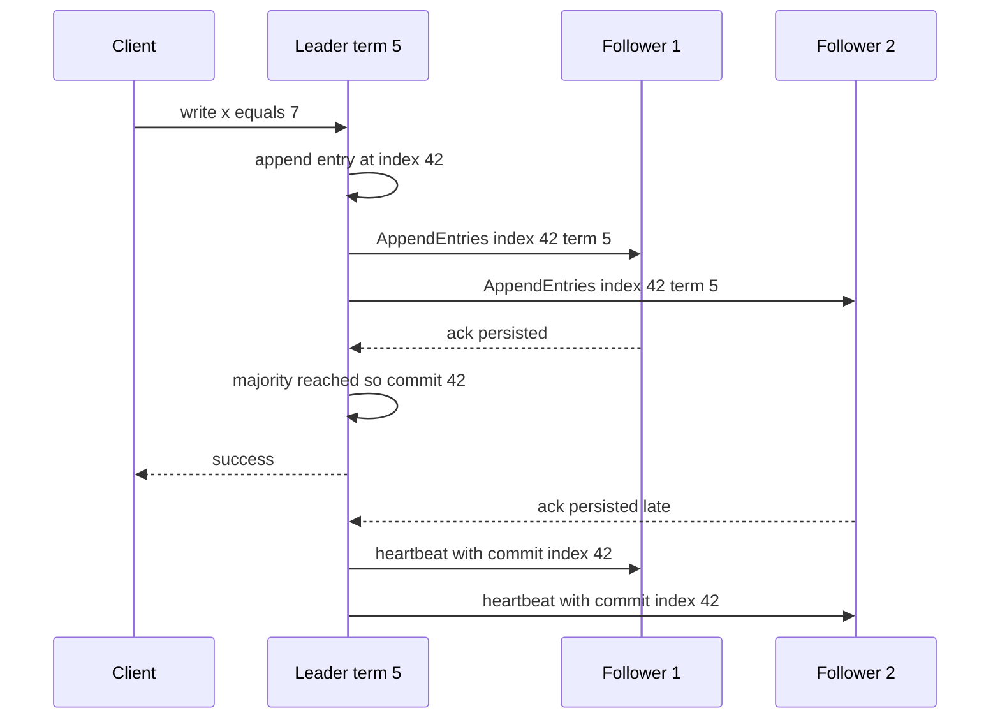

Sooner or later two machines need to agree on something: which instance runs the nightly billing job, which replica is the database primary, who holds the lock on a customer's account, whether the config change is live. On one machine you would use a mutex. Across machines there is no shared memory, the network can delay or drop messages, processes pause for seconds during garbage collection, and clocks disagree. Coordination is the set of techniques that make agreement safe anyway. The practical rule is to avoid needing it where you can, and where you cannot, to use a proven consensus system rather than building one.

## Why coordination is hard

Three facts break naive designs:

- **You cannot tell slow from dead.** If node B does not answer node A for 5 seconds, B may have crashed, be in a 10-second GC pause, or be fine but partitioned from A. Any timeout-based decision can be wrong.
- **Partitions split the cluster.** During a network partition each side may believe the other is dead. If both sides elect a leader, you get split brain: two primaries accepting conflicting writes.
- **Clocks drift and jump.** NTP keeps servers within a few milliseconds in a good datacenter, but tens to hundreds of milliseconds across regions or on a misconfigured VM, and a clock can step backwards after sync. You cannot order events across machines by wall-clock timestamp alone.

Real systems use timeouts for liveness but guarantee safety through majority quorums: they may stall during a bad partition, but never let two leaders commit conflicting decisions.

## Leader election

Many problems reduce to "exactly one node should do this": run a scheduler, own a partition, accept writes.

| Approach | Safety | Notes |
|----------|--------|-------|
| Static config ("node 1 is leader") | No failover | Fine for dev only |
| Database row lock or advisory lock | As good as the database | `pg_try_advisory_lock` held on a session; simple for cron-style singletons |
| Lease in etcd, ZooKeeper or Consul | Strong, with fencing | Standard for infrastructure |
| Kubernetes Lease object | Built on etcd | Used by controllers via client-go leader election |
| Built-in consensus (Raft inside the system) | Strong | Kafka KRaft, CockroachDB, MongoDB replica sets |

A lease is a lock with an expiry, say 15 seconds, that the holder renews every 5. If the leader dies, the lease expires and another candidate acquires it. The catch: a paused leader may still believe it holds the lease after it expired. That is what fencing tokens solve, covered below.

## Consensus with Raft

Raft is the consensus algorithm behind etcd, Consul, CockroachDB, TiKV and Kafka KRaft. It keeps a replicated log identical on a majority of nodes, so every node applies the same commands in the same order.

**Terms and roles.** Time is divided into numbered terms. Each node is a follower, candidate or leader. Followers expect heartbeats from the leader; if none arrives within a randomized election timeout (for example 150 to 300 ms), a follower increments the term, becomes a candidate and requests votes. Each node votes at most once per term, and only for candidates whose log is at least as up to date as its own. A candidate with votes from a majority becomes leader for that term. Randomized timeouts make split votes rare.

**Log replication.** Clients send writes to the leader. The leader appends the entry to its log, sends it to followers, and once a majority has persisted it, marks it committed, applies it, and replies to the client.



**Why a majority.** Any two majorities of the same cluster overlap in at least one node. A new leader must win a majority, so it must include a node that saw every committed entry, and the log up-to-date rule ensures that node's history wins. That overlap is what prevents split brain: a minority partition cannot elect a leader or commit writes.

**Why 3 or 5 nodes.**

| Nodes | Majority | Failures tolerated |
|-------|----------|--------------------|
| 3 | 2 | 1 |
| 4 | 3 | 1 |
| 5 | 3 | 2 |
| 7 | 4 | 3 |

Even counts add cost without adding fault tolerance. Larger clusters tolerate more failures but every write waits for more acknowledgements, so 3 or 5 is standard. Spread them across three availability zones so losing one zone keeps a majority. Writes cost at least one round trip to a majority plus an fsync, so consensus stores handle thousands to tens of thousands of writes per second, not millions. Keep them for small, critical data.

## etcd, ZooKeeper and Consul

These are small, strongly consistent key-value stores built on consensus (Raft for etcd and Consul, the similar ZAB for ZooKeeper). Use them for leader election and leases (etcd leases, ZooKeeper ephemeral sequential nodes), consistent configuration with watches that push changes, service discovery (Consul's core use), and cluster metadata (Kubernetes keeps all state in etcd).

Do not use them as general databases: etcd's default storage quota is 2 GB, with 8 GB the suggested maximum. If you already run Postgres and need a singleton job, an advisory lock may be all you need.

## Distributed locks, leases and fencing tokens

A lock across machines is always a lease, because a holder that crashes must not hold it forever. The danger is a client that pauses (GC, VM migration, slow disk) longer than the lease, wakes up, and writes while another client now holds the lock.

```text
t=0   Client A acquires lease (30 s), token 33
t=5   Client A enters a 40 s GC pause
t=30  Lease expires; Client B acquires, token 34
t=31  Client B writes to storage with token 34
t=45  Client A wakes, still "holds" the lock, writes with token 33
      Storage rejects 33 because it has seen 34
```

A **fencing token** is a number that increases every time the lock is granted (etcd's revision or lease ID ordering, ZooKeeper's zxid or sequential node number). The protected resource stores the highest token seen and rejects older ones. Without that check at the resource, no lock service can make a lease safe against pauses.

```sql
UPDATE accounts
SET balance = $1, fence = $2
WHERE id = $3 AND fence < $2;
-- 0 rows updated means a newer lock holder already wrote
```

### The Redlock debate

Redis's Redlock acquires a key with a TTL on a majority of independent Redis nodes. Martin Kleppmann argued it is unsafe for correctness because it depends on bounded clock drift and pauses and provides no fencing token; Redis's author replied that the timing assumptions are reasonable in practice. The working consensus: a single Redis `SET key value NX PX 30000` is fine as an **efficiency** lock (avoid two workers doing the same expensive job; occasional duplication is harmless). If duplication would corrupt data or move money, use a consensus-backed lease with fencing, or redesign so the lock is unnecessary.

## Time: skew, logical and hybrid clocks

Wall clocks are fine for logs and TTLs, dangerous for ordering. Last-write-wins by timestamp silently drops a write when the second writer's clock is 50 ms behind. Run chrony against your cloud's time service, monitor offset, and prefer slewing over stepping.

**Lamport clocks** give a logical counter per node: increment on every event, attach it to messages, and on receive set `counter = max(local, received) + 1`. If A happened before B, A's timestamp is smaller. The reverse does not hold, so concurrent events cannot be detected.

**Vector clocks** keep one counter per node and can detect concurrency, at the cost of size growing with node count.

**Hybrid logical clocks** combine a physical timestamp with a logical counter: close to wall time, monotonic, and causal. CockroachDB and YugabyteDB use them. Google Spanner's TrueTime uses GPS and atomic clocks to bound uncertainty to a few milliseconds and waits it out before committing.

## Idempotency as an alternative to locks

Many locks exist only to stop duplicate work. Often it is simpler and safer to make the work idempotent and let duplicates happen:

- **Unique constraints**: `INSERT ... ON CONFLICT DO NOTHING` on a business key (order ID, idempotency key) lets the database arbitrate.
- **Conditional writes**: optimistic concurrency with a version column (`WHERE version = 7`) or DynamoDB condition expressions.
- **Single-writer partitioning**: route all events for a key to one Kafka partition so one consumer handles them in order, no lock needed.
- **Deterministic outputs**: write to a key derived from the input so a rerun overwrites the same result.

These push coordination into a component that is already consistent, usually the database, instead of adding a separate lock service.

## Trade-offs and pitfalls

- **Locks without fencing** are unsafe against pauses, whatever the lock service.
- **Even-sized or two-node clusters** give no extra tolerance; two nodes cannot survive one failure.
- **Consensus stores as databases** leads to slow writes and size limits.
- **Wall-clock ordering** across machines loses writes silently.
- **Homegrown consensus** is almost always subtly wrong; use etcd, ZooKeeper or your database.

## Interview angle

- State that you cannot distinguish slow from dead, then explain quorums.
- Sketch Raft: terms, election, log replication, commit on majority.
- Justify 3 or 5 nodes across three zones.
- When asked for a distributed lock, add a lease and a fencing token, and mention the Redlock critique.
- Offer idempotency or a unique constraint as the simpler design.

## Key takeaways

- Coordination is hard because of partitions, pauses and unreliable clocks.
- Raft commits on a majority; overlapping majorities prevent split brain.
- Use etcd, ZooKeeper or Consul for small, critical coordination state.
- Every distributed lock is a lease; only fencing tokens make it safe for correctness.
- Prefer idempotent operations and database constraints over locks when you can.
