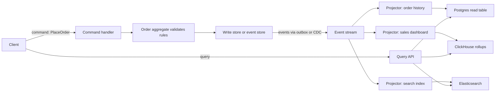

Three ideas get bundled together and confused: event-driven architecture (services communicate by publishing facts), CQRS (separate models for writing and reading), and event sourcing (store the history of changes as the source of truth instead of current state). They combine well, but each stands alone, and each has a very different cost. Most systems benefit from the first, many from a light form of the second, and only a few from the third. This guide explains how each works in practice and how to tell when it earns its complexity.

## Commands vs events

A **command** is a request to do something, addressed to one handler, which can refuse: `PlaceOrder`, `CapturePayment`. It is named in the imperative, and the sender cares about the result.

An **event** is a fact that already happened, broadcast to anyone interested: `OrderPlaced`, `PaymentCaptured`. It is named in the past tense, cannot be rejected, and the publisher does not know or care who consumes it.

The distinction matters for coupling. If the order service sends `SendConfirmationEmail` to the notification service, the order service knows about email. If it publishes `OrderPlaced`, the notification, analytics and loyalty services each decide what to do, and you can add a fourth without changing the order service.

## Event notification vs event-carried state transfer

**Event notification** sends a thin event: `{ "type": "OrderPlaced", "orderId": "ord_81" }`. Consumers that need details call back to the order service. Events are small and never stale, but consumers now depend on the publisher being up, and a burst of events becomes a burst of API calls.

**Event-carried state transfer** includes the data consumers need:

```json
{
  "eventId": "evt_01JBR3...",
  "type": "OrderPlaced",
  "version": 2,
  "occurredAt": "2026-11-03T10:15:02Z",
  "orderId": "ord_81",
  "customerId": "cus_19",
  "items": [{ "sku": "TSHIRT-M", "qty": 2, "unitPrice": 1999 }],
  "totalCents": 3998,
  "currency": "USD"
}
```

Consumers can maintain their own local copies and work even when the publisher is down. The costs are larger events, a public schema you must version carefully, and data duplicated across services. In practice, carry what most consumers need and let rare consumers call back.

## Choreography

With **choreography**, there is no central coordinator: each service reacts to events and emits its own. Order placed leads payment to capture, which leads inventory to reserve, which leads shipping to schedule. It is loosely coupled and easy to extend. The downside is that the overall workflow is implicit, spread across many services, and hard to see or change. Once a flow has more than about four or five steps or needs compensation logic, an **orchestrator** (a workflow engine like Temporal or AWS Step Functions, or a dedicated saga service) that sends commands and tracks state is easier to reason about. Many systems use orchestration inside a business process and choreography between domains.

Whatever the style, publish events reliably. Writing to the database and then to Kafka in two steps loses events on crashes. Use a transactional outbox or CDC, and make every consumer idempotent, because delivery is at least once.

## CQRS: separate read models

Command Query Responsibility Segregation means the model you write through is not the model you read from. The write side enforces invariants on normalized aggregates. The read side holds **projections**: denormalized views shaped for specific screens or queries, updated from events.



CQRS pays off when reads and writes have very different shapes or scale: a write model of a few hundred orders per second, and read models serving a customer order list, an admin dashboard aggregated by hour, and full-text search over the same data. Each projection uses the store that fits.

CQRS does not require separate databases. The lightest form is separate code paths in one app: command handlers that load aggregates, and query handlers that run tuned SQL or read a materialized view. Go further only when needed.

### Eventual consistency in the UI

Projections lag the write side, typically by tens of milliseconds to a few seconds. A user who places an order and is redirected to "My orders" may not see it. Options:

- Return the new state in the command response and render it directly.
- Return the position or version of the write; the query API waits until the projection has processed that position (with a timeout).
- Optimistically insert the item client-side and reconcile when the read model catches up.
- Read from the write model for the user's own just-changed data, and from projections for everything else.

Monitor projection lag as a first-class metric and alert when it exceeds your budget.

## Event sourcing

In a normal system the database stores current state, and history is lost unless you add audit tables. With **event sourcing**, the append-only sequence of domain events is the source of truth, and current state is derived by replaying them.

```text
Stream: account-7781
  #1 AccountOpened      { owner: "cus_19", currency: "EUR" }
  #2 MoneyDeposited     { amount: 50000 }
  #3 MoneyWithdrawn     { amount: 12000 }
  #4 MoneyDeposited     { amount: 3000 }
Current balance = 50000 - 12000 + 3000 = 41000
```

To handle a command, load the stream, fold the events into the aggregate's state, check business rules, and append new events with an expected version. If another writer appended first, the expected version check fails and you retry: optimistic concurrency per stream, with no locks.

**Event store.** EventStoreDB (now Kurrent) is purpose-built; many teams use a Postgres table with `(stream_id, version)` as a unique key plus a global sequence for subscriptions. Kafka is good for distributing events but weak as the primary event store, because loading one aggregate's stream by key and enforcing per-stream expected versions are not what it is built for.

**Snapshots.** Replaying 50,000 events per command is slow. Periodically store a snapshot of aggregate state at version N, then load the snapshot and replay only events after N. Snapshot every few hundred events, or design aggregates with short lifecycles so streams stay small.

**Rebuilding projections.** Because all history is kept, you can build a new read model by replaying from event 1: a new report, a fixed bug in a projector, a migration to a new database. Build the new projection alongside the old, let it catch up, then switch. Replays of hundreds of millions of events take hours, so plan for parallelism by stream.

**Versioning events.** Events are permanent, so their schemas live forever. Rules that work:

- Only add optional fields; never change the meaning of an existing one.
- For breaking changes, introduce `MoneyDeposited` version 2 and write an **upcaster** that converts v1 to v2 when reading.
- Keep a schema registry (Avro, Protobuf or JSON Schema) and compatibility checks in CI.
- Name events in business terms, not technical ones (`OrderShipped`, not `OrderStatusUpdated`).

**The GDPR deletion problem.** An immutable log conflicts with the right to erasure. Approaches: keep personal data out of events and reference it by ID from a deletable store; or **crypto-shredding**, encrypting each person's personal fields with a per-subject key and deleting the key on request, which makes the data unreadable in every copy and backup. Rewriting history in place is possible but breaks the immutability that consumers rely on.

## When each is worth it

| Pattern | Worth it when | Over-engineering when |
|---------|---------------|----------------------|
| Domain events between services | Several consumers react to the same fact; you want decoupled availability | One consumer, which a direct call or job handles fine |
| Event-carried state | Consumers need data while the source is down | Data changes constantly and consumers only need it rarely |
| CQRS (code-level) | Read and write logic diverge in a medium-sized domain | Simple CRUD screens |
| CQRS (separate stores) | Read load or query shapes differ greatly from writes | A single database with indexes and a materialized view suffices |
| Event sourcing | Audit is a core requirement (ledgers, trading, healthcare), temporal queries matter, or the domain is naturally a sequence of events | CRUD apps, teams new to the patterns, data with heavy deletion or privacy requirements |

Event sourcing applied to a whole system is a common, expensive mistake. Apply it to the one or two bounded contexts where history is the product, and use ordinary state storage elsewhere.

## Trade-offs and pitfalls

- **Dual writes** to a database and broker lose events; use an outbox or CDC.
- **Non-idempotent consumers** double-charge on redelivery.
- **Leaking internal events** as public contracts locks your internal model; publish separate integration events.
- **Ignoring projection lag** produces confusing UIs and support tickets.
- **Breaking event schemas** strands old events that can no longer be replayed.
- **Choreography sprawl** hides the business flow; switch to orchestration when flows get long.

## Interview angle

- Distinguish commands from events and say why events reduce coupling.
- Draw a CQRS flow with projections and address read-after-write in the UI.
- Explain event sourcing with optimistic concurrency, snapshots and replay.
- Raise schema versioning and GDPR crypto-shredding unprompted.
- Say clearly where you would not use event sourcing.

## Key takeaways

- Commands ask; events tell. Events let you add consumers without changing producers.
- Carry enough state in events for common consumers, and publish via outbox with idempotent consumers.
- CQRS separates write invariants from read-optimized projections, at the cost of eventual consistency.
- Event sourcing gives full history and rebuildable views but demands versioning, snapshots and a deletion strategy.
- Use each pattern only where its specific benefit is needed.
