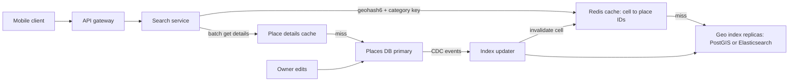

"Show restaurants within 2 km of me" sounds like a `WHERE` clause, but at 200 million places and 50,000 queries per second it is an indexing problem. Ordinary indexes sort along one dimension; location has two. Every production geospatial technique, from geohash to Uber's H3, maps 2D space onto something a 1D index or hash map can handle while keeping nearby points near each other. This guide covers the techniques, the databases that implement them, a read-heavy "find nearby" design, and how moving objects differ.

## Why a B-tree on lat and lng fails

With a composite index on `(lat, lng)`, the query `lat BETWEEN a AND b AND lng BETWEEN c AND d` uses the index only for the latitude range, scanning a strip around the whole planet (Madrid to Beijing at 40 degrees north) and filtering longitude row by row. Two separate indexes just produce two huge strips to intersect.

A radius in degrees is also wrong: a degree of latitude is about 111 km, but a degree of longitude is 111 km times cos(latitude), about 85 km at 40 degrees. Use haversine or spheroid distance.

## Geohash

Geohash recursively halves the world, alternating longitude and latitude, and writes the resulting bits in base32. Each extra character subdivides a cell into 32. Points sharing a prefix are in the same cell, so a prefix query on a normal B-tree (`WHERE geohash LIKE '9q8yy%'`) finds everything in a cell.

| Length | Cell size (approx, at equator) | Typical use |
| --- | --- | --- |
| 4 | 39 km x 19.5 km | Metro area |
| 5 | 4.9 km x 4.9 km | Large neighbourhood |
| 6 | 1.2 km x 0.6 km | "Within 1 km" searches |
| 7 | 153 m x 153 m | Street block |
| 8 | 38 m x 19 m | Building |

Pick the length whose cell is roughly the search radius: 5 for a 5 km search, 6 for 1 km.

**The edge problem.** Two points 5 metres apart can sit on opposite sides of a cell boundary and share no prefix at all (the equator and prime meridian are extreme cases). A correct search queries the **centre cell plus its 8 neighbours**, then filters by exact distance. Cells also shrink in width toward the poles, and density varies wildly: a Manhattan cell holds thousands of places, a Nevada cell none.

## Quadtree

A quadtree starts with one node covering the map and splits any node holding more than a threshold (say 100 places) into four children. Dense cities get deep, small leaves; empty desert stays one big leaf. That adapts to density, which fixed geohash cells cannot.

The tree usually lives in memory on each search server: 200 million places at roughly 100 bytes each plus node overhead is 25 to 30 GB per replica. Descend to the user's leaf, then expand to neighbouring leaves until you have enough results. The costs are minutes of rebuild at startup and awkward incremental updates, acceptable for places that rarely change.

## Google S2

S2 projects the sphere onto the six faces of a cube and subdivides each face as a quadtree, numbering cells along a **Hilbert curve** into 64-bit IDs across 31 levels (level 30 cells are about 1 cm). The Hilbert curve preserves locality better than geohash's Z-order, and the spherical geometry has no distortion seams at the antimeridian.

S2's best feature is the **region coverer**: give it a circle or polygon and it returns a few cells at mixed levels covering it. Each cell is a contiguous ID range, so a radius search becomes a handful of range scans on any ordered key-value store. MongoDB's 2dsphere index uses S2 cells internally.

## Uber H3

H3 tiles the world with hexagons (plus 12 pentagons) at 16 resolutions. Hexagons have one property squares lack: all six neighbours are the same distance from the centre, so "within k rings" approximates a circle cleanly and movement between cells is uniform. That makes H3 ideal for **aggregation and analytics**: surge pricing per cell, demand heatmaps, supply and demand balance.

| Resolution | Average hexagon area | Average edge |
| --- | --- | --- |
| 7 | 5.2 km² | 1.4 km |
| 8 | 0.74 km² | 0.53 km |
| 9 | 0.11 km² | 0.2 km |

The trade-off: hexagons do not nest perfectly (a parent's seven children do not exactly cover it), so H3 is less suited to precise hierarchical containment than S2.

## Databases that do it for you

You rarely implement these by hand.

**PostGIS** stores `geography(Point, 4326)` and indexes it with GiST (an R-tree style index of bounding boxes). `ST_DWithin` uses the index; `<->` gives index-assisted nearest-neighbour ordering.

```sql
CREATE INDEX places_geo_idx ON places USING GIST (location);

SELECT id, name, ST_Distance(location, ST_MakePoint(-122.41, 37.77)::geography) AS m
FROM places
WHERE ST_DWithin(location, ST_MakePoint(-122.41, 37.77)::geography, 2000)
  AND category = 'restaurant'
ORDER BY m
LIMIT 20;
```

**MongoDB** uses a `2dsphere` index on GeoJSON. Coordinates are `[longitude, latitude]`, a frequent source of bugs.

```js
db.places.createIndex({ location: "2dsphere", category: 1 });
db.places.find({
  category: "restaurant",
  location: { $nearSphere: { $geometry: { type: "Point", coordinates: [-122.41, 37.77] }, $maxDistance: 2000 } }
}).limit(20);
```

**Redis GEO** stores members in a sorted set with a 52-bit geohash as the score. It is fast and simple for millions of points and constant updates, but holds only member and position; details live elsewhere.

```
GEOADD drivers:sf -122.41 37.77 driver:842
GEOSEARCH drivers:sf FROMLONLAT -122.42 37.78 BYRADIUS 2 km ASC COUNT 10
```

**Elasticsearch** offers `geo_point` distance filters when location is one filter among full-text search and facets.

## Designing "find nearby" end to end

Requirements for a Yelp-like service: 200 million places, search within 0.5 to 20 km with filters (category, open now, rating), 50,000 searches per second at peak, p99 under 200 ms, place updates around 100 per second. Reads outnumber writes about 500 to 1.



Separate the **geo index** (ID, location, category, rating; small) from **place details** (photos, hours, description; large). The search service:

1. Converts the user's location to a geohash at the precision that matches the radius, and computes the 8 neighbours.
2. Fetches candidate IDs for those 9 cells, per category, from Redis. Keys look like `geo:6:9q8yyk:restaurant`.
3. On a miss, queries the geo index replica and caches the cell's result for 10 to 60 minutes.
4. Computes exact distance, applies filters, ranks (distance, rating, relevance), and takes the top 20.
5. Batch-fetches details for those 20 IDs from the details cache.

Caching by **cell rather than user coordinates** is the key move: users have unique coordinates but share a modest number of cells, so hit rates are high. Too few results? Widen to a shorter geohash and repeat. Cap dense cells' cached lists at the top N by rating.

Writes are rare, so CDC handles freshness: an edit updates the primary, and an event updates the index and invalidates affected cells; a minute of lag is fine. 200 million small rows fits on replicated PostGIS or a modest Elasticsearch cluster, so shard by region only if it outgrows that; read replicas scale queries.

## Moving objects vs static places

Drivers, couriers and shared scooters break the static design. A fleet of 1 million active drivers reporting every 4 seconds generates 250,000 location writes per second, and results are stale within seconds.

- Keep live positions **in memory**: Redis GEO sharded by city, or an in-memory grid keyed by H3 or geohash cell, with each update moving the driver between cells.
- Do not cache query results; the data changes faster than any TTL worth having.
- Persist location history asynchronously through Kafka to a time-series or lake store for trip records and analytics.
- Expire stale entries: a driver who has not reported in 30 seconds is removed or marked offline.
- Matching queries search the rider's cell plus rings of neighbours (H3 `gridDisk` with k=1, 2, 3) until enough candidates are found, then rank by estimated arrival time from a routing engine rather than straight-line distance.

| | Static places | Moving objects |
| --- | --- | --- |
| Write rate | ~100/s | 100,000s/s |
| Store | Database with geo index | In-memory grid or Redis GEO |
| Caching | Cache results per cell | No result cache |
| Freshness | Minutes OK | Seconds |

## Trade-offs and pitfalls

- **Forgetting neighbour cells** misses results right next to the user.
- **Longitude and latitude order**: GeoJSON and PostGIS `ST_MakePoint` take longitude first; many APIs take latitude first.
- **Distance in degrees** is wrong away from the equator; use geography types or haversine.
- **Fixed cell sizes** give empty results in rural areas and huge lists in cities; adapt precision or use quadtrees.
- **Caching per exact coordinate** yields near-zero hit rates; cache per cell.

## Interview angle

- Explain why a B-tree on two columns fails before proposing a geo index.
- Present geohash with the neighbour fix, then mention quadtree, S2 or H3 as refinements and when each fits.
- Split the geo index from place details and cache by cell.
- Distinguish static places from moving objects and change the storage accordingly.

## Key takeaways

- Geospatial indexes map 2D space onto 1D keys while preserving locality.
- Geohash is simple and prefix-queryable but needs the 8-neighbour search and has uneven cells.
- Quadtrees adapt to density; S2 gives precise spherical coverings; H3 hexagons excel at aggregation.
- PostGIS, MongoDB 2dsphere and Redis GEO cover most needs without custom code.
- Read-heavy nearby search scales with cell-keyed caching; moving objects need in-memory, frequently updated grids.
