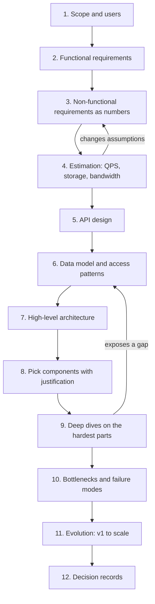

Most bad designs are not bad because someone picked the wrong database. They are bad because nobody wrote down what the system had to do, how many people would use it, or what "fast" meant, so every later choice was a guess. A good design process is boring on purpose: the same steps every time, each one producing an artefact the next step consumes. This guide is that process. It works for a whiteboard interview in 45 minutes and for a real project over two weeks; only the depth changes.

## The playbook at a glance

Each step narrows the problem. You go forward, but you loop back whenever a later step exposes a gap (estimation often changes the data model; a deep dive often changes the API).



## Steps 1 to 3: scope, functional and non-functional requirements

**Scope and users.** Name the actors (members, staff, admins, other systems), the platforms (web, mobile, API), and what is explicitly out of scope. "We will not build payments; we use Stripe" removes a week of design.

**Functional requirements** are verbs: "a member can book a class", "staff can cancel a class and everyone booked is notified". Keep them to the five to eight that matter. Everything else goes in a "later" list.

**Non-functional requirements** are numbers. "Highly available" becomes 99.9% monthly. "Fast" becomes p99 under 300 ms for the booking API. Add consistency per feature (can two people get the last spot?), durability, retention, compliance and a cost ceiling. If you cannot get numbers from stakeholders, state assumptions and move on; an assumed number can be challenged, a vague word cannot.

## Step 4: estimation

Estimation tells you which problems are real. Convert daily active users into requests per second, multiply by a peak factor (2 to 10x depending on how spiky traffic is), and compute storage per year. A useful shortcut: 1 million requests per day is about 12 per second on average. If your peak is 200 writes per second, a single PostgreSQL primary handles it and sharding is a distraction. If it is 200,000, sharding is the main topic.

## Step 5: API design

Write the endpoints the clients actually call, with methods, key fields and status codes. This forces precision about inputs, pagination, idempotency and authorization before you draw boxes.

```http
POST /v1/classes/{classId}/bookings
Idempotency-Key: 7f3c...
→ 201 { "bookingId": "b_91", "status": "confirmed" }
→ 409 { "error": "class_full", "waitlistPosition": 4 }
```

## Step 6: data model and access patterns

List the queries first, then design tables or documents to serve them. For each access pattern note frequency, latency target and the index that serves it. "List my upcoming bookings" needs an index on `(member_id, starts_at)`; "count bookings for a class" needs either an index on `class_id` or a counter column updated in the same transaction. Pick the store from the access patterns and consistency needs, not from fashion.

## Steps 7 and 8: architecture and component choices

Draw the request path end to end: client, CDN, load balancer, stateless services, cache, primary database, queue, workers, object storage. Then justify each box in one sentence tied to a requirement. "Redis cache because class schedules are read 50x more than written and p99 must stay under 300 ms" is a justification. "Redis because it is fast" is not. Every component you add is something to run, patch, monitor and pay for, so a box without a requirement behind it should be removed.

## Step 9: deep dives

Pick the two or three hardest parts and go deep. Hard usually means one of: contention on a shared resource (the last spot in a class), a hot key, a strict consistency requirement, a large fan-out, or an external dependency you do not control. For each, compare at least two options, choose one, and say what you give up.

## Step 10: bottlenecks and failure modes

Walk the diagram and ask of every box: what happens when it is slow, down, or overloaded? What is the single point of failure? Which tier hits its limit first as traffic grows 10x? Write down detection (metric, alert), mitigation (timeout, retry, fallback, failover) and the user-visible degradation for each.

## Step 11: evolve from v1 to scale

Design v1 as the simplest thing that meets today's numbers, usually a monolith on two app servers behind a load balancer with a managed database and a replica. Then describe the triggers for each next step: "add read replicas when primary CPU passes 60%", "extract notifications into a worker when send volume delays API responses", "shard bookings by gym region when write QPS passes 5,000". This shows you can ship now and still know where you are going.

## Step 12: document decisions

Record each significant decision as a short Architecture Decision Record: context, decision, alternatives considered, consequences. ADRs live in the repo next to the code, take ten minutes to write, and save hours of "why did we do this?" a year later. Supersede them rather than editing history.

## A reusable one-page design template

```markdown
# <System name> design (v0.1, <date>, <author>)

## 1. Scope
Users/actors:            Platforms:            Out of scope:

## 2. Functional requirements (top 5-8)
- FR1 ...

## 3. Non-functional requirements
Availability: __%   p99 latency: __ ms (per API)   Durability: __
Consistency per feature: ...   Retention: ...   Compliance: ...
Peak QPS read/write: __/__   Growth/yr: __   Cost ceiling: $__/mo

## 4. Estimates
DAU: __  avg QPS: __  peak QPS: __  storage/yr: __  bandwidth: __

## 5. API (key endpoints, idempotency, auth)
## 6. Data model + access patterns (query -> index -> frequency)
## 7. Architecture diagram
## 8. Components and why (one line each, tied to an NFR)
## 9. Deep dives (options, choice, trade-off)
## 10. Failure modes (component -> detection -> mitigation -> degradation)
## 11. Evolution plan (trigger metric -> next step)
## 12. Open questions and ADR links
```

## Worked mini-example: class booking for a gym chain

**Scope.** 300 gyms, 600,000 members, mobile app and staff web console. Payments via an existing provider; out of scope.

**Functional.** Members browse the weekly timetable, book a class, join a waitlist, cancel; staff create and cancel classes; members are notified of waitlist promotion and cancellations.

**Non-functional.** 99.9% availability (about 43 minutes of downtime a month). Booking p99 under 300 ms. A class with 20 spots must never confirm 21 bookings: strong consistency on capacity, eventual consistency is fine for timetable views. Keep booking history for 2 years; GDPR applies (EU gyms), so support data export and erasure.

**Estimation.** 30% of members are daily active: 180,000 DAU. Each opens the timetable 3 times and books once: about 540,000 reads and 180,000 writes a day, or 6 reads/s and 2 writes/s on average. Traffic is brutally spiky: popular classes open for booking 7 days ahead at 06:00, so assume 100x peak for a minute, roughly 200 writes/s against a handful of hot classes. Storage: 180,000 bookings/day at 200 bytes is about 13 GB a year. This is a small-data, hot-contention problem.

**API.** `GET /v1/gyms/{id}/timetable?week=`, `POST /v1/classes/{id}/bookings` with an idempotency key, `DELETE /v1/bookings/{id}`, `POST /v1/classes/{id}/cancel` for staff.

**Data model.** PostgreSQL: `classes(id, gym_id, starts_at, capacity, booked_count)`, `bookings(id, class_id, member_id, status, created_at)` with a unique constraint on `(class_id, member_id)` and an index on `(member_id, starts_at)`.

**Architecture.** Mobile app → CDN (timetable JSON cached 30 s) → load balancer → stateless booking service (3 instances) → PostgreSQL primary with one replica in another zone; Redis for timetable cache; a queue plus worker for notifications.

**Components.** PostgreSQL because capacity needs a transactional check-and-increment; Redis and the CDN because reads spike at 06:00 and are cacheable; a queue because sending push notifications must not slow the booking response.

**Deep dive: the last spot.** Use a conditional update in one transaction: `UPDATE classes SET booked_count = booked_count + 1 WHERE id = $1 AND booked_count < capacity`; if zero rows change, insert into the waitlist instead. Row-level locking serialises only bookings for that one class, and 200 writes/s is well within one primary.

**Failure modes.** Replica down: reads fall back to primary. Primary down: managed failover in about 60 seconds; booking returns 503 with a retry hint; timetable still served from cache. Notification provider down: queue retains messages and retries with backoff.

**Evolution.** Add a virtual waiting room if peak exceeds 2,000 writes/s; partition by region only if a single primary saturates.

**ADR-001.** "Use PostgreSQL conditional updates for capacity instead of Redis counters, because correctness on the last spot outweighs the throughput we do not need."

## The order to learn this category

Work through the category in this sequence. **Method** first: this playbook and the guide on requirements and NFRs, so you know what questions to ask. **Fundamentals** next: scalability, availability and reliability, consistency models, latency numbers and estimation. Then **building blocks**: load balancers, caches, databases and indexing, replication and sharding, queues and streams, object storage, CDNs. Then **patterns** that combine them: resilience patterns, sagas and the outbox, idempotent consumers, multi-tenancy, rate limiting. Then **case studies** where you apply everything to a URL shortener, news feed, notification system or search autocomplete. Finish with the **design review checklist**, and use it on every design you produce, including your own past ones.

## Trade-offs and pitfalls

- **Jumping to boxes** before requirements produces a design that solves an imagined problem.
- **Vague NFRs** ("scalable", "fast") cannot be tested and cannot justify any component.
- **Skipping estimation** leads to sharding a 10 GB database or under-provisioning a hot path.
- **Over-building v1** adds Kafka, microservices and multi-region to a product with 500 users.
- **No failure analysis** means the first outage defines the architecture for you.
- **Undocumented decisions** get relitigated every time someone new joins.

## Interview angle

- Spend the first 5 to 8 minutes on scope, requirements and numbers; interviewers grade this heavily.
- Say your assumptions out loud and write them down.
- Use estimates to decide what to deep-dive, and tell the interviewer why you chose those parts.
- Offer two options for each hard problem and pick one with a trade-off.
- Close with bottlenecks, failure modes and how the design evolves at 10x.

## Key takeaways

- Follow the same twelve steps every time; each produces an input for the next.
- Turn every quality word into a number before designing.
- Estimation decides which problems are real.
- Justify every component with a requirement, or remove it.
- Design v1 simply and name the metrics that trigger each next step.
- Write ADRs so decisions outlive the meeting they were made in.
