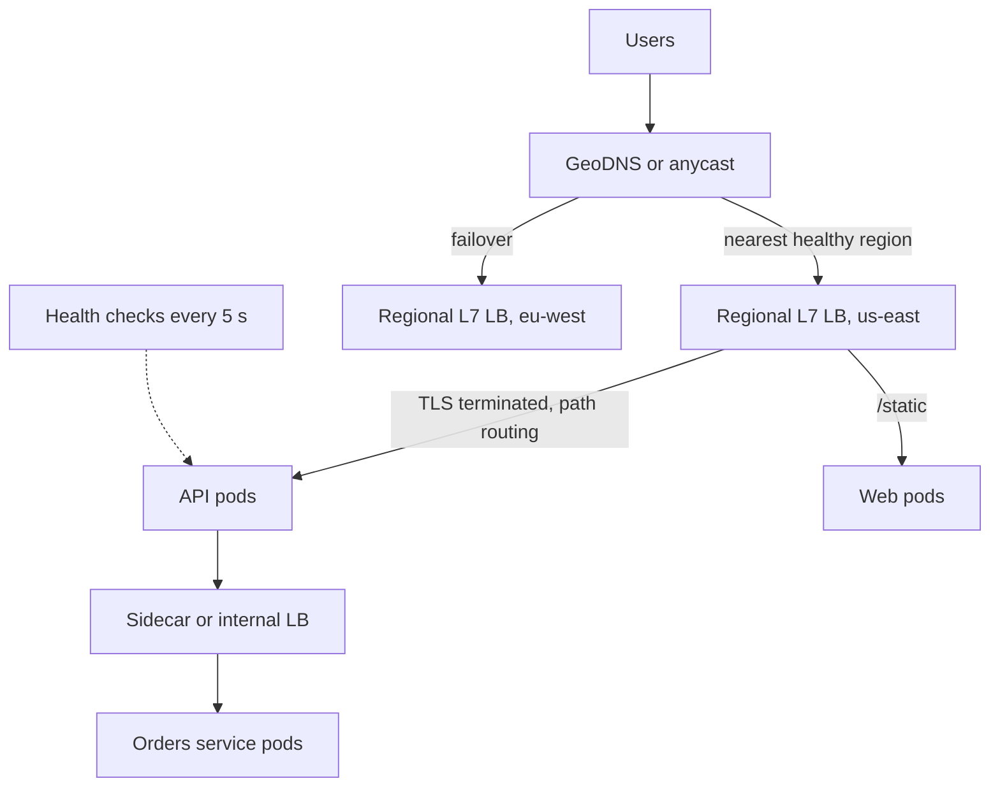

The moment you run more than one instance of a service, something has to decide which instance gets each request, notice when one is sick, and hide all of that from clients. That is a load balancer. Usually it is also a reverse proxy: it terminates client connections, speaks to backends on your behalf, and becomes the natural place for TLS, compression, retries and routing. Getting it right is what lets you scale horizontally, deploy without downtime and survive instance failures without users noticing.

## How it works

A typical public application layers several balancers: global routing picks a region, a regional L4 or L7 balancer picks a cluster or instance, and inside the cluster a proxy or mesh spreads service-to-service calls.



## L4 vs L7

**Layer 4** balancers work on TCP or UDP connections. They pick a backend when a connection opens and then shuttle bytes, without reading HTTP. They are extremely fast (millions of connections, microseconds of added latency), protocol-agnostic and preserve end-to-end TLS if you want. But they balance connections, not requests: one HTTP/2 or gRPC client with a single long-lived connection lands on one backend forever.

**Layer 7** balancers parse HTTP. They can route by host, path or header, terminate TLS, add headers like `X-Forwarded-For`, retry idempotent requests, rewrite URLs, enforce rate limits, and balance each request independently, which is essential for gRPC and HTTP/2. The cost is more CPU per request and a millisecond or so of latency.

| Use L4 when | Use L7 when |
| --- | --- |
| Non-HTTP protocols (databases, MQTT, custom TCP) | HTTP APIs and websites |
| Very high throughput, static IPs needed | Path or host-based routing |
| You want TLS passed through to the backend | Per-request balancing for gRPC or HTTP/2 |
| Simple fronting of a fleet of L7 proxies | Auth, rate limits, retries, observability |

## Balancing algorithms

| Algorithm | How | Good for | Weakness |
| --- | --- | --- | --- |
| Round robin | Next backend in order | Uniform requests, uniform servers | Ignores current load |
| Weighted round robin | Proportional to weights | Mixed instance sizes, canaries at 5 percent | Static weights |
| Least connections | Backend with fewest open connections | Varying request durations, long-lived connections | Needs shared view across LB nodes |
| Least response time / EWMA | Lowest recent latency, smoothed | Heterogeneous or noisy backends | Can herd onto a newly fast node |
| Power of two choices | Pick two at random, send to less loaded | Large fleets, many LB nodes | Slightly less optimal than full scan |
| Consistent hashing | Hash a key (user ID, cache key) to a ring | Cache affinity, sharded stateful backends | Hot keys overload one node |

**Power of two choices** deserves attention. Picking the least-loaded of all backends from many independent balancer nodes causes herding: they all see the same "best" node and stampede it. Picking two at random and taking the better one needs only local information and gives load spread that is exponentially better than pure random. Envoy's `LEAST_REQUEST` uses this by default, and Nginx offers `random two least_conn`.

**Consistent hashing** keeps the same key on the same backend while minimizing remapping when nodes join or leave: adding one node to 10 moves about one tenth of keys instead of nearly all of them. Use virtual nodes (100 or more per server) for even spread, and bounded-load variants to cap how far over average any node can go.

## Health checks

Balancers should send traffic only to instances that can serve it. **Active** checks poll an endpoint, for example `GET /healthz` every 5 seconds, marking a node unhealthy after 2 to 3 failures and healthy after 2 to 3 successes. **Passive** checks (outlier detection) eject a node that returns a run of 5xx errors or timeouts on real traffic.

Separate liveness from readiness. Liveness asks "is the process stuck?" and should be trivial. Readiness asks "should I receive traffic?" and can include warm-up state. Do not make readiness depend on a shared database: if the database blips, every instance fails its check at once and the balancer removes the whole fleet, turning a slowdown into a total outage. Many balancers have a "fail open" mode that keeps sending traffic when all backends look unhealthy, for exactly this reason.

## Sticky sessions and why to avoid them

Session affinity pins a client to one backend via a cookie or IP hash, usually because session state lives in server memory. It causes uneven load (one heavy user pins one node), loses sessions when that node dies or deploys, and makes autoscaling slow because new nodes get no existing clients. Move session state to a shared store such as Redis or into a signed token, and keep servers stateless. Legitimate uses of affinity are narrow: WebSocket connections are naturally sticky for their lifetime, and consistent hashing for cache locality is affinity by key rather than by session.

## TLS termination

Terminating TLS at the balancer centralizes certificates (with automated renewal via ACM or Let's Encrypt), offloads handshake CPU from app servers, and lets the L7 layer inspect requests. Traffic from the balancer to backends travels inside your VPC; re-encrypt it (TLS or mTLS to backends) if compliance or zero-trust policy demands, which service meshes make automatic. TLS passthrough at L4 keeps encryption end to end but forgoes L7 features.

## Connection draining

When an instance is removed for a deploy or scale-in, the balancer should stop sending new requests but let in-flight requests finish, within a deregistration delay such as 30 seconds (AWS default is 300). The app should handle `SIGTERM` by failing readiness, waiting for the balancer to notice, finishing work, then exiting.

```js
process.on('SIGTERM', () => {
  ready = false;                     // readiness now returns 503
  setTimeout(() => server.close(() => process.exit(0)), 10_000);
});
```

Long-lived WebSocket connections need explicit handling: send clients a reconnect message and close gradually rather than all at once.

## Global load balancing

To route users to the closest healthy region:

- **GeoDNS or latency-based DNS** (Route 53, Cloudflare, NS1) returns different IPs by resolver location and health. Simple, but failover speed is bounded by DNS TTLs and resolver caching, often a minute or more.
- **Anycast** announces the same IP from many locations via BGP; the internet routes each user to the nearest point of presence. Failover is a routing change, measured in seconds. Cloudflare, Google Cloud's global load balancer and AWS Global Accelerator use it.

Both need health signals per region and enough spare capacity in surviving regions to absorb a failed region's traffic.

## The load balancer as a single point of failure

A balancer in front of everything must itself be redundant. Self-managed setups run an **HA pair**: two HAProxy or Nginx nodes sharing a virtual IP via VRRP (keepalived), where the standby takes over the IP within a few seconds. Larger deployments run N active nodes behind ECMP routing or an L4 tier. Managed balancers like AWS ALB and NLB are already spread across availability zones; your job is to enable multiple zones and register targets in each.

## Managed and self-hosted options

| Option | Layer | Notes |
| --- | --- | --- |
| AWS ALB | L7 | Path and host routing, gRPC, WebSockets, WAF integration |
| AWS NLB | L4 | Static IPs, millions of requests per second, TLS passthrough or termination |
| Cloudflare, Fastly, Akamai | L7 at edge | Anycast, CDN, DDoS protection, global load balancing |
| Nginx | L7 and L4 | Ubiquitous reverse proxy, simple config |
| HAProxy | L4 and L7 | Very fast, rich health checks and stats |
| Envoy | L7 and L4 | Dynamic config via xDS, gRPC-native, basis of most meshes |

## Reverse proxy vs API gateway vs service mesh

A **reverse proxy** forwards client requests to backends and handles TLS, caching, compression and routing. An **API gateway** is a reverse proxy specialised for APIs, adding authentication, API keys, rate limiting per consumer, request validation and developer-facing concerns, sitting at the edge for north-south traffic. A **service mesh** (Istio, Linkerd) puts a proxy beside every service instance to handle east-west traffic: mTLS, retries, timeouts, load balancing and telemetry, configured centrally. Most systems use a gateway at the edge and add a mesh only when the number of services makes per-service libraries painful.

## Trade-offs and pitfalls

- **L4 with gRPC** sends all of a client's requests to one pod; use L7 or client-side balancing.
- **Deep health checks** that touch shared dependencies can eject the whole fleet.
- **Sticky sessions** hide statefulness that will bite at deploy and failover time.
- **Idle timeout mismatches**: backend keep-alive must exceed the balancer's idle timeout, or the balancer reuses closed sockets and returns 502s.
- **Retries at the balancer and in clients** multiply load; pick one layer.
- **DNS failover** is only as fast as the TTL clients actually honour.

## Interview angle

- Draw the layers: global routing, regional L7, internal balancing.
- Pick an algorithm and justify it: least request with power of two choices by default, consistent hashing for cache affinity.
- Explain health checks, draining and why servers should be stateless instead of sticky.
- Say how the balancer itself avoids being a single point of failure.

## Key takeaways

- L4 balances connections; L7 balances requests and adds routing and visibility.
- Power of two choices beats both round robin and global least-loaded at scale.
- Shallow readiness checks plus passive outlier detection keep healthy nodes in rotation.
- Keep servers stateless and drain gracefully so deploys are invisible.
- Use anycast or GeoDNS for regions, and make every balancer tier redundant.
