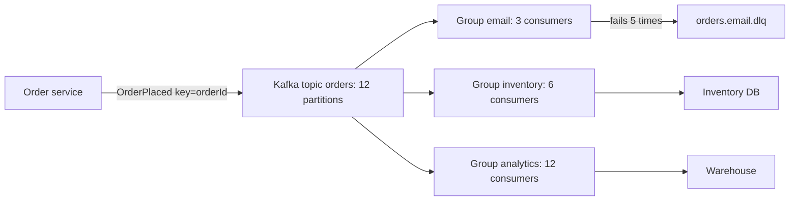

Asynchronous messaging lets the API accept an order in 50 ms while emails, invoices, inventory and analytics happen behind a broker. That decoupling absorbs spikes, isolates failures and lets teams add consumers without touching producers. It also introduces duplicates, reordering, poison messages, lag, and a new piece of infrastructure to run. Using it well means picking the right kind of broker and designing consumers that assume every message may arrive more than once.

## Queue vs log

A **queue** (RabbitMQ, SQS) distributes messages to competing consumers. Each message is delivered to one consumer, acknowledged, and then deleted. It is a work list: send email, resize image, charge card.

A **log** or **stream** (Kafka, Kinesis, Redis Streams, Pulsar) appends messages to an ordered, durable, partitioned log. Consumers track their own position (offset) and messages stay until retention expires, regardless of who read them. Many independent consumer groups can read the same events, and any of them can rewind and replay. It is a record of facts: order placed, payment captured.

Use a queue when you want tasks done once by whichever worker is free. Use a log when several systems need the same events, order matters per key, or you want replay.



## Comparing the common options

| | RabbitMQ | Kafka | SQS / SNS | Redis Streams | NATS JetStream |
| --- | --- | --- | --- | --- | --- |
| Model | Queue with exchanges and routing | Partitioned log | Queue (SQS), pub/sub fan-out (SNS) | Log in memory with consumer groups | Subjects with optional persisted streams |
| Throughput | Tens of thousands msg/s per node | Millions msg/s per cluster | Practically unlimited (standard), 300 to 70,000 msg/s for FIFO depending on batching and high-throughput mode | Hundreds of thousands msg/s, memory bound | Millions msg/s core, lower with persistence |
| Ordering | Per queue, single consumer | Per partition | FIFO queues per message group | Per stream | Per stream or subject |
| Retention and replay | Until acked (streams feature adds replay) | Time or size based, days to forever | Up to 14 days, no replay after delete | Capped by memory or `MAXLEN` | Configurable, replay supported |
| Operations | Moderate | Heavy self-hosted; MSK, Confluent Cloud ease it | None, fully managed | Low if you already run Redis | Low, single binary |
| Best for | Task queues, complex routing, RPC | Event streaming, CDC, many consumers | AWS apps, simple job queues and fan-out | Lightweight streams inside an existing Redis | Low-latency messaging, edge and IoT |

A sound default: SQS (plus SNS for fan-out) on AWS for jobs, Kafka (managed) when you need an event backbone with multiple consumers and replay, RabbitMQ when routing rules are rich or you are not on a cloud queue.

## Delivery semantics

- **At-most-once**: acknowledge before processing. Fast, but a crash loses the message. Acceptable for metrics sampling.
- **At-least-once**: acknowledge after processing. A crash after processing but before the ack causes redelivery. This is the default everywhere and what you should design for.
- **Exactly-once**: not achievable end to end over a network in general. Kafka offers exactly-once semantics within Kafka (idempotent producers plus transactions for read-process-write between topics), but any external side effect, such as a database write or an email, needs its own deduplication.

What you build is **effectively-once**: at-least-once delivery plus idempotent consumers. Store processed message IDs with a unique constraint in the same transaction as the side effect, or make the operation naturally idempotent (upsert by order ID, `SET status = 'paid' WHERE status = 'pending'`).

```sql
INSERT INTO processed_messages (message_id) VALUES ($1)
ON CONFLICT DO NOTHING RETURNING message_id;
-- no row returned: already handled, skip and ack
```

## Ordering and partitions

Kafka guarantees order only within a partition. The producer's message key chooses the partition (`hash(key) mod partitions`), so all events for `orderId=123` land in one partition, in order. There is no global order across partitions, and you rarely need one. Pick the key as the entity whose events must be ordered: order ID, account ID, device ID.

Ordering breaks in subtle ways: producer retries can reorder unless idempotence is enabled (`enable.idempotence=true`, default since Kafka 3.0); adding partitions changes key-to-partition mapping for future messages; and consumers that process a partition's messages in parallel threads lose order unless they parallelise by key. SQS standard queues offer best-effort ordering only; use FIFO queues with a `MessageGroupId` when order matters.

## Consumer groups

In Kafka, each consumer group gets every message; within a group, each partition is assigned to exactly one consumer. So the partition count caps parallelism: 12 partitions means at most 12 active consumers per group. Adding or removing consumers triggers a rebalance; use cooperative sticky assignment and static membership to keep rebalances from stalling processing. In SQS and RabbitMQ, consumers simply compete for messages, so you can scale workers freely, at the cost of ordering.

## Retries and dead-letter queues

Consumers fail for two reasons: transient (a dependency timed out) and permanent (malformed payload, a bug). Retry transient failures with backoff; send messages that keep failing to a **dead-letter queue** so one poison message does not block everything.

- SQS: set a redrive policy with `maxReceiveCount` (for example 5) and a visibility timeout longer than your processing time.
- RabbitMQ: dead-letter exchanges, with per-message TTL for delayed retries.
- Kafka: no built-in redelivery. A failing message blocks its partition, so the common pattern is retry topics with increasing delays (`orders.retry.1m`, `orders.retry.10m`) and finally a DLQ topic.

Alert on DLQ depth, include the error and original metadata with each dead letter, and build a redrive tool. A DLQ nobody watches is a silent data loss bin.

## Back-pressure

If producers outpace consumers indefinitely, the backlog grows without bound. Monitor **consumer lag** (Kafka offset lag, SQS `ApproximateAgeOfOldestMessage`) and autoscale consumers on it, for example with KEDA. Cap in-flight work per consumer (Kafka `max.poll.records`, RabbitMQ `prefetch` of 10 to 100) so a consumer does not pull more than it can handle. When downstream systems are the bottleneck, scaling consumers just moves the overload; rate limit the consumers and let the queue hold the backlog. Alert on age, such as oldest message over 5 minutes.

## Retention and replay

Kafka retention is per topic, commonly 7 days; log compaction keeps only the latest message per key, which suits changelog topics. Replay lets you backfill a new consumer or recover from a bug by resetting offsets to a timestamp, provided consumers are idempotent. Tiered storage moves old segments to object storage for long history.

## Schema evolution

Messages outlive the code that wrote them, especially with replay. Treat schemas as contracts:

- Use Avro, Protobuf or JSON Schema with a **schema registry** (Confluent, Apicurio, AWS Glue) that rejects incompatible changes at publish time.
- Prefer backward-compatible changes: add optional fields with defaults; never reuse or change a field's type or Protobuf field number.
- Set the registry's compatibility mode (`BACKWARD` is common) so new consumers can read old messages.
- For breaking changes, publish to a new topic version (`orders.v2`) and migrate consumers.

Include an event ID, type, version, timestamp and producer in every envelope.

## Sizing partitions

Estimate required throughput and per-consumer throughput. If peak is 30,000 messages per second and one consumer processes 2,000 per second, you need at least 15 consumers, so at least 15 partitions; round up to 24 or 30 for growth, since increasing partitions later reshuffles keys. Each partition handles roughly 10 MB/s of writes comfortably. Avoid thousands of tiny partitions: they increase memory, file handles, and failover time. Replication factor 3 with `min.insync.replicas=2` and `acks=all` is the standard durability setting.

## When not to add a queue

- The caller needs the result now, such as checking a password or reading a balance. A queue just adds latency and failure modes.
- Volume is low and a database table polled with `SELECT ... FOR UPDATE SKIP LOCKED` would do. Postgres job queues (pg-boss, Graphile Worker, Oban, Solid Queue) handle thousands of jobs per second with transactional enqueueing for free.
- The team cannot yet operate it; a managed queue or the database is a better first step.

## Trade-offs and pitfalls

- **Assuming exactly-once** and writing non-idempotent consumers causes double charges and duplicate emails.
- **Dual writes** (commit to the DB, then publish) lose events on crash; use the transactional outbox.
- **Poor partition keys** create hot partitions or break required ordering.
- **No DLQ** means one poison message stalls a partition or loops forever.
- **Breaking schema changes** crash consumers, especially during replay.

## Interview angle

- Say whether you need a queue (tasks) or a log (events, fan-out, replay).
- State at-least-once delivery with idempotent consumers.
- Key partitions by the ordering requirement; cover DLQs, lag autoscaling and the outbox.

## Key takeaways

- Queues distribute tasks; logs retain ordered events for many consumers and replay.
- Design for at-least-once delivery with idempotent consumers to get effectively-once results.
- Order exists only per partition or message group; key by the entity that needs ordering.
- Retries with backoff, a watched DLQ and lag monitoring keep failures contained.
- Version schemas with a registry, and skip the queue entirely when a synchronous call or a database job table suffices.
