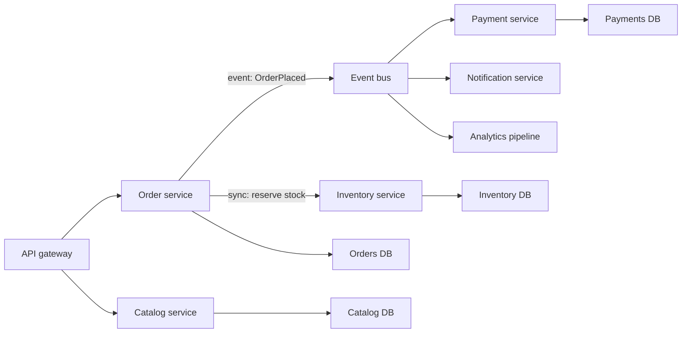

The monolith versus microservices question is mostly about people, not technology. A single deployable unit is the fastest way for a small team to build and change software. Many independently deployable services let many teams ship without waiting for each other, at the price of distributed-systems problems that never existed in-process. Teams get into trouble when they adopt microservices for the benefits large organizations report without having the team size, domain clarity or platform to pay for them. This guide lays out the options, how to tell when to split, how to split well, and what it actually costs.

## The options

| Style | Unit of deployment | Strengths | Costs |
|-------|-------------------|-----------|-------|
| Monolith | One app, one database | Simple dev, debug, deploy; in-process calls; ACID transactions everywhere | Coupling grows without discipline; one deploy pipeline for everyone; scales as one unit |
| Modular monolith | One app with enforced internal modules | Monolith simplicity plus clear boundaries; cheap to split later | Requires boundary enforcement tooling and discipline |
| Microservices | Many services, each with its own data | Independent deploy and scaling per team; fault and tech isolation | Network calls, eventual consistency, observability and platform overhead |
| Serverless functions | Function per endpoint or event | No servers, scale to zero, pay per use | Cold starts, vendor limits, hard local testing, sprawl of tiny units |

A **modular monolith** deserves more attention than it gets. One repository and one deployable, but code is organized into modules such as `billing`, `catalog`, `orders`, each with a public interface and private internals. Modules do not read each other's tables. Tools like ArchUnit for Java, Nx or dependency-cruiser module boundary rules for TypeScript, or Packwerk for Rails fail the build when someone crosses a boundary. Shopify runs one of the largest Rails codebases this way. If a module later needs to be a service, its interface and data are already separated.

## When to split

Split a service out when you can name a concrete pressure. Common good reasons:

- **Team scale.** Once more than roughly 25 to 50 engineers work in one codebase, merge conflicts, coordinated releases and unclear ownership slow everyone. Services let a team of 5 to 9 own something end to end.
- **Deploy independence.** One part changes daily while another is regulated and changes quarterly, or a risky area keeps blocking everyone's release.
- **Different scaling or resource profiles.** Video transcoding needs GPUs and bursts; the CRUD API needs steady small instances. Scaling them together wastes money.
- **Fault isolation.** A memory-hungry report generator should not take down checkout.
- **Different technology needs.** An ML inference path in Python next to a Go API.

Bad reasons: "it is modern", "Netflix does it", "we want to try Kubernetes", or a five-person startup expecting to need it later. A useful heuristic is no more services than teams, and early on, one.

## Finding boundaries with bounded contexts

The hardest part is drawing the lines. Domain-Driven Design gives the best tool: the **bounded context**, a part of the domain where a model and its language are consistent. "Product" means different things to the catalog team (description, images, attributes), the inventory team (SKU, warehouse quantity) and the pricing team (base price, discounts). Forcing one shared `Product` entity across them creates coupling; letting each context have its own model, linked by ID, removes it.

Signals of a good boundary:

- Most changes for a feature land inside one context.
- The context can do its main job when others are down, perhaps degraded.
- It owns a business capability (payments, search, notifications), not a technical layer (a "database service" or "validation service").
- Interactions with other contexts are few and coarse, like "order placed", not chatty.

Run an event storming session: lay out domain events on a timeline ("Order placed", "Payment captured", "Shipment dispatched"), then cluster them by who cares and what language they use. The clusters are candidate contexts.

## Database per service and data ownership

Each service owns its data store, and no other service reads or writes it directly. This is the rule that makes independent deployment real: if three services query the `orders` table, nobody can change its schema without coordinating three teams.

Consequences you must design for:

- **No cross-service joins.** The order service stores `customer_id`, not customer details. To show a customer name, call the customer service, or keep a local read-only copy updated from events.
- **No distributed ACID transactions.** A workflow spanning services uses a saga: a sequence of local transactions with compensations, coordinated by events or an orchestrator, with an outbox so state changes and events are published atomically.
- **Reporting** needs a separate pipeline: CDC from each service into a warehouse.
- Services can share a database server for cost, as long as each has its own schema and credentials.

## Inter-service communication and the distributed monolith

Synchronous calls (REST, gRPC) are simple and fit queries that need an answer now. Asynchronous messaging (Kafka, SQS, RabbitMQ) fits notifications of facts and work that can happen later, and decouples availability.

Synchronous chains multiply failure: if a request crosses five services each at 99.9 percent availability, the chain is about 99.5 percent, and latencies add. Keep synchronous call depth to one or two hops for user-facing requests, with timeouts and circuit breakers on each.

The **distributed monolith** is the common failure mode: services that must be deployed together, share a database, call each other synchronously in long chains, or share a domain library that forces lockstep upgrades. You get every cost of microservices and none of the independence. Symptoms: a release train coordinating ten services, a schema change requiring four PRs, an outage in one service taking down all of them. The fix is usually merging services that change together and replacing chatty sync calls with events or local data copies.

## Migration with the strangler fig

Big-bang rewrites fail far more often than they succeed. The strangler fig pattern migrates incrementally:

1. Put a routing layer (API gateway, reverse proxy, or the monolith's own router) in front of the monolith.
2. Pick one capability with a clear boundary and real pressure, such as notifications or search.
3. Build it as a service. Sync its data from the monolith via CDC or events, or move ownership of its tables.
4. Route a small percentage of traffic to it, compare results (shadow traffic or parallel runs), then shift fully.
5. Delete the old code path in the monolith. Repeat.

Extract the edges first: capabilities with few inbound dependencies. Leave the tangled core for last, and often, after modularizing it in place, leave it as a modular monolith permanently.

## Operational cost

Microservices move complexity from code into operations. Budget for:

- **Observability**: distributed tracing (OpenTelemetry) is mandatory, because a slow request now spans many processes. Centralized logs with correlation IDs, per-service dashboards and SLOs.
- **CI/CD per service**: independent pipelines, contract tests between consumers and providers (for example Pact), and progressive delivery with canaries.
- **Infrastructure**: service discovery, a gateway, mTLS or a service mesh, secrets management, and usually Kubernetes or ECS.
- **A platform team**: organizations that succeed with dozens of services typically dedicate 10 to 20 percent of engineers to a platform team that provides paved paths, templates and shared tooling.
- **On-call**: every service needs an owner who answers pages.

A rough rule: below about 3 teams, this overhead exceeds the benefit. Above about 10 teams, the coordination cost of a single deployable usually exceeds it.

## Recommendation for most teams

Start with a modular monolith on a single relational database, deployed by one pipeline, with enforced module boundaries and modules that do not share tables. Use a queue for background work from day one. Extract a service only when a specific module has a measured reason: a separate team, a different scaling profile, or a deploy cadence conflict. Use serverless for event glue and spiky jobs (image resizing, webhooks, scheduled tasks), not as the core architecture. This path keeps options open: good module boundaries make later extraction cheap, while premature services are very expensive to merge back.

## Trade-offs and pitfalls

- **Splitting by technical layer** (UI service, logic service, data service) creates chatty coupling.
- **Shared databases** between services undo deploy independence.
- **Too many tiny services**: more services than engineers is a warning sign.
- **Long synchronous chains** multiply latency and failure.
- **No tracing** makes production debugging nearly impossible.
- **Big-bang rewrites** stall feature work for a year and often get abandoned.

## Interview angle

- Ask about team size and growth before choosing an architecture.
- Propose a modular monolith first and state the triggers for extraction.
- Use bounded contexts to justify each service boundary.
- Enforce database per service and explain sagas for cross-service workflows.
- Name the distributed monolith anti-pattern and how you would avoid it.

## Key takeaways

- Architecture follows team structure; microservices solve organizational scaling first.
- A modular monolith gives clear boundaries without network costs.
- Draw boundaries along business capabilities and bounded contexts, with data owned per service.
- Prefer async events between services and keep sync chains short.
- Migrate incrementally with the strangler fig, and budget for a platform and observability.
