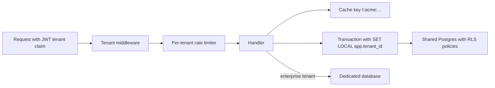

A SaaS product serves many customers, called tenants, from one codebase and usually shared infrastructure. The central question is where the walls go and how you guarantee tenant A never sees tenant B's data. The worst multi-tenancy bug is one missing `WHERE tenant_id = $1` that leaks a customer's invoices to a competitor. A sound design picks an isolation model that fits the business, enforces scoping in a layer developers cannot forget, and stops one large tenant from degrading everyone else.

## How it works

Each request is resolved to a tenant at the edge from a subdomain, JWT claim or API key, and that ID travels into every data access, cache key, queue message and log line. The isolation model decides what the tenant ID selects: a set of rows, a schema, or an entire database.



## Choosing an isolation model

| Model | Isolation | Cost per tenant | Ops effort | Good for |
| --- | --- | --- | --- | --- |
| Shared tables with `tenant_id` | Logical, enforced by code or RLS | Lowest | Low: one schema, one migration | Thousands to millions of small tenants |
| Schema per tenant | Namespace-level | Low to medium | Medium: migrate N schemas | Tens to low thousands of tenants |
| Database per tenant | Physical | Highest | High: N databases, backups, connections | Enterprise, regulated, data residency |

**Shared tables** are the default for B2B SaaS. Add `tenant_id` to every tenant-owned table and lead composite indexes and unique constraints with it (`UNIQUE (tenant_id, email)`). Citus can later distribute tables by `tenant_id` so a tenant's rows co-locate on one node.

**Schema per tenant** gives each tenant its own Postgres schema and uses `search_path`. Isolation is clearer and per-tenant restore is easier, but Postgres catalogs bloat with tens of thousands of schemas times dozens of tables, and every migration runs N times.

**Database per tenant** gives the strongest isolation and per-tenant backups, keys and regions, but connection pools multiply and fleet-wide changes need tooling. Many products are hybrid: shared tables for the long tail, dedicated databases for large or regulated customers, and a catalog mapping tenant ID to location.

## PostgreSQL row-level security

Row-level security (RLS) moves the tenant filter into the database, so a forgotten clause returns no rows instead of everyone's.

```sql
ALTER TABLE invoices ENABLE ROW LEVEL SECURITY;
ALTER TABLE invoices FORCE ROW LEVEL SECURITY;  -- apply to the table owner too

CREATE POLICY tenant_isolation ON invoices
  USING (tenant_id = current_setting('app.tenant_id')::uuid)
  WITH CHECK (tenant_id = current_setting('app.tenant_id')::uuid);
```

`USING` filters reads, updates and deletes; `WITH CHECK` rejects inserts or updates that would write another tenant's ID. Superusers and roles with `BYPASSRLS` skip policies entirely, so the application must connect as an ordinary role. If `app.tenant_id` is unset, `current_setting` raises an error, which is the safe failure; `current_setting('app.tenant_id', true)` returns NULL instead, which also matches nothing.

### The pooling gotcha

A plain `SET app.tenant_id = 'acme'` lasts for the whole session. Pools reuse connections, so the next request inherits the previous tenant if your code forgets to set it. In PgBouncer **transaction mode** it is worse: consecutive autocommit statements can land on different server connections, so the `SET` may not apply to your next query and instead leaks into another client's.

The fix is to scope the setting to a transaction with `SET LOCAL` (or `set_config(..., true)`, which is parameterisable), so it resets at `COMMIT` or `ROLLBACK` and travels with the transaction through any pooler:

```js
async function withTenant(tenantId, fn) {
  const client = await pool.connect();
  try {
    await client.query('BEGIN');
    await client.query("SELECT set_config('app.tenant_id', $1, true)", [tenantId]);
    const result = await fn(client);
    await client.query('COMMIT');
    return result;
  } catch (e) {
    await client.query('ROLLBACK');
    throw e;
  } finally {
    client.release();
  }
}

const invoices = await withTenant(req.tenantId, (c) =>
  c.query('SELECT id, total FROM invoices ORDER BY created_at DESC LIMIT 50')
);
```

Keep explicit `tenant_id` predicates in queries anyway. RLS is the safety net: the explicit parameter keeps intent visible in review and gives the planner a plain value for your `(tenant_id, ...)` indexes and partitions.

## MongoDB tenant scoping

MongoDB has no RLS, so scoping lives in the application. Put `tenantId` on every document, make it the first field in compound indexes such as `{ tenantId: 1, createdAt: -1 }`, and never let handlers build queries without it. A small repository wrapper or a Mongoose plugin that injects it into every query is the usual guard:

```js
function tenantPlugin(schema) {
  schema.add({ tenantId: { type: String, required: true, index: true } });
  const scope = function () {
    const tenantId = als.getStore()?.tenantId; // AsyncLocalStorage set by middleware
    if (!tenantId) throw new Error('tenant context missing');
    this.where({ tenantId });
  };
  schema.pre(['find', 'findOne', 'countDocuments', 'updateOne', 'updateMany', 'deleteOne', 'deleteMany', 'findOneAndUpdate'], scope);
}
```

Aggregations and `insertMany` bypass query middleware, so they need an explicit `$match` or `tenantId`. When sharding, `{ tenantId: 1, _id: 1 }` keeps a tenant's data together while letting large tenants split across chunks. Database-per-tenant works too, but every collection and index adds files and memory, so it does not scale to thousands of tenants per cluster.

## Noisy neighbours and per-tenant limits

One tenant running a giant export can saturate CPU, connections or I/O for everyone. Defences:

- **Per-tenant rate limits** keyed on tenant ID, not IP, for example a Redis token bucket at `rl:{tenantId}` with limits by plan (100 requests per second on standard, 1,000 on enterprise).
- **Per-tenant concurrency caps** on expensive endpoints and background jobs, such as BullMQ group limits or one queue per tier.
- **Statement timeouts** (`SET LOCAL statement_timeout = '5s'`) so a pathological query cannot run for minutes.
- **Per-tenant metrics** for request rate, DB time and storage, to spot the neighbour and move it to a dedicated shard.

## Tenant-aware caching

Every cache key must include the tenant: `t:{tenantId}:invoice:{id}`, never `invoice:{id}`. Mark tenant responses `Cache-Control: private` or add the tenant to the CDN cache key. Namespacing also makes purging one tenant's cache cheap.

## Migrations, export and deletion

With shared tables, one migration covers everyone but runs against the largest tables in the product, so zero-downtime techniques matter. With schema or database per tenant, a job iterates tenants with bounded concurrency and records each tenant's schema version, and the app must work with both old and new schemas during rollout.

Plan export and deletion from day one; GDPR and enterprise contracts demand both. A `tenant_id` column with a foreign key to `tenants` on every owned table makes it mechanical to stream a tenant's data to an archive and delete it in batches of a few thousand rows. Remember object storage prefixes, search indexes, caches, warehouses and backups, where deletion usually means expiry within a documented retention window. Database-per-tenant makes deletion a single `DROP DATABASE`, which is one of its strongest selling points.

## Trade-offs and pitfalls

- **Forgotten tenant filter** in a raw query, report or background job is the classic leak; RLS or a mandatory wrapper prevents it.
- **Session-level `SET`** with pooling leaks tenant context; use `SET LOCAL` inside a transaction.
- **App connecting as superuser or table owner** without `FORCE ROW LEVEL SECURITY` silently bypasses policies.
- **Global unique constraints** (`UNIQUE (email)`) block two tenants from having the same user; scope them by tenant.
- **Schema-per-tenant** looks clean at 50 tenants and hurts at 50,000.

## Interview angle

- State the three isolation models with their cost and isolation trade-offs, and propose a hybrid.
- Explain how the tenant is resolved and propagated through every layer.
- Show RLS policies and the `SET LOCAL` fix for connection pooling.
- Cover noisy neighbours, tenant-scoped cache keys and deletion.

## Key takeaways

- Shared tables with `tenant_id` scale furthest; dedicated databases buy isolation at operational cost.
- Enforce scoping below the application code: Postgres RLS, or a mandatory query wrapper in MongoDB.
- Set tenant context per transaction with `SET LOCAL` or `set_config(..., true)`, never per session behind a pooler.
- Include the tenant in index prefixes, rate-limit keys and cache keys.
- Design tenant export and deletion up front, including stores outside the main database.
