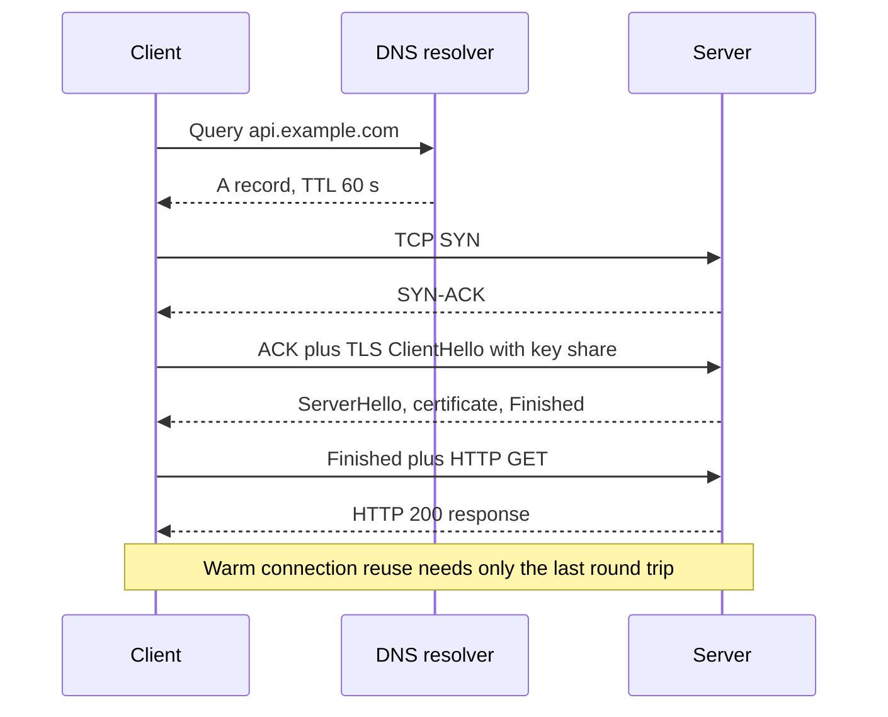

Most latency in a web system is not spent computing; it is spent waiting on the network. A request from a phone in Mumbai to a server in Virginia pays roughly 200 ms per round trip before your code runs, and a cold connection needs several round trips just to start. You do not need to know packet formats to design well, but you do need to know what each layer costs, where connections are set up, and which numbers dominate. This guide covers the parts that change design decisions.

## TCP vs UDP

**TCP** gives you a reliable, ordered byte stream with flow and congestion control. It costs a three-way handshake (one round trip) before data flows, and it suffers **head-of-line blocking**: one lost packet stalls every byte behind it until retransmission. New connections also start slowly; congestion control's slow start begins with about 10 segments (roughly 14 KB) and grows each round trip, so short-lived connections never reach full speed.

**UDP** sends independent datagrams with no handshake, ordering or retransmission. It suits workloads where late data is useless: voice, video calls, game state, DNS queries. It is also the base for QUIC, which rebuilds reliability in user space.

For almost all application-to-application traffic you will use TCP or QUIC through a higher protocol. The design lesson is to reuse connections rather than pay setup repeatedly.

## The cost of a new connection

A fresh HTTPS request over TCP and TLS 1.3 needs: DNS lookup (0 to 1 RTT, often cached), TCP handshake (1 RTT), TLS handshake (1 RTT), then the request (1 RTT). That is 3 round trips before the first response byte, versus 1 on a warm connection.



| Setup | Round trips before first byte |
| --- | --- |
| TCP + TLS 1.2 | 3 RTT plus request (4 total) |
| TCP + TLS 1.3 | 2 RTT plus request (3 total) |
| TCP + TLS 1.3 resumption with 0-RTT | 1 RTT (data sent with handshake) |
| QUIC (HTTP/3), new | 1 RTT plus request (2 total) |
| QUIC with 0-RTT resumption | Request with first packet |
| Reused keep-alive connection | Request only (1 total) |

At 150 ms RTT, a cold TLS 1.3 connection costs 450 ms where a reused one costs 150 ms. That is why CDNs and edge proxies terminate TLS close to users: the handshake round trips are 10 ms to the edge instead of 150 ms to origin, and the edge keeps warm connections back to origin.

**0-RTT** data can be replayed by an attacker, so only allow it for idempotent requests such as GETs.

## HTTP/1.1, HTTP/2 and HTTP/3

| Version | Transport | Multiplexing | Head-of-line blocking | Notes |
| --- | --- | --- | --- | --- |
| HTTP/1.1 | TCP | No, one request at a time per connection | At HTTP level | Browsers open about 6 connections per host |
| HTTP/2 | TCP | Many streams on one connection | At TCP level on packet loss | Binary framing, HPACK header compression |
| HTTP/3 | QUIC over UDP | Independent streams | None across streams | Faster setup, connection migration across networks |

HTTP/2 fixed request queuing but kept TCP, so on lossy mobile networks one dropped packet still stalls all streams. HTTP/3 runs over QUIC, where loss on one stream does not block others, and a connection survives a phone switching from Wi-Fi to cellular because it is identified by a connection ID rather than the IP and port tuple.

Practical guidance: enable HTTP/2 and HTTP/3 at your CDN or edge for browsers and mobile apps. Inside the data centre, HTTP/1.1 with keep-alive or HTTP/2 (gRPC requires it) are both fine; loss is rare and RTT is under a millisecond.

## Keep-alive and connection pooling

Every client that calls another service should keep a pool of warm connections. Without it, each request pays handshakes, burns CPU on TLS, and leaves sockets in `TIME_WAIT`, which can exhaust ephemeral ports (about 28,000 by default on Linux) under high request rates.

```js
import { Agent, setGlobalDispatcher } from 'undici';
setGlobalDispatcher(new Agent({
  connections: 100,          // max sockets per origin
  keepAliveTimeout: 30_000,  // keep idle sockets 30 s
  pipelining: 1,
}));
```

Database connections matter even more: a Postgres connection is a process using several megabytes, and setup with TLS and authentication takes milliseconds. Use a pool per app instance (10 to 20 connections is typical) and a pooler like PgBouncer when you have hundreds of instances. Make idle timeouts consistent: if the load balancer closes idle connections after 60 seconds, the client's keep-alive timeout must be shorter, or requests will hit a socket the other side just closed and fail with a reset.

## DNS and TTLs

DNS maps names to addresses, and every resolver caches answers for the record's TTL. TTL is your failover speed dial: a 300-second TTL means some clients keep using an old IP for at least five minutes after you change it, and many clients and resolvers stretch TTLs further. Use 30 to 60 seconds for records you might fail over, longer for stable ones to reduce lookup latency. Lower the TTL a day before planned migrations. Remember that application runtimes may cache DNS themselves (the JVM historically cached indefinitely), which silently breaks failover.

## L4 vs L7

Layer 4 (transport) devices route by IP and port and forward TCP or UDP streams without understanding the content. They are fast, cheap and protocol-agnostic. Layer 7 (application) devices parse HTTP, so they can route by path or header, terminate TLS, retry, rewrite and observe requests, at the cost of more CPU and latency. AWS NLB is L4; ALB, Nginx and Envoy in HTTP mode are L7. A common split: L4 at the edge of a cluster for raw throughput, L7 where you need routing and visibility.

## Latency numbers to remember

| Path | Typical RTT |
| --- | --- |
| Same host, loopback | under 0.1 ms |
| Same availability zone | 0.1 to 0.5 ms |
| Across zones in one region | 0.5 to 2 ms |
| US East to US West | 60 to 75 ms |
| US East to Western Europe | 75 to 90 ms |
| US East to India or Singapore | 200 to 250 ms |
| Europe to Australia | 250 to 300 ms |

Light in fibre travels about 200 km per millisecond, so physics sets a floor: New York to London is 5,600 km, at least 56 ms round trip. Design consequences: a request that makes 10 sequential calls across regions is a second-long request; keep chatty calls inside one region and batch or parallelise the rest.

## Bandwidth vs latency

Latency is how long one bit takes; bandwidth is how many bits per second. For small API payloads, latency dominates: a 2 KB response takes the same 150 ms whether the link is 10 Mbps or 10 Gbps. For bulk transfer, bandwidth dominates: 1 TB over 1 Gbps takes about 2.2 hours. The bandwidth-delay product (bandwidth times RTT) is how much data must be in flight to fill a pipe; at 1 Gbps and 100 ms that is 12.5 MB, which needs large TCP windows. Also budget cost: cloud egress is commonly around 0.05 to 0.09 USD per GB to the internet, and cross-zone traffic is billed too.

## Private networking, VPCs and NAT

A VPC is your private address space in the cloud, typically a /16 such as 10.0.0.0/16 split into subnets per availability zone. Public subnets route to an internet gateway; private subnets hold databases and app servers with no inbound path from the internet. Instances in private subnets reach the internet through a **NAT gateway**, which translates many private addresses to one public one. NAT gateways charge per GB processed, so route heavy traffic to S3 or DynamoDB through VPC endpoints instead. Security groups act as stateful firewalls per instance; keep databases reachable only from the app tier's security group. Plan non-overlapping CIDR ranges early, because peering two VPCs that both use 10.0.0.0/16 is impossible without renumbering.

## Long-lived connections and their cost

WebSockets, SSE, gRPC streams and MQTT keep a TCP connection open for minutes or hours. Each one costs memory (tens of KB per connection with buffers, more with TLS), a file descriptor, and state in every load balancer and NAT on the path. A server with 64 GB can hold hundreds of thousands of idle connections if tuned, but deploys become harder: restarting a node drops all its clients at once, and they reconnect together. Plan for heartbeats every 20 to 30 seconds so NATs and load balancers with 60-second idle timeouts do not silently drop connections, reconnect with jittered backoff, and drain connections gradually during deploys.

## Trade-offs and pitfalls

- **Creating a new client or connection per request** multiplies latency and exhausts ports.
- **Mismatched idle timeouts** between client, load balancer and server cause sporadic connection resets.
- **High DNS TTLs** turn failover into a long partial outage.
- **Ignoring RTT in call chains**: sequential cross-region calls add up fast.
- **NAT gateway bills** from pulling container images or S3 data through NAT instead of endpoints.
- **0-RTT on non-idempotent requests** allows replay.

## Interview angle

- Count round trips: DNS, TCP, TLS, request, and how reuse or QUIC removes them.
- Explain why HTTP/2 still has head-of-line blocking and how HTTP/3 fixes it.
- Quote rough cross-region RTTs and use them to justify region placement and edge termination.
- Distinguish L4 and L7 and say when you need each.

## Key takeaways

- Round trips, not bandwidth, dominate latency for typical API calls.
- Reuse connections everywhere and size pools deliberately.
- Terminate TLS near users and keep warm connections to origin.
- DNS TTLs determine how fast you can move traffic.
- Long-lived connections are cheap per connection but expensive in operations; plan heartbeats and draining.
