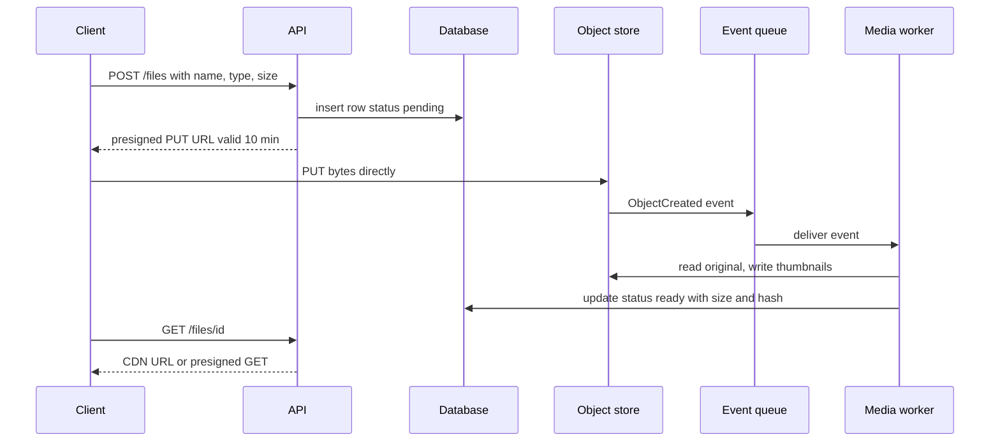

Almost every real application stores files: avatars, invoices, video, exports, backups, ML datasets. The mistake teams make early is putting those bytes somewhere they do not belong, such as a `BYTEA` column, a local disk on the app server, or streamed through the API process. The standard design is simple and has held for fifteen years: bytes live in an object store, metadata lives in your database, clients upload and download directly against the object store with short-lived signed URLs, and a CDN serves anything read more than once. This guide covers how that model works and where it bites.

## Object vs block vs file storage

| Type | Interface | Examples | Good for | Bad for |
|------|-----------|----------|----------|---------|
| Block | Raw disk volume, mounted by one host | EBS, Persistent Disk | Databases, boot volumes, low-latency random I/O | Sharing across many machines, unlimited growth |
| File | POSIX file system over the network | EFS, NFS, Azure Files | Legacy apps that expect a shared directory, ML training reads | Billions of files, internet-facing access |
| Object | HTTP API on whole objects by key | S3, GCS, Azure Blob, R2 | User uploads, media, backups, data lakes, static sites | In-place edits, low-latency small random writes |

Object storage trades POSIX semantics for near-infinite scale. You cannot modify part of an object, there are no real directories or locks, and "rename" is copy plus delete. In exchange you get unlimited capacity, pay-per-GB pricing and very high durability with nothing to run.

## The S3 model

- **Bucket**: a namespace with a region, access policy, versioning setting and lifecycle rules. Names are global.
- **Key**: a string up to 1,024 bytes, like `users/8812/avatar/3f9a.jpg`. Slashes are just characters; the console shows them as folders, and `ListObjectsV2` with a `prefix` and `delimiter` emulates directory listing.
- **Object**: the bytes (up to 5 TB) plus system metadata (size, ETag, content type) and up to 2 KB of user metadata.
- **Consistency**: since December 2020, S3 provides strong read-after-write consistency for PUTs, overwrites, deletes and LIST. A GET right after a successful PUT returns the new object. GCS and Azure Blob are also strongly consistent. Older advice about eventual consistency and "wait before reading" is obsolete.
- **Throughput**: S3 supports at least 3,500 writes and 5,500 reads per second per prefix, and scales by partitioning prefixes automatically. Spreading hot traffic across prefixes (for example a hash or tenant ID near the front of the key) helps at extreme rates.

### Storage classes and lifecycle

| Class | Storage $/GB-month (us-east-1, approx.) | Retrieval | Use |
|-------|-----------------------------------------|-----------|-----|
| Standard | 0.023 | Instant, no fee | Hot user content |
| Intelligent-Tiering | 0.023 down to 0.004 | Instant for frequent/infrequent tiers | Unknown access patterns |
| Standard-IA | 0.0125 | Instant, per-GB fee, 30-day minimum | Older content read occasionally |
| Glacier Instant Retrieval | 0.004 | Milliseconds, higher per-GB fee | Archives read a few times a year |
| Glacier Deep Archive | ~0.001 | 12 to 48 hours | Compliance retention |

Lifecycle rules move or delete objects by age and prefix without any code:

```json
{
  "Rules": [{
    "ID": "uploads-tiering",
    "Filter": { "Prefix": "uploads/" },
    "Status": "Enabled",
    "Transitions": [
      { "Days": 30, "StorageClass": "STANDARD_IA" },
      { "Days": 180, "StorageClass": "GLACIER_IR" }
    ],
    "AbortIncompleteMultipartUpload": { "DaysAfterInitiation": 7 }
  }]
}
```

Always include `AbortIncompleteMultipartUpload`; abandoned parts are billed and invisible in normal listings.

## Metadata in the database, bytes in the object store

The database row is the source of truth for what a file is and who may see it. The object store only holds bytes.

```sql
CREATE TABLE files (
  id           uuid PRIMARY KEY,
  owner_id     uuid NOT NULL,
  storage_key  text NOT NULL UNIQUE,   -- e.g. 'u/8812/3f9a...'
  content_type text NOT NULL,
  size_bytes   bigint,
  sha256       text,
  status       text NOT NULL DEFAULT 'pending', -- pending, ready, failed, deleted
  created_at   timestamptz NOT NULL DEFAULT now()
);
```

Never use the user's original filename as the key; it causes collisions and path tricks. Generate the key server-side and store the display name as a column. Keep buckets private and enforce authorization in your API before handing out any URL.

## Presigned uploads and downloads

Proxying uploads through your API wastes bandwidth, ties up workers, and makes your service the bottleneck for a 2 GB video. Instead, the API signs a URL that grants one operation on one key for a few minutes, and the client talks to S3 directly.



Practical rules:

- Constrain what is signed. With a presigned POST policy you can enforce `content-length-range` and a content type; with presigned PUT, sign the `Content-Type` and validate size after upload.
- Keep expiry short: 5 to 15 minutes for uploads, minutes to an hour for downloads.
- Do not trust the client to tell you it finished. Mark the file ready from the storage event (or a `HEAD` check), not from a client callback alone.
- For downloads of private content, either issue presigned GETs or use CDN signed URLs or signed cookies so the CDN can cache while still checking authorization.

## Multipart and resumable uploads

A single PUT is limited to 5 GB, and a dropped connection at 90 percent means starting over. Multipart upload splits the file into parts (5 MB to 5 GB each, up to 10,000 parts), uploaded in parallel and retried individually. The flow is `CreateMultipartUpload`, then a presigned URL per part, then `CompleteMultipartUpload` with the list of part ETags. Use it above roughly 100 MB. Parallel parts also raise throughput: eight concurrent 16 MB parts saturate most home connections.

On mobile networks, resumability matters more than speed: the client stores the upload ID, calls `ListParts` after reconnecting, and continues. The tus protocol and GCS resumable uploads offer the same idea.

## Content-addressed storage and dedup

If the key is the hash of the content (`sha256/ab/cd/abcdef...`), identical files map to the same object: automatic dedup, immutable objects cacheable forever, and free integrity checks. Container registries and Git work this way. The costs: you must hash before choosing the key, deletes need reference counting, and cross-user dedup can leak whether someone already has a file, so scope it per tenant. For ordinary user uploads, random keys plus a stored `sha256` column are simpler.

## Media processing pipelines

Uploads trigger work: thumbnails, video transcoding into HLS renditions, virus scanning, EXIF stripping, OCR. Wire it as events, not as synchronous API work.

- S3 sends `ObjectCreated` notifications to SQS, SNS, Lambda or EventBridge. Route to a queue so you get retries, a dead-letter queue and backpressure.
- Notifications are at-least-once and unordered, so workers must be idempotent: derive output keys deterministically (`thumbs/{file_id}/256.webp`) and check status first.
- Write outputs to a different prefix or bucket than the trigger, or you create an infinite loop.
- Image jobs fit Lambda; video transcoding fits containers on a queue or a managed service like MediaConvert.
- Keep originals in a quarantine prefix until a malware scan marks them clean.

## Durability, availability and replication

S3 Standard is designed for 99.999999999 percent (eleven nines) durability across at least three availability zones. Losing an object to hardware is practically impossible; losing it to a buggy script calling `DeleteObject` is not. Enable versioning on important buckets, Object Lock for compliance data, and Cross-Region Replication for regional disaster recovery. Availability is separate: 99.99 percent designed for Standard.

## Egress cost and serving via CDN

Storage is cheap; moving bytes out is not. Data transfer from S3 to the internet costs around $0.09 per GB for the first 10 TB a month. A site serving 50 TB a month of images pays about $4,000 in egress against perhaps $100 in storage. Requests also add up: $0.005 per 1,000 PUTs and $0.0004 per 1,000 GETs.

Put a CDN in front. Transfer from S3 to CloudFront is free, CDN egress is cheaper at volume, and a 95 percent cache hit ratio cuts origin load twentyfold. Make objects immutable (new key per version, such as including a hash) and set `Cache-Control: public, max-age=31536000, immutable` so you never need invalidations. Use Origin Access Control so the bucket is reachable only through the CDN. Providers like Cloudflare R2 charge zero egress, which changes the maths for download-heavy products.

## Trade-offs and pitfalls

- **Public buckets** remain the top cause of data leaks. Block public access at the account level and serve through a CDN or signed URLs.
- **Proxying bytes through the API** caps throughput at your app tier and inflates compute cost.
- **Orphans**: rows without objects and objects without rows. Run a periodic reconciliation and delete pending rows older than a day.
- **Listing as a query engine**: LIST pages at 1,000 keys. Query your database, not the bucket.
- **Small objects in cold tiers**: IA and Glacier bill a 128 KB minimum size, so tiering tiny files can cost more.

## Interview angle

- Separate metadata (database) from bytes (object store) in the first minute.
- Draw the presigned upload flow and explain why the API never touches the bytes.
- Mention multipart for large files and resumability for mobile.
- Make processing asynchronous with idempotent workers.
- Bring up egress cost and the CDN unprompted; it shows production experience.

## Key takeaways

- Object storage gives unlimited capacity and eleven nines durability, at the price of whole-object writes and no file system semantics.
- S3 is strongly consistent for reads after writes and listings.
- Clients upload and download directly with short-lived presigned URLs; the database tracks status and ownership.
- Multipart uploads handle large files and retries; lifecycle rules handle tiering and cleanup.
- Egress dominates cost for read-heavy products, so serve immutable objects through a CDN.
