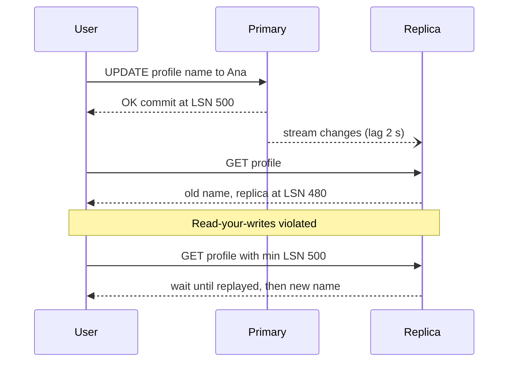

Replication keeps copies of data on several machines for availability, read scaling and latency to distant users. Every replication scheme answers the same questions differently: who accepts writes, when is a write considered committed, and what happens when copies disagree. The answers decide what anomalies your users can see and what you lose when a machine dies.

## Three topologies

**Single-leader** (primary-replica). One node accepts writes and streams a change log to followers, which serve reads. Postgres, MySQL, SQL Server, MongoDB replica sets and Redis all default to this. Simple to reason about: there is one order of writes, so no write conflicts.

**Multi-leader** (active-active). Several nodes accept writes, typically one per region, and replicate to each other asynchronously. Writes are fast locally and each region survives others failing, but two leaders can modify the same row concurrently, so you need conflict resolution.

**Leaderless** (Dynamo-style). Any replica accepts reads and writes. The client or a coordinator sends each write to N replicas and waits for W acknowledgements; reads query R replicas and take the newest value. Cassandra, ScyllaDB and Riak work this way; DynamoDB's original design inspired the model, although DynamoDB itself uses a leader per partition internally.

| Topology | Write conflicts | Write availability | Typical use |
| --- | --- | --- | --- |
| Single-leader | None | Lost during failover (seconds to a minute) | Most OLTP apps |
| Multi-leader | Yes, must resolve | High, per region | Multi-region writes, offline-capable clients |
| Leaderless | Yes, resolved by timestamps or versions | Very high | Write-heavy, always-on systems |

## Synchronous, asynchronous, semi-synchronous

With **synchronous** replication the leader waits for a replica to persist the write before acknowledging the client. No committed data is lost if the leader dies, but every write pays a network round trip, and if the synchronous replica is down, writes stall. Within a region that costs about 1 ms; across regions 50 to 150 ms.

With **asynchronous** replication the leader acknowledges immediately and ships changes in the background. Writes are fast, but a leader crash loses whatever had not reached a replica, typically milliseconds to seconds of writes, more under load.

**Semi-synchronous** waits for at least one of several replicas. Postgres expresses this as `synchronous_standby_names = 'ANY 1 (replica_a, replica_b)'`; MySQL's semi-sync plugin waits for one replica to receive (not necessarily apply) the transaction. Managed services pick this for you: Aurora writes to six storage copies across three zones and commits at four of six; RDS Multi-AZ uses a synchronous standby.

A practical setup: one synchronous or quorum standby in another zone for durability, plus asynchronous read replicas and cross-region replicas.

## Replication lag and its anomalies

Async replicas are usually under 100 ms behind, but seconds or minutes during bulk writes or network trouble. Reading from them causes three classic anomalies.

**Read-your-writes.** A user saves a change, reloads, and sees the old value because the read hit a lagging replica. Fixes, from simplest:

- **Primary pinning**: after a user writes, route that user's reads to the primary for a window longer than typical lag, say 5 seconds, tracked in a cookie or session.
- **Always read your own data from the primary**: profile and settings pages read from the primary; public listings read from replicas.
- **LSN or session tokens**: return the commit position with the write (Postgres `pg_current_wal_lsn()`, MySQL GTID). On reads, send it along and only use a replica that has replayed past it (`pg_last_wal_replay_lsn()` on the replica), otherwise wait briefly or fall back to the primary. MongoDB implements this as causally consistent sessions; Cosmos DB as session consistency tokens.

**Monotonic reads.** A user sees a new comment, refreshes, hits a more-lagged replica, and the comment disappears. Fix by pinning each user to one replica (hash the user ID) or by carrying the highest LSN seen and requiring replicas at least that far along.

**Consistent prefix reads.** An observer sees an answer before its question because they live in partitions that replicate independently. Keep causally related writes in one partition.

Monitor lag as a first-class metric (`pg_stat_replication.replay_lag`, MySQL `Seconds_Behind_Source`) and remove replicas from the read pool when lag exceeds a threshold such as 10 seconds.

## Failover, split brain and fencing

Failover means detecting the dead leader (missed heartbeats for 10 to 30 seconds), promoting the most up-to-date replica, and redirecting clients via DNS, a virtual IP or a proxy. Tools: Patroni for Postgres (using etcd or Consul for leader election), Orchestrator or MySQL Group Replication, MongoDB's built-in Raft-like elections, and managed failover in RDS (typically 60 to 120 seconds) or Aurora (often under 30 seconds).

Failover fails in subtle ways:

- **Lost writes.** With async replication, writes acknowledged by the old leader but not replicated are gone. If other systems already acted on them (an email sent, an ID handed out), you get inconsistencies; reused auto-increment IDs have caused real data leaks.
- **Split brain.** A network partition makes the old leader look dead while it is still accepting writes. Now two leaders diverge. Prevention requires a majority quorum for leader election, so only the side with more than half the voters can elect, plus fencing.
- **Fencing.** Make the old leader unable to do harm: revoke its storage access, shut it down via the cloud API (STONITH), or use **fencing tokens**, a monotonically increasing epoch number that storage or downstream systems check, rejecting writes from an older epoch.

## Conflict handling in multi-leader and leaderless systems

When two leaders change the same record concurrently, something must pick a result:

- **Last write wins (LWW)** by timestamp. Simple and the default in Cassandra and DynamoDB global tables, but it silently drops one write and depends on clock accuracy.
- **Version vectors** detect concurrency so the application can merge siblings (Riak) instead of losing data.
- **CRDTs** (counters, sets, maps) merge automatically and deterministically; used in Redis Enterprise active-active and collaborative editors.
- **Avoid conflicts by design**: route all writes for a given record to its home region, such as a user's data to the region they signed up in. This is the most common real-world approach and turns multi-leader into many single-leader partitions.

Leaderless systems add repair mechanisms: **read repair** fixes stale replicas noticed during reads, **hinted handoff** stores writes for a down replica on another node, and **anti-entropy** (Merkle tree comparison, `nodetool repair` in Cassandra) reconciles in the background. With N=3, choosing W=2 and R=2 (QUORUM) means reads and writes overlap on at least one replica, so a read sees the latest acknowledged write in normal operation, though sloppy quorums and LWW can still surprise you.

## Cross-region replication

Cross-region links add 60 to 200 ms of round trip, so synchronous replication across regions is rare outside consensus databases (Spanner, CockroachDB) that accept that write latency. Common patterns:

| Pattern | Write latency | RPO on region loss | Example |
| --- | --- | --- | --- |
| Async read replica in second region | Local | Seconds | RDS cross-region replica, Aurora Global Database (typically under 1 s lag) |
| Home-region per user | Local for that user | Seconds for that user's data | Sharded by region |
| Multi-leader with LWW | Local | Seconds, plus lost conflicts | DynamoDB global tables, Cassandra multi-DC |
| Consensus across regions | 50 to 150 ms | Zero | Spanner, CockroachDB |

## How popular systems replicate

- **PostgreSQL**: physical streaming replication of the write-ahead log, async by default, sync configurable per transaction via `synchronous_commit`. Logical replication publishes row changes per table, used for upgrades and CDC.
- **MySQL**: binary log replication, row-based format recommended, GTIDs for position tracking; semi-sync plugin; Group Replication for Paxos-based single- or multi-primary.
- **MongoDB**: replica sets with an elected primary, oplog replication, `writeConcern: "majority"` to avoid rollbacks on failover, `readConcern` and read preferences for replica reads.
- **Cassandra**: leaderless, per-query consistency levels (`ONE`, `QUORUM`, `LOCAL_QUORUM`), replication factor per datacenter.
- **DynamoDB**: three copies across zones per partition, eventually consistent reads by default with an option for strongly consistent reads; global tables replicate asynchronously across regions.

## Trade-offs and pitfalls

- **Reading from replicas without a lag strategy** produces bugs that look like lost saves.
- **Async replication with automatic failover** means accepting data loss; state your RPO explicitly.
- **Failover without fencing** risks split brain and divergent data.
- **LWW across regions** drops concurrent updates silently; avoid it for counters and money.
- **Never-tested failover** fails when needed; rehearse it regularly.

## Interview angle

- State the topology, sync or async, and the resulting RPO and RTO.
- Fix read-your-writes with primary pinning or LSN tokens.
- Explain split brain and how quorum plus fencing prevents it; prefer home-region routing to conflict resolution.

## Key takeaways

- Single-leader is the default; multi-leader and leaderless buy write availability at the cost of conflicts.
- Synchronous replication trades latency for zero data loss; semi-sync or quorum is the usual compromise.
- Replica lag causes read-your-writes and monotonic read anomalies; handle them deliberately.
- Failover needs quorum-based election and fencing to avoid split brain.
- Prefer avoiding conflicts with home-region ownership over resolving them with last write wins.
