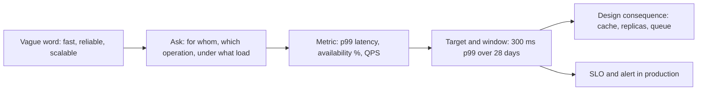

Two systems with identical features can need completely different architectures. A booking app for one gym and a booking app for 300 gyms with a 06:00 rush do the same thing; what differs is how many, how fast, how reliably and under what rules. Functional requirements tell you what to build. Non-functional requirements (NFRs) tell you how to build it, and they only help when they are numbers. "Fast and highly available" cannot be designed, tested or argued about. "p99 under 300 ms at 2,000 requests per second with 99.9% monthly availability" can.

## Functional vs non-functional

Functional requirements are behaviours a user or system can observe: "a customer can place an order", "an admin can refund an order", "the warehouse receives an event when an order is paid". Write them as actor plus verb plus object, and keep the list short. Each one should map to at least one API endpoint or event.

Non-functional requirements are qualities of the whole system or of a specific feature: availability, latency, throughput, durability, consistency, security, retention, compliance, cost, operability. They are often per feature, not global. Checkout needs stronger guarantees than the product recommendations widget, and saying so explicitly lets you spend money where it matters.

## The path from vague to measurable

## Availability: nines and downtime

Availability is the fraction of time (or of requests) the system serves correctly. Each extra nine cuts allowed downtime by 10x and typically multiplies cost and operational effort.

| Availability | Downtime per year | Downtime per month (30 days) | Typical meaning |
|---|---|---|---|
| 99% | 3.65 days | 7.2 hours | Internal tool, batch reporting |
| 99.9% | 8.8 hours | 43 minutes | Most SaaS products, single region multi-AZ |
| 99.95% | 4.4 hours | 22 minutes | Business-critical APIs |
| 99.99% | 53 minutes | 4.3 minutes | Payments, auth; needs automated failover |
| 99.999% | 5.3 minutes | 26 seconds | Telecom core; multi-region active-active |

Define availability precisely: "percentage of HTTP requests to `/checkout` that return non-5xx within 2 seconds, measured at the load balancer, over a rolling 28 days". A request-based definition handles partial outages better than "the site was up".

## Latency: percentiles and budgets per hop

Averages hide pain. If p50 is 80 ms and p99 is 2 seconds, 1 in 100 requests is terrible, and a page that makes 20 backend calls will hit that tail on most loads. State latency as p50, p95 and p99 per operation, and measure where the user feels it.

Then split the budget across the request path. For a 300 ms p99 API:

| Hop | Budget |
|---|---|
| Client to edge (TLS, CDN) | 50 ms |
| Load balancer and gateway (auth, rate limit) | 15 ms |
| Service logic | 40 ms |
| Cache lookup (hit) | 5 ms |
| Database query (miss path) | 60 ms |
| Downstream service call | 80 ms |
| Headroom for retries and GC pauses | 50 ms |

Budgets turn into timeouts. If the downstream call has 80 ms, its timeout is about 100 ms, and you cannot afford more than one retry. A budget that does not add up tells you to cache, parallelise calls, or move work off the request path.

## Throughput, read/write ratio and growth

Throughput is requests or events per second, at average and at peak. Peak drives capacity; average drives cost. Express it per operation, because reads and writes scale differently.

- Average QPS = daily requests / 86,400. Ten million a day is about 115 per second.
- Peak factor: 2 to 3x for steady consumer apps, 10 to 100x for ticket drops, flash sales and scheduled openings.
- Read/write ratio: 100:1 means caching and replicas solve most of it; 1:1 means write path design (partitioning, batching, log-structured storage) is the main topic.
- Growth: state 12- and 36-month targets. Design for roughly 10x current load; plan, but do not build, for 100x.

## Durability, consistency and retention

**Durability** is the probability data survives once acknowledged. "No acknowledged order is ever lost" means synchronous replication or a write-ahead log replicated before acknowledgement, plus backups tested by restoring. Object stores like S3 advertise 11 nines of durability; your database's durability depends on your replication and backup settings. State a recovery point objective (RPO) such as "at most 1 minute of data loss in a regional disaster".

**Consistency** should be decided per feature:

| Feature | Need | Why |
|---|---|---|
| Account balance, inventory decrement | Strong (linearizable or serializable transaction) | Overselling or double spending is a real loss |
| User sees own profile edit | Read-your-writes | Otherwise the user thinks the save failed |
| Like counts, follower counts | Eventual, seconds | Nobody notices 1,204 vs 1,206 |
| Search index, analytics | Eventual, minutes | Freshness is a product choice, not correctness |

**Retention** says how long each data class lives: raw logs 30 days, orders 7 years for tax, deleted user content purged within 30 days. Retention drives storage cost, tiering (hot database, warm object storage, cold archive) and TTL design.

## Security and compliance

Compliance requirements are NFRs with legal teeth, and they constrain architecture early.

- **GDPR** (EU personal data): lawful basis, data minimisation, right of access and erasure (typically within one month), breach notification within 72 hours, restrictions on transfers outside the EU. Design consequences: know where every personal field lives, support deletion across primary stores, replicas, caches, search indexes and backups (or crypto-shredding), and pick regions deliberately.
- **PCI DSS** (card data): scope everything that stores, processes or transmits card numbers. The usual design answer is to never touch card data: use the payment provider's hosted fields or tokenization so your systems hold only tokens, shrinking scope to the simplest self-assessment.
- **HIPAA, SOC 2, data residency** laws add audit logging, access review, encryption at rest and in transit, and region pinning.

## Cost constraints

Cost is a requirement, not an afterthought. State a monthly ceiling or a unit cost such as "infrastructure under $0.02 per active user per month". It rules options in and out: multi-region active-active roughly doubles infrastructure and adds cross-region transfer fees; a 99.99% target with a $500/month budget is a conversation to have with stakeholders now, not after launch.

## How NFRs drive architecture

| NFR | Typical design consequence |
|---|---|
| 99.99% availability | Multi-AZ everything, automated failover, no manual steps in recovery, careful deploys |
| 99.999% or regional disaster tolerance | Multi-region active-active, conflict handling or global consensus database |
| p99 under 100 ms reads | Cache in front of the database, CDN for static and cacheable API responses, precomputed views |
| 100:1 read/write | Read replicas, cache-aside, denormalized read models |
| High write QPS (50k+/s) | Partitioning/sharding, append-only logs, batching, queues to absorb bursts |
| Spiky peak (100x) | Autoscaling with headroom, queues, waiting rooms, load shedding |
| Strong consistency on a resource | Single-leader transactional store for that data, conditional writes, idempotency keys |
| Zero acknowledged data loss | Synchronous replication, write-ahead log, tested backups, outbox for events |
| Long retention, large volume | Tiered storage, partitioned tables by time, TTL indexes |
| GDPR erasure | Data map, per-user keys or deletion pipelines across every copy |
| PCI | Tokenization via provider; keep card data out of your network |
| Tight budget | Managed services, monolith first, single region multi-AZ, serverless for low or spiky load |

## Prioritising and stating assumptions

You will not get all the numbers, and some will conflict. Handle it explicitly:

1. **Rank the NFRs.** For a payments ledger: correctness, durability, availability, then latency. For a social feed: latency and availability, then freshness. When two conflict (strong consistency vs low latency across regions), the ranking decides.
2. **Write assumptions as numbers** and mark them: "Assumed: 2M DAU, peak 5x, 80:1 read/write. Revisit after beta."
3. **Separate must from want.** "Must: 99.9%. Want: 99.95% if it costs under 20% more."
4. **Attach an owner and a measurement.** Each NFR becomes an SLO with a dashboard and an alert, otherwise it is a wish.

## Trade-offs and pitfalls

- **Global NFRs** ("everything must be strongly consistent") force the expensive option everywhere.
- **Averages instead of percentiles** hide the tail that users actually feel.
- **Availability without a definition** leads to arguments about whether an outage counted.
- **Ignoring peak** sizes for the average and falls over at the moment that matters most.
- **Compliance discovered late** can force a re-architecture of storage and regions.
- **Chasing nines** past what the business needs burns money and slows delivery.

## Interview angle

- Ask for scale, read/write ratio, latency target and consistency needs before drawing anything.
- Convert DAU to QPS out loud and apply a peak factor.
- State consistency per feature; it shows judgment rather than dogma.
- Use the nines table to set an availability target and tie it to multi-AZ or multi-region.
- Mention compliance when personal or payment data appears.

## Key takeaways

- Functional requirements say what; NFRs say how well, and must be numbers.
- Each nine is 10x less downtime and usually much more cost.
- Specify latency as percentiles and split the budget per hop into timeouts.
- Peak load, read/write ratio and growth determine scaling strategy.
- Decide consistency, durability and retention per feature or data class.
- Rank NFRs and write assumptions down so trade-offs have a basis.
