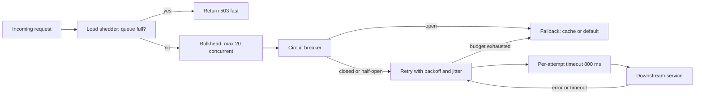

Most large outages start not with a service going down cleanly but with a dependency getting slow. A payments API that normally answers in 50 ms starts taking 30 seconds; your Node.js service keeps accepting requests, sockets and pools fill, and soon your service is the one timing out. Then clients retry, multiplying load on everything already struggling. Resilience patterns bound the damage one failing component can do, and they work as a set: timeouts limit waiting, retries recover from blips, circuit breakers stop hammering something broken, bulkheads isolate resources, and load shedding protects you from your own callers.

## How it works

Each outbound call passes through layers: a per-attempt timeout, a retry policy with a budget, a circuit breaker that fails fast when the dependency is unhealthy, and a fallback. Bulkheads cap how many calls are in flight.



## Timeouts

Every network call needs a timeout, and the defaults are usually wrong. Node's `fetch` (undici) has no overall request deadline by default, and many HTTP clients wait indefinitely on a slow response body. Set them slightly above the dependency's measured p99, for example 800 ms for a p99 of 600 ms.

```js
const res = await fetch(url, { signal: AbortSignal.timeout(800) });
```

Think in deadlines, not just per-hop timeouts. If the user request has a 2-second budget, pass the remaining time downstream (gRPC does this natively; for HTTP, use a header such as `x-request-deadline`). Inner timeouts must be shorter than outer ones, or the caller gives up while the callee keeps working.

## Retries with exponential backoff and full jitter

Many failures are transient: a dropped connection, a leader election, a pod restarting. Retrying recovers them, but immediate or synchronised retries from thousands of clients arrive in waves.

Exponential backoff doubles the wait each attempt; **full jitter** picks a random delay between zero and that cap, which spreads clients out and, per AWS's well-known analysis, minimises total work and completion time compared with fixed or "equal" jitter.

```js
async function withRetry(fn, { retries = 3, base = 100, cap = 2000 } = {}) {
  for (let attempt = 0; ; attempt++) {
    try {
      return await fn();
    } catch (err) {
      const retryable = err.name === 'TimeoutError' || [502, 503, 504].includes(err.status);
      if (!retryable || attempt >= retries) throw err;
      const delay = Math.random() * Math.min(cap, base * 2 ** attempt);
      await new Promise((r) => setTimeout(r, delay));
    }
  }
}
```

Only retry errors that might succeed next time: timeouts, connection resets, 502, 503, 504, and 429 honouring `Retry-After`. Never retry 400, 401, 403, 404 or validation failures.

## Retry budgets and amplification

Retries multiply: three layers each retrying 3 times turn one click into 4 x 4 x 4 = 64 bottom-layer calls during an outage. Retry at one layer only, and cap retries with a **retry budget**, for example at most 10 percent extra traffic over a 10-second window, failing immediately once it is spent. Envoy, Linkerd and gRPC's retry throttling implement this; in application code a token bucket that earns 0.1 tokens per successful request and spends 1 per retry works.

## Idempotency is a precondition

Retrying is safe only if doing an operation twice equals doing it once. A timeout does not tell you whether the server processed the request; it may have charged the card and lost the response. GET, PUT and DELETE are idempotent by HTTP semantics. For POSTs that create things or move money, send an idempotency key that the server stores with the result:

```js
await fetch('/payments', {
  method: 'POST',
  headers: { 'Idempotency-Key': orderId, 'Content-Type': 'application/json' },
  body: JSON.stringify({ amount: 4999, currency: 'USD' }),
});
```

The server records the key with a unique constraint and returns the stored response for duplicates. Without this, adding retries turns timeouts into double charges.

## Circuit breakers

A circuit breaker tracks recent failures for a dependency and, past a threshold, stops calling it for a cool-down period. It has three states:

- **Closed**: calls flow normally while the breaker counts failures over a rolling window.
- **Open**: the error rate crossed the threshold (say 50 percent over at least 20 requests); calls fail immediately without touching the network, for a reset timeout such as 30 seconds.
- **Half-open**: after the reset timeout, a trial request is let through. Success closes the breaker; failure reopens it.

Failing fast frees your resources and gives the dependency room to recover. In Node, `opossum` is the common library:

```js
import CircuitBreaker from 'opossum';

const breaker = new CircuitBreaker((id) => getRecommendations(id), {
  timeout: 800,                  // treat slower calls as failures
  errorThresholdPercentage: 50,  // open at 50% failures
  volumeThreshold: 20,           // need 20 calls before judging
  resetTimeout: 30000,           // try half-open after 30 s
});

breaker.fallback(() => ({ items: [], degraded: true }));
breaker.on('open', () => logger.warn('recommendations breaker open'));
breaker.on('halfOpen', () => logger.info('recommendations breaker half-open'));

const recs = await breaker.fire(userId);
```

Use one breaker per dependency and export its state as a metric.

## Bulkheads

Named after the watertight compartments in a ship, bulkheads give each dependency its own limited pool of resources so one slow dependency cannot consume all of them. In Java this is often a separate thread pool; in Node the equivalents are a dedicated HTTP agent with `maxSockets`, a separate database pool, or a concurrency limiter:

```js
import pLimit from 'p-limit';
const searchLimit = pLimit(20); // at most 20 concurrent calls to search
const results = await searchLimit(() => searchClient.query(q));
```

If search slows down, at most 20 requests wait on it while checkout, with its own limit, keeps working.

## Fallbacks and graceful degradation

A fallback returns something useful when the real call fails: a cached value, a default, an empty list. A product page can render without recommendations but not without the product, so decide per dependency which are critical and which can degrade. Avoid fallbacks that call another fragile service or hide data loss, such as returning a zero balance.

## Load shedding

At capacity, accepting more work makes every request slower until all time out. Load shedding rejects excess requests early with 503 or 429 and `Retry-After`. Signals include in-flight request count, queue length, CPU, or in Node, event-loop lag. Prioritise: shed batch and background traffic first, keep checkout over browsing, and never shed health checks or the load balancer will pull every instance at once. A request that has already waited longer than its client's timeout should be dropped rather than processed, since nobody will read the answer.

## Trade-offs and pitfalls

- **Timeouts too long** make breakers and bulkheads useless; too short and you fail healthy slow calls.
- **Retries without jitter or budgets** turn a brief outage into a sustained retry storm.
- **Retrying non-idempotent writes** causes duplicates.
- **Breaker thresholds** set on tiny volumes flap open and closed; require a minimum request count.
- **Shared pools** across dependencies defeat bulkheads.
- **Untested fallbacks** often break the first time they run; exercise them with fault injection.

## Interview angle

- For any synchronous call chain, say what happens when one hop is slow.
- Explain exponential backoff with full jitter and why retries need budgets and idempotency keys.
- Walk through the three circuit breaker states and what triggers each transition.
- Distinguish bulkheads (isolate resources) from circuit breakers (stop calling) and load shedding (protect yourself).

## Key takeaways

- Set explicit timeouts on every call, based on measured p99, and propagate deadlines.
- Retry only transient errors, with exponential backoff, full jitter, one layer, and a budget.
- Retries require idempotent operations or idempotency keys.
- Circuit breakers fail fast when a dependency is unhealthy and probe it in half-open state.
- Bulkheads, fallbacks and load shedding keep partial failures partial.
