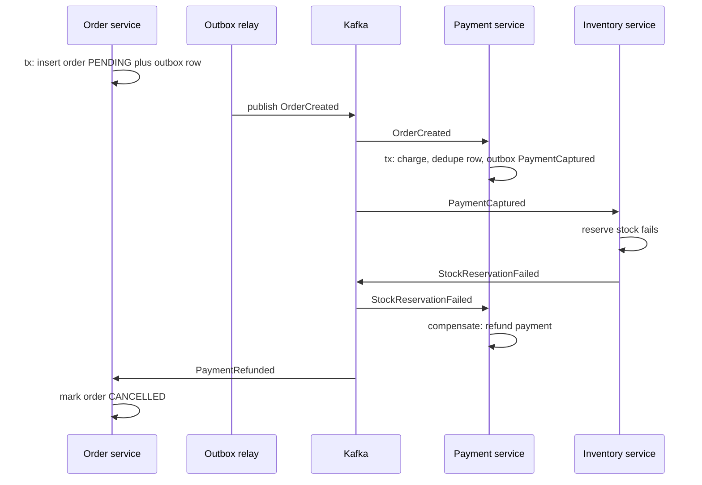

Once orders, payments and inventory live in three services with three databases, you lose the single `BEGIN ... COMMIT` that kept them consistent. The classic bug: the order service saves the order, then publishes `OrderCreated` to Kafka, and crashes in between. The order exists but nobody charges for it. Or the publish succeeds, the write rolls back, and payment charges for an order that does not exist. Three patterns fix this together: sagas coordinate a multi-step business process with compensations, the transactional outbox makes "write data and publish event" atomic, and idempotent consumers make it safe for messages to arrive more than once.

## Why not two-phase commit

Two-phase commit (2PC, XA) has a coordinator ask every participant to prepare, then tells all of them to commit. Participants hold locks from prepare until commit, so latency tracks the slowest member. If the coordinator dies after prepare, participants sit "in doubt" holding locks until it recovers. Availability becomes the product of every participant's availability. And Kafka, most managed queues, and APIs like Stripe cannot join an XA transaction at all. So services accept eventual consistency and make each step locally atomic and globally recoverable.

## How it works

A saga is a sequence of local transactions, each in one service, where each step's event or command triggers the next. If a step fails, the saga runs **compensating transactions** for completed steps in reverse order. Compensations are semantic undo: you refund a payment rather than erase it.



## Choreography versus orchestration

In **choreography**, each service listens for events and reacts: payment listens for `OrderCreated`, inventory for `PaymentCaptured`. It is loosely coupled and simple for two or three steps. Beyond that, the flow exists only implicitly across codebases, and answering "where is order 123 stuck?" means correlating logs from every service.

In **orchestration**, a saga orchestrator (a service or a workflow engine such as Temporal, AWS Step Functions or Camunda) holds the state machine and sends commands: `ChargePayment`, `ReserveStock`, `RefundPayment`. The flow is explicit, persisted and observable; the cost is a central component that knows every participant.

A reasonable rule: choreography for short flows owned by one team, orchestration for flows with four or more steps, branching, or long waits.

### Designing compensations

Every step that can be followed by a failure needs a compensation, and both must be idempotent and retryable. Actions that cannot be undone, such as shipping a parcel, belong after the **pivot transaction**, the step after which the saga must complete. Sagas lack isolation, so use semantic states like `PENDING` and `CANCELLED` to show an order is mid-saga.

## Transactional outbox

The outbox solves the dual-write problem: write the event into an `outbox` table in the same local transaction as the business change, and let a separate relay publish it. Both rows commit or neither does.

### PostgreSQL

```sql
CREATE TABLE outbox (
  id           uuid PRIMARY KEY,
  aggregate_id text NOT NULL,
  type         text NOT NULL,
  payload      jsonb NOT NULL,
  created_at   timestamptz NOT NULL DEFAULT now(),
  published_at timestamptz
);
CREATE INDEX outbox_unpublished ON outbox (created_at) WHERE published_at IS NULL;
```

```js
const client = await pool.connect(); // one connection for the whole transaction
try {
  await client.query('BEGIN');
  await client.query('INSERT INTO orders (id, status, total) VALUES ($1, $2, $3)', [id, 'PENDING', total]);
  await client.query(
    'INSERT INTO outbox (id, aggregate_id, type, payload) VALUES ($1, $2, $3, $4)',
    [randomUUID(), id, 'OrderCreated', { orderId: id, total }]
  );
  await client.query('COMMIT');
} catch (e) { await client.query('ROLLBACK'); throw e; }
finally { client.release(); }
```

### MongoDB

MongoDB multi-document transactions need a replica set, which every production deployment has:

```js
await session.withTransaction(async () => {
  await db.collection('orders').insertOne({ _id: id, status: 'PENDING', total }, { session });
  await db.collection('outbox').insertOne(
    { _id: new ObjectId(), type: 'OrderCreated', payload: { orderId: id, total }, publishedAt: null },
    { session }
  );
});
```

Alternatively, embed pending events in the order document itself; single-document writes are atomic.

### Polling relay versus CDC

A **polling relay** queries unpublished rows every 100 ms to 1 s, publishes them, and marks them published:

```sql
SELECT * FROM outbox WHERE published_at IS NULL
ORDER BY created_at LIMIT 100 FOR UPDATE SKIP LOCKED;
```

`SKIP LOCKED` lets several relays run without grabbing the same rows. Polling is simple but adds latency and query load, and multiple relays break strict ordering.

**Change data capture** reads the replication log instead: Debezium tails the Postgres WAL via logical decoding (or the MongoDB oplog via change streams), and its outbox event router keys messages by `aggregate_id` so one aggregate's events stay ordered in one partition. Latency drops to milliseconds with no polling load, but you operate Kafka Connect and must watch replication slot lag, since an abandoned slot makes Postgres retain WAL until the disk fills.

Either way, a relay can publish and crash before marking the row, so delivery is **at least once**. Purge published rows on a schedule.

## Idempotent consumers

Kafka's exactly-once semantics cover Kafka-to-Kafka processing, not your side effects in Postgres or Stripe, so consumers must tolerate duplicates. `SET status = 'PAID'` is naturally safe to repeat; `balance = balance - 50` is not. The general tool is a **dedupe table** written in the same transaction as the side effect:

```sql
CREATE TABLE processed_messages (
  consumer   text NOT NULL,
  message_id uuid NOT NULL,
  processed_at timestamptz NOT NULL DEFAULT now(),
  PRIMARY KEY (consumer, message_id)
);
```

```js
async function handle(msg) {
  const client = await pool.connect();
  try {
    await client.query('BEGIN');
    const r = await client.query(
      'INSERT INTO processed_messages (consumer, message_id) VALUES ($1, $2) ON CONFLICT DO NOTHING',
      ['payment-svc', msg.id]
    );
    if (r.rowCount === 0) { await client.query('ROLLBACK'); return; } // duplicate
    await client.query('UPDATE accounts SET balance = balance - $1 WHERE id = $2', [msg.amount, msg.accountId]);
    await client.query('COMMIT');
  } catch (e) { await client.query('ROLLBACK'); throw e; }
  finally { client.release(); }
}
```

Commit the Kafka offset only after the database commit; a crash in between causes redelivery, which the dedupe row absorbs. Keep dedupe rows at least as long as broker retention, for example 7 to 14 days.

## The inbox pattern

The inbox pattern is the receiving-side mirror of the outbox. The consumer first writes each incoming message into an `inbox` table keyed by message ID (rejecting duplicates via the primary key) and acknowledges the broker immediately. A local worker then processes inbox rows in order inside local transactions. This decouples acknowledgement from slow processing, leaves a durable record for retries, and lets one transaction mark the inbox row processed and write new outbox events.

## Trade-offs and pitfalls

- **No isolation**: other requests see intermediate saga states; design around them with explicit statuses.
- **Compensations can fail** too; they need retries, alerts and sometimes a manual queue.
- **Event IDs must be stable**: generate them when writing the outbox row, never at publish time, or dedupe cannot work.
- **Ordering**: partition by aggregate ID; across aggregates, assume no order.
- **Outbox growth** and CDC slot lag both need monitoring.
- **Dedupe outside the transaction** (for example in Redis) reopens the crash window.

## Interview angle

- State that you avoid 2PC across services and why.
- Sketch a saga with its compensations and say whether you'd choreograph or orchestrate.
- Name the dual-write problem and solve it with an outbox plus polling or CDC.
- Say "at-least-once delivery plus idempotent consumers" and show the dedupe table.

## Key takeaways

- 2PC is avoided because it blocks, couples availability, and most brokers and APIs cannot join it.
- Sagas chain local transactions and undo with compensations; orchestrate longer flows.
- The outbox makes state changes and events atomic; relay with polling or Debezium CDC.
- Delivery is at least once, so every consumer must be idempotent, ideally with a dedupe row in the same transaction.
- The inbox pattern gives consumers durable, deduplicated, retryable processing.
