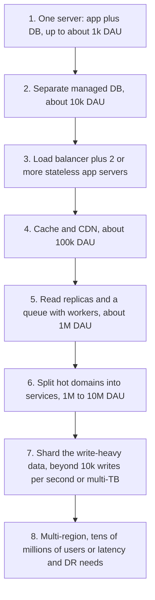

Scalability is the ability to handle more load by adding resources, with cost and latency growing no faster than the load itself. It is not the same as performance: a fast system can fail to scale (one huge database box at its limit), and a scalable system can be slow per request. The practical goal is a system where you know which resource runs out first, what you will add when it does, and roughly at what traffic that happens. Most applications never need exotic techniques; they need state moved out of the app tier, a cache, read replicas and good indexes, applied at the right time.

## Vertical vs horizontal

**Vertical scaling** (scale up) means a bigger machine: more cores, RAM, faster disks. It needs no code changes and keeps everything in one process and one database, which is why it should be your first move. Cloud instances go up to hundreds of vCPUs and terabytes of RAM, so a single well-tuned PostgreSQL server can serve tens of thousands of simple queries per second. The limits: price grows faster than capacity at the top end, there is a hard ceiling, upgrades often need a restart, and one machine is one failure domain.

**Horizontal scaling** (scale out) means more machines behind a load balancer. It has no practical ceiling for stateless tiers, gives redundancy for free, and lets you add capacity in small steps. The cost is complexity: load balancing, shared state, distributed data and partial failures.

| | Vertical | Horizontal |
|---|---|---|
| Code changes | None | Services must be stateless; data may need partitioning |
| Ceiling | Largest instance | Effectively none for stateless tiers |
| Failure impact | Whole system | One node of many |
| Cost curve | Rises steeply at the top | Roughly linear |
| Best for | Databases early on, quick wins | Web/API tier, workers, caches, later data tier |

## Stateless services: moving state out

A service is horizontally scalable when any instance can serve any request. That means no state that lives only in one process or one disk.

- **Sessions**: store in Redis or a database, or use signed tokens (JWT or encrypted cookies) carrying a session ID. Avoid sticky sessions as a crutch; they break on deploys and uneven load.
- **Uploaded files**: write directly to object storage (S3, GCS, Azure Blob), ideally via presigned URLs so bytes skip your servers.
- **In-process caches**: fine for small, immutable or short-TTL data; anything that must be consistent across instances goes to a shared cache.
- **Scheduled jobs and locks**: run through a queue or a scheduler with leader election, not "the cron on server 1".

## The scale cube

The scale cube (from *The Art of Scalability*) names three independent ways to scale.

- **X axis, cloning**: run N identical copies behind a load balancer. Easiest; solves compute, not data size.
- **Y axis, functional decomposition**: split by function (catalogue, checkout, notifications) so each part scales and deploys independently. This is what microservices are; worth it when teams or load profiles genuinely differ.
- **Z axis, data partitioning**: each server handles a subset of data, chosen by a key such as user ID, tenant or region. This is sharding; it is how you scale writes and data size beyond one machine.

Real systems combine them: a checkout service (Y) with 12 replicas (X) over a database sharded by customer ID (Z).

## Read scaling vs write scaling

Reads are much easier to scale because copies can serve them.

- **Caching**: a cache with 95% hit rate cuts database reads 20x. CDN caching does the same at the edge.
- **Read replicas**: asynchronous replicas absorb read traffic; accept replication lag (usually milliseconds to seconds) and route read-your-writes cases to the primary.
- **Denormalized read models**: precompute what pages need (feed timelines, counters) so reads are single-key lookups.

Writes must eventually land in one authoritative place per item, so you have fewer tools:

- **Do less per write**: fewer indexes, smaller rows, batched inserts, async side effects through a queue.
- **Buffer**: a queue absorbs bursts and lets consumers write at a steady rate.
- **Partition**: shard by a key so each shard takes a fraction of writes. This is the big step and it is hard to undo, so pick the key carefully (high cardinality, evenly distributed, matches the main access pattern).

## The typical evolution path

The numbers below are rough orders of magnitude for a typical web or mobile app with a 10:1 to 100:1 read/write ratio and decent queries. Your thresholds will differ; the order of steps usually does not.

1. **One server.** App and database on one VM. Fine for a prototype and a few hundred concurrent users.
2. **Separate the database.** Move to a managed database so app and DB scale independently, and you get automated backups. Scale both vertically for a long time.
3. **Load balancer plus stateless app servers.** Triggered by app CPU or by needing zero-downtime deploys. Requires moving sessions and files out (previous section). Two instances in different zones also gives basic redundancy.
4. **Cache and CDN.** When the database spends most of its time on repeated reads. Static assets and cacheable API responses go to the CDN; hot objects go to Redis or Memcached.
5. **Read replicas and asynchronous work.** When primary CPU stays above about 60% from reads, add replicas. When requests do slow work (email, image processing, webhooks), move it to a queue and workers.
6. **Functional split.** When one area has very different load or a separate team, extract it.
7. **Shard.** When a single primary cannot take the write rate (often somewhere around 10k to 50k writes per second on strong hardware, lower with heavy transactions) or the data set is too big to manage, back up and restore on one node (multiple TB).
8. **Multi-region.** For global latency, regulatory residency or regional disaster tolerance, not just raw scale.

Do not skip ahead. Each step adds operational cost, and many successful products live at step 5 for years.

## Amdahl's law and the Universal Scalability Law

**Amdahl's law** says the speedup from N workers is limited by the serial fraction s: speedup = 1 / (s + (1 − s) / N). With 5% serial work, no number of servers gives more than 20x. In systems, the serial part is anything all requests must pass through one at a time: a single database row everyone updates, a global lock, a single leader.

The **Universal Scalability Law** (Neil Gunther) adds a coherency term for the cost of keeping nodes in agreement: C(N) = N / (1 + σ(N − 1) + κN(N − 1)), where σ is contention and κ is crosstalk. With κ greater than zero, throughput does not just plateau, it peaks and then falls as you add nodes, because every node spends more time coordinating with every other. The practical lesson: scaling well means removing shared contended resources and coordination from the hot path, not adding more machines.

## Elasticity and autoscaling

Elasticity is adding and removing capacity automatically as load changes.

- **Scale on a leading signal**: CPU around 50 to 70% for CPU-bound services, request concurrency or queue depth for I/O-bound services and workers. Memory is a poor signal for most web services.
- **Account for warm-up time.** A new VM can take 2 to 5 minutes, a container 10 to 60 seconds plus JIT and cache warm-up. Keep headroom (for example 30%) and use scheduled scaling for known peaks like a 09:00 login rush.
- **Scale in slowly** (cooldown of several minutes) to avoid flapping.
- **Set maximums** so a bug or attack cannot scale your bill without limit, and remember downstream limits: 200 new app instances each opening 20 database connections is 4,000 connections. Use a connection pooler such as PgBouncer.

## Hot spots

Even load across machines is an assumption, not a given. Hot spots appear when one key, partition or tenant gets far more traffic than average: a celebrity's profile, a flash-sale product, today's date as a partition key, one huge enterprise tenant.

- **Detect** with per-key and per-partition metrics, not just cluster averages.
- **Read hot spots**: cache the hot key, replicate it to several cache nodes, or add a short in-process cache.
- **Write hot spots**: split the key (counter sharded into 16 sub-counters summed on read), batch updates, or route through a queue.
- **Bad partition keys**: avoid monotonically increasing keys (timestamps, sequential IDs) as the only partition key on range-partitioned stores; add a hash prefix or use hash partitioning.

## Trade-offs and pitfalls

- **Premature sharding** makes every query, migration and report harder for load a single node could handle.
- **Sticky sessions** hide statefulness and break under deploys and autoscaling.
- **Autoscaling the app tier** without protecting the database just moves the bottleneck.
- **Microservices for scale** rarely help; they help team independence. Scale is usually a data problem.
- **Shared coordination** (global locks, single counters) caps scale no matter how many nodes you add.

## Interview angle

- Start with vertical scaling and a single database; justify each step outward with a number.
- Explain how you make the app tier stateless before adding a load balancer.
- Separate read scaling (cache, replicas) from write scaling (queue, partitioning).
- Name a shard key and discuss hot spots it might create.
- Mention autoscaling signals and the database connection limit.

## Key takeaways

- Scale up first, scale out when you need redundancy or hit the ceiling.
- Stateless services plus external session, file and cache stores make horizontal scaling trivial.
- The scale cube: clone (X), split by function (Y), partition data (Z).
- Reads scale with copies; writes scale by doing less, buffering, and partitioning.
- Follow the evolution path one step at a time, triggered by measured limits.
- Contention and coordination, not machine count, decide how far you can scale.
