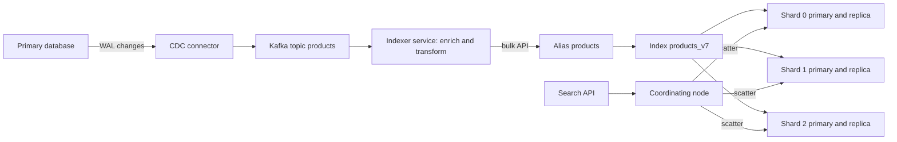

A `LIKE '%running shoes%'` query works for the first thousand products and then falls over: it cannot use a B-tree index, does not rank, misses "shoe" and "Running", and has no idea that "sneakers" is close. Search is a separate kind of system with its own data structure, consistency model and operational load. Most applications end up with a primary database as the source of truth and a search index as a derived, rebuildable copy optimized for relevance. This guide explains how that index works, how to keep it in sync, and when you do not need a separate engine at all.

## The inverted index

A B-tree maps a row to its values. An inverted index maps each term to the list of documents containing it, called a posting list, usually with term frequency and positions.

| Term | Postings (doc id: positions) |
|------|------------------------------|
| run | 1: [0], 3: [4], 7: [1, 9] |
| shoe | 1: [1], 2: [3], 7: [2] |
| trail | 3: [3], 7: [0] |

A query for `trail run` intersects or unions the sorted, compressed posting lists, so lists of millions of entries merge in milliseconds. Positions enable phrase queries and highlighting. Lucene, under Elasticsearch, OpenSearch and Solr, stores the index as immutable segments: new documents go into new segments, deletes are tombstones, and background merges compact them.

## Analyzers and tokenization

The same analysis runs on documents at index time and on queries at search time, so they meet in the same term space. An analyzer has three stages:

1. **Character filters**: strip HTML, normalize punctuation.
2. **Tokenizer**: split text into tokens. The standard tokenizer splits on Unicode word boundaries; CJK languages need dictionary or n-gram tokenizers.
3. **Token filters**: lowercase, ASCII folding (`café` to `cafe`), stop words, stemming (`running` to `run`), synonyms (`sneakers` to `shoes`).

```json
{
  "settings": {
    "analysis": {
      "filter": { "en_syn": { "type": "synonym_graph", "synonyms": ["sneaker, trainer, shoe"] } },
      "analyzer": {
        "product_text": {
          "tokenizer": "standard",
          "filter": ["lowercase", "asciifolding", "en_syn", "porter_stem"]
        }
      }
    }
  },
  "mappings": {
    "properties": {
      "title":    { "type": "text", "analyzer": "product_text" },
      "brand":    { "type": "keyword" },
      "price":    { "type": "scaled_float", "scaling_factor": 100 },
      "in_stock": { "type": "boolean" }
    }
  }
}
```

Use `text` fields for things people search and `keyword` fields for exact filters, sorting and facets. Changing an analyzer changes the stored terms, so it always requires a reindex.

## Relevance with BM25

Elasticsearch and OpenSearch rank with BM25 by default. Per query term, a document scores higher when:

- the term appears more often in it (term frequency), with diminishing returns controlled by `k1` (default 1.2), so ten mentions is not ten times better than one;
- the term is rare across the corpus (inverse document frequency), so "trail" outweighs "shoe";
- the field is short relative to average (length normalization, `b` = 0.75), so a match in a 5-word title beats one in a 500-word description.

On top of BM25 you add business signals: field boosts (`title^3`), recency decay, popularity, stock status, or personalization through `function_score`. Measure changes with a fixed set of judged queries and metrics like NDCG or click-through, not by eyeballing a few searches.

## Elasticsearch and OpenSearch architecture

An index is split into **primary shards**, each a full Lucene index. Each primary has **replica** copies on other nodes for availability and read throughput. A query fans out to one copy of every shard, each returns its top N, and a coordinating node merges them.



Sizing rules of thumb: aim for 10 to 50 GB per shard and avoid thousands of tiny shards, since each one costs heap and cluster-state overhead. Primary shard count is fixed at creation (changing it requires split, shrink or reindex), so plan for 12 to 18 months of growth. One replica is the usual minimum in production.

**Near real-time**: a written document is durable in the translog immediately but becomes searchable only after a **refresh** opens a new segment, every 1 second by default. So search is eventually consistent with writes, typically by about a second. During bulk loads set `refresh_interval` to `30s` or `-1` and replicas to 0, then restore. Do not call refresh after every write in production; it creates tiny segments and kills indexing throughput.

## Keeping the index in sync with the primary database

The database stays the source of truth. The search index is a projection you can always rebuild.

| Approach | How | Problem |
|----------|-----|---------|
| Dual write in request | App writes DB, then writes ES | If the second write fails or the process crashes, they diverge silently; ordering races between concurrent updates |
| Outbox | App writes DB row and outbox row in one transaction; relay publishes | Reliable, needs a relay and app discipline |
| CDC | Debezium reads Postgres WAL or MySQL binlog, or MongoDB change streams, into Kafka | Captures every change including manual SQL; needs Kafka or similar |
| Periodic batch | Query `updated_at > last_run` every minute | Simple; misses deletes unless soft-deleted; lag equals interval |

CDC or outbox is the production answer. The indexer consumes events, often re-reads or joins related data (brand name, category path) to build a denormalized document, and sends `_bulk` requests of 5 to 15 MB. Make writes idempotent by using the DB primary key as the document `_id`, and protect against out-of-order events with external versioning (`version_type=external` using a row version or LSN) so an old update never overwrites a newer one.

## Reindexing with aliases

Mapping changes, analyzer tweaks and shard count changes all need a new index. Applications should never query a concrete index name; they query an alias.

1. Create `products_v8` with the new mapping.
2. Backfill from a database snapshot or `_reindex`, while the CDC stream writes to both v7 and v8 (or replay Kafka from the snapshot offset).
3. Compare counts and run the judged query set against v8.
4. Swap the alias atomically: `remove products_v7, add products_v8` in one `_aliases` call.
5. Keep v7 for a day for rollback, then delete it.

## Facets, filters and typo tolerance

**Facets** ("Brand: Nike (124)") are aggregations on `keyword` or numeric fields, computed over the matching set. Put structured constraints in a `filter` clause, not `must`: filters skip scoring and are cached. Use `post_filter` when the facet counts should ignore the user's own selection in that facet.

**Typo tolerance** uses fuzzy matching with Levenshtein edit distance. `"fuzziness": "AUTO"` allows 0 edits for terms of 1 to 2 characters, 1 for 3 to 5, and 2 beyond. Set `prefix_length: 1` or 2 to keep it fast. For autocomplete, use `search_as_you_type` fields or edge n-grams rather than fuzzy queries on every keystroke, and keep the latency budget under about 100 ms.

## Semantic and hybrid search

Lexical search fails when words differ but meaning matches ("laptop for video editing" vs "creator notebook"). Vector search embeds documents and queries into dense vectors (384 to 1,536 dimensions) and finds approximate nearest neighbors, usually with an HNSW graph, in milliseconds over millions of vectors.

Pure vector search is weak at exact terms: SKUs, error codes, names. **Hybrid** search runs both and merges. Reciprocal Rank Fusion is the simple, robust default: each document scores the sum of `1 / (60 + rank)` across the result lists, so you do not need to normalize BM25 and cosine scores. A cross-encoder reranker on the top 50 to 100 results improves precision further at the cost of 50 to 200 ms. Elasticsearch, OpenSearch, Atlas Search and pgvector all support some form of this. Memory is the main cost: one million 768-dimension float32 vectors is about 3 GB before graph overhead; quantization cuts that 4 to 32 times.

## When database-native search is enough

You do not always need a cluster. Postgres full-text search (`tsvector`, GIN index, `ts_rank`, `pg_trgm` for fuzzy matching) handles a few million documents well, with transactional consistency and no sync pipeline. MongoDB Atlas Search embeds Lucene next to your cluster with managed sync. Choose a dedicated engine when you need BM25-quality relevance tuning, heavy faceting across large result sets, many languages, tens of millions of documents, or search traffic that should not load your primary database.

## Trade-offs and pitfalls

- **Treating the index as the source of truth**: it will drift or be lost; always be able to rebuild from the database.
- **Dual writes** from request handlers create silent inconsistency.
- **Oversharding**: hundreds of tiny shards waste heap and slow queries more than a few large ones.
- **Deep pagination** with `from` beyond 10,000 is expensive; use `search_after`.
- **Read-your-writes UX**: after saving, show the saved item from the database, not from search.

## Interview angle

- Explain the inverted index and analyzers before naming any product.
- Draw DB to CDC to Kafka to indexer to ES, and say the index is rebuildable.
- Mention refresh interval and that search lags writes by about a second.
- Describe alias-swap reindexing for zero-downtime mapping changes.
- Offer hybrid BM25 plus vector with RRF for semantic queries.

## Key takeaways

- An inverted index maps terms to posting lists; analyzers decide what a term is.
- BM25 balances term frequency, rarity and field length; business signals layer on top.
- Shards set parallelism and are fixed at creation; refresh makes search near real-time.
- Sync via CDC or outbox, use DB IDs and external versions, and reindex behind aliases.
- Postgres FTS or Atlas Search is often enough; add a dedicated engine when relevance or scale demands it.
