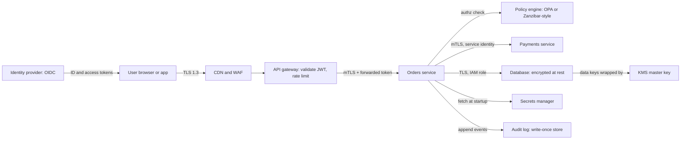

Most breaches are not clever cryptography. They are an internal service that trusted any caller on the network, a public S3 bucket, an admin endpoint that checked authentication but not authorization, or a password committed to a repository. Those are architecture failures, far cheaper to prevent on the whiteboard than after an incident. This guide covers the security decisions you make when drawing the system: trust boundaries, identity, per-hop authentication and authorization, encryption and key ownership, and knowing afterwards what happened.

## Threat modelling with STRIDE

Draw the data flow diagram, mark **trust boundaries** (internet to edge, edge to services, services to data stores, you to third parties), and ask what could go wrong at each crossing. STRIDE is the checklist.

| Threat | Violates | Example | Typical control |
| --- | --- | --- | --- |
| Spoofing | Authentication | Forged JWT, stolen session cookie | Signed tokens, short expiry, MFA, mTLS |
| Tampering | Integrity | Modified request body, altered DB row | TLS, signatures, least-privilege writes |
| Repudiation | Non-repudiation | "I never issued that refund" | Append-only audit log with actor identity |
| Information disclosure | Confidentiality | IDOR leaks another user's invoice | Per-object authorization, encryption |
| Denial of service | Availability | Login endpoint flooded | Rate limits, WAF, autoscaling, quotas |
| Elevation of privilege | Authorization | User sets `role=admin` in a profile update | Server-side authz, mass-assignment guards |

Spend 30 to 60 minutes per feature with the engineers building it; the output is a list of threats, each with a mitigation and owner. Re-run when a trust boundary changes, such as a new public webhook or vendor.

## Reference architecture

## Authentication vs authorization at the architecture level

**Authentication** answers "who is this?" and should happen in one place. **Authorization** answers "may they do this to this object?" and must happen in every service that owns data, because only that service knows the object.

### Central identity provider

Do not build login into each service. Use an identity provider (Auth0, Okta, Cognito, Keycloak) speaking **OpenID Connect**. Apps use the authorization code flow with PKCE; the IdP handles passwords, MFA and recovery, and returns an ID token (who the user is) and an access token (what the client may call).

Access tokens are usually JWTs that services validate locally against the IdP's JWKS keys: signature, `iss`, `aud`, `exp` and scopes. Keep them short-lived (5 to 15 minutes) with rotating refresh tokens, because a JWT cannot easily be revoked early. For browsers, a backend-for-frontend holding tokens server-side behind an `HttpOnly`, `SameSite` cookie removes token theft via XSS.

### Tokens between services

A downstream service needs two facts: which **service** is calling, and which **user** it acts for.

- **Propagate the user's token**, or swap it via OAuth 2.0 token exchange for a narrower downstream-audience token, so each service enforces user permissions.
- Background jobs use the **client credentials** flow for a scoped service token.
- Never accept a plain `X-User-Id` header as identity unless a cryptographically trusted gateway set it.

### mTLS and service identity

Network location is not identity. In a zero-trust design every service has a cryptographic identity, such as SPIFFE ID `spiffe://prod/ns/orders/sa/orders-api`, issued as a short-lived X.509 certificate by SPIRE or a mesh like Istio or Linkerd. With **mutual TLS** both sides present certificates, so payments knows the caller is orders, and the mesh can enforce "only orders may call `POST /charges`". Automatic rotation makes it practical.

## Authorization models

| Model | Decision based on | Fits | Weakness |
| --- | --- | --- | --- |
| RBAC | User's roles: `admin`, `editor`, `viewer` | Internal tools, simple SaaS | Role explosion; cannot express "own documents only" |
| ABAC | Attributes of user, resource, environment | Rules like "same department, business hours, region EU" | Policies get hard to reason about and audit |
| ReBAC | Relationships in a graph: user is member of team, team owns folder | Sharing, nested folders, orgs (Google Drive, GitHub) | Needs a dedicated, consistent relationship store |

Most products combine them: RBAC for coarse org roles, ReBAC or ownership checks for per-object access, and ABAC conditions for things like data residency.

**ReBAC and Zanzibar.** Google's Zanzibar stores relationship tuples like `document:42#viewer@group:eng#member` plus a schema (viewers include editors and members of the parent folder); a check walks the graph. SpiceDB and OpenFGA are open-source implementations. Consistency tokens solve the "new enemy" problem of checking against permissions that predate a revoke.

**OPA** or **Cedar** express attribute policies as testable code. Whatever the engine, enforce authorization in the service on every request with the object ID, never only in the UI or gateway. The most common API flaw, broken object-level authorization (IDOR), is a missing `WHERE owner_id = :user`.

## Defence in depth and network segmentation

Assume each layer will eventually fail and make sure the next one still holds.

- **Edge:** CDN and WAF absorb floods and known exploits; only the load balancer is public.
- **Network:** private subnets for services, a separate data subnet, security groups allowing specific sources (the orders security group, not `10.0.0.0/8`), and egress controls against exfiltration.
- **Workload:** non-root containers, read-only filesystems, default-deny NetworkPolicies.
- **Identity:** one least-privilege IAM role per service, never a shared role.
- **Data:** encryption, row-level filters, separate stores for the most sensitive data.

Separate production accounts from staging, with just-in-time, logged production access.

## Encryption in transit and at rest

**In transit:** TLS 1.2 minimum, 1.3 preferred, on every hop including inside the VPC, plus HSTS on web domains.

**At rest:** managed stores encrypt with AES-256 by default. That stops stolen disks, not an attacker with database credentials. For national IDs or bank details, add **application-level encryption** so the database holds only ciphertext.

### KMS and envelope encryption

You cannot send gigabytes to KMS, and master keys should never sit in application memory. **Envelope encryption** solves both:

1. Ask KMS for a data key; it returns the key in plaintext and encrypted under a master key that never leaves KMS hardware.
2. Encrypt data locally with the plaintext key (AES-256-GCM), then discard it.
3. Store the encrypted data key next to the ciphertext.
4. To decrypt, send the encrypted key to KMS, which checks IAM, logs the call and returns the plaintext key.

Every decryption becomes an authorized, audited event, and master key rotation needs no bulk re-encryption. Per-tenant keys enable **crypto-shredding**: delete the key and the data is unreadable, even in backups.

## Secrets management

Passwords, API keys and signing keys live in a secrets manager (AWS Secrets Manager, Vault), never in Git or images; services fetch them with their workload identity. **Dynamic secrets** (Vault, IAM database auth) issue short-lived credentials per instance, so a leak expires on its own. Scan for secrets in CI and rehearse rotation.

## PII handling and data minimisation

The safest data is data you never collected. For each personal field, ask whether you need it, for how long, and who must see it.

- Classify fields (public, internal, confidential, restricted) and enforce handling by class.
- Keep PII in few services; others use opaque user IDs.
- **Pseudonymise** analytics data with a keyed HMAC so joins work but values are unreadable.
- Redact tokens, passwords, card numbers and emails in the logging library, not by convention.
- Enforce retention, support export and deletion requests (GDPR gives one month), and respect data residency.

## Audit logging

**Audit logs** answer "who did what, to which object, when, from where, and was it allowed". Record logins, permission changes, admin actions, exports and restricted-data access with actor, action, resource, result, IP and request ID. Ship them to a separate account's write-once store (S3 Object Lock or a SIEM) so an attacker cannot erase them, and alert on events like new admin grants or mass exports.

## Abuse prevention

Rate limit by IP, account and API key, tighter on login, signup, password reset and SMS endpoints (SMS pumping fraud is expensive). Counter credential stuffing with breached-password checks and anomaly signals, stepping up to MFA or CAPTCHA rather than blocking. Size-limit input, sandbox upload processing, and sign webhooks with HMAC plus timestamps against replay.

## Trade-offs and pitfalls

- **Authorization only at the gateway** leaves every service open to any caller that gets past it; enforce per object in the owning service.
- **Long-lived JWTs** cannot be revoked; keep them short and rotate refresh tokens.
- **"Encrypted at rest" as the whole story** ignores the attacker with database credentials; add field-level encryption for crown jewels.
- **Shared IAM roles and credentials** turn one compromised service into total compromise.
- **PII in logs** is the most common accidental leak; redact centrally.

## Interview angle

- Mark trust boundaries on your diagram and name a STRIDE threat at each.
- Separate authentication (central IdP, OIDC) from authorization (per-service, per-object).
- Explain service identity with mTLS rather than trusting the network.
- Choose RBAC, ABAC or ReBAC based on the sharing model, and mention Zanzibar for document sharing.

## Key takeaways

- Threat model on the data flow diagram, at trust boundaries, with STRIDE as the checklist.
- One identity provider authenticates; every data-owning service authorizes each object.
- Services prove identity with short-lived certificates and mTLS, not IP addresses.
- Envelope encryption with KMS makes every decryption authorized and logged.
- Minimise PII, keep secrets in a manager, and write audit logs somewhere attackers cannot delete them.
