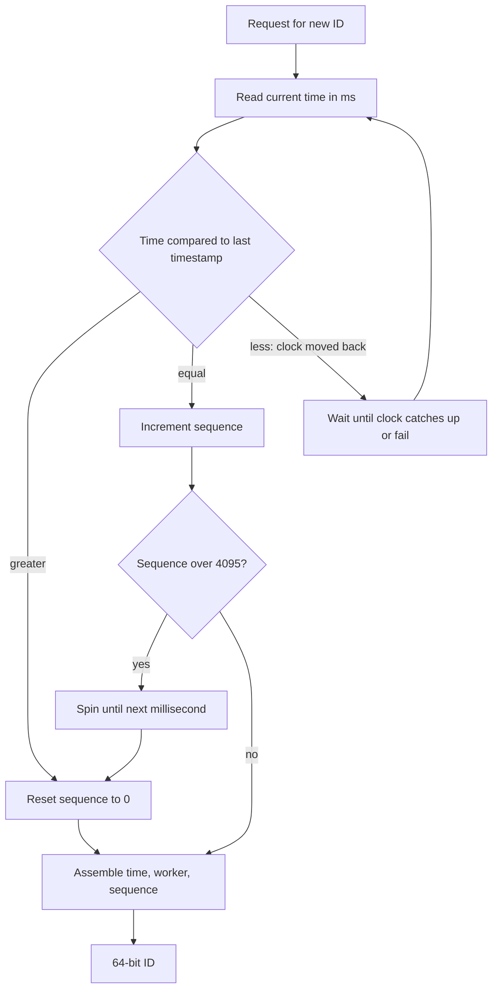

Every row, message and file needs an identifier, and the choice is harder to change than almost any other decision in a schema: IDs leak into URLs, foreign keys, caches, logs, partner integrations and analytics. A good ID scheme is unique without coordination on the hot path, sorts roughly by creation time so indexes stay compact, fits the storage and URL constraints you have, and does not reveal things you would rather keep private. This guide walks through the main options, their bit layouts and failure modes, and ends with a choice per use case.

## Auto-increment and its limits

A database sequence (`BIGSERIAL`, `IDENTITY`, `AUTO_INCREMENT`) is the simplest scheme and the right default for a single database. IDs are 8 bytes, strictly increasing within one node, and new rows always land at the right edge of the B-tree, which is ideal for insert performance and cache locality.

The limits show up as the system grows:

- **One authority**: every insert needs the primary. Sharded or multi-region writes cannot share a sequence without coordination.
- **Client-side creation**: the client cannot know the ID before the insert, which complicates offline-first apps, idempotent retries and creating parent and child objects in one request.
- **Merging data**: two databases both have order 1001; migrations and tenant moves collide.
- **Leakage**: `/orders/18234` tells competitors your volume and invites enumeration.
- **Gaps**: sequences are not transactional; rollbacks and caching leave gaps, so never use them as invoice numbers that must be contiguous.
- **32-bit overflow**: `INT` caps at about 2.1 billion. Use `BIGINT` from day one; migrating a hot primary key later is painful.

## UUIDv4 vs UUIDv7

A UUID is 128 bits, generated anywhere without coordination. Version 4 is 122 random bits; the chance of any collision across 1 trillion IDs is around one in 10 trillion, so treat it as unique.

The problem with v4 is index locality. Random keys insert into random leaf pages of the B-tree, so once the index outgrows memory, almost every insert reads a page from disk, pages split at 50 percent fill, and write amplification and WAL volume climb. In Postgres and especially MySQL InnoDB (where the primary key is the clustered table layout) teams see insert throughput drop several times at large table sizes.

**UUIDv7** (RFC 9562, 2024) fixes this. It keeps the 128-bit UUID format but puts a 48-bit Unix millisecond timestamp first:

| Bits | Field |
|------|-------|
| 48 | Unix timestamp in milliseconds |
| 4 | Version (7) |
| 12 | Random or sub-millisecond counter |
| 2 | Variant |
| 62 | Random |

IDs created close in time are close in the index, so inserts hit the right edge like a sequence, while still being generated on any node. Postgres 18 ships `uuidv7()`; most languages have libraries. Store UUIDs in a native `uuid` column (16 bytes), never as a 36-character string.

## ULID

ULID predates UUIDv7 with the same idea: 48-bit millisecond timestamp plus 80 random bits, encoded as 26 Crockford base32 characters (`01JBQ6Z8X3V4K9M2N7P5R8S1TW`) that sort lexicographically by time and avoid ambiguous letters. Monotonic mode increments the random part within the same millisecond to guarantee ordering on one generator. ULIDs fit in a `uuid` column as 16 bytes. For new systems, UUIDv7 is the standard choice; ULID remains good where you want the shorter, case-insensitive text form.

## Snowflake IDs

Twitter's Snowflake packs a time-ordered ID into 64 bits, so it fits a `BIGINT` and is half the size of a UUID. The classic layout:

| Bits | Field | Capacity |
|------|-------|----------|
| 1 | Sign, always 0 | Keeps IDs positive |
| 41 | Milliseconds since a custom epoch | About 69.7 years |
| 10 | Worker ID (often 5 datacenter + 5 machine) | 1,024 generators |
| 12 | Sequence within the millisecond | 4,096 IDs per ms per worker |

That is up to about 4 million IDs per second per worker. Discord, Instagram (with a variant using shard ID) and many others use this pattern.



Two operational problems decide whether Snowflake works for you:

- **Worker ID assignment**: two processes with the same worker ID will produce duplicates. Assign IDs from a coordinator (a lease in etcd or ZooKeeper, a row in a database claimed at startup, or the Kubernetes StatefulSet ordinal) rather than from configuration that someone will copy.
- **Clock skew**: if NTP steps the clock backwards, the generator could reissue timestamps. The generator must remember its last timestamp and refuse to go backwards: wait out small regressions (a few ms) and fail loudly on large ones. Configure NTP to slew rather than step. Also persist or offset the last timestamp across restarts if a machine might reboot with a wrong clock.

Snowflake IDs are only roughly time-ordered across workers (within clock skew), which is fine for indexes and pagination but not for strict global ordering.

## Ticket servers and range allocation

If you want short numeric IDs without clock concerns, allocate ranges. A central table hands each app instance a block:

```sql
UPDATE id_ranges
SET next_start = next_start + 1000
WHERE name = 'links'
RETURNING next_start - 1000 AS range_start;
```

The instance serves IDs from memory for the next 1,000 inserts, then fetches another block. The coordinator is hit once per thousand IDs, so it is not a bottleneck, and a crash only wastes the rest of a block. Flickr ran two MySQL "ticket servers" with odd and even offsets for availability. The trade-off: IDs are unique but only loosely ordered across instances, and the allocator is a dependency you must keep highly available.

## Short IDs and base62

For URLs and human-facing codes, encode a number in base62 (`0-9a-zA-Z`). Each character carries about 5.95 bits:

| Length | Combinations |
|--------|--------------|
| 6 | 56.8 billion |
| 7 | 3.5 trillion |
| 8 | 218 trillion |
| 11 | Enough for any 64-bit integer |

You can encode a counter (short, but sequential), a Snowflake ID (11 characters), or random bytes (NanoID's default 21 characters gives UUID-level collision resistance). For random short codes, check the collision probability with the birthday bound: with 7 random base62 characters, a collision is more likely than not after about 2 million codes, so insert with a unique constraint and retry on conflict. Drop look-alike characters (`0O1lI`) for codes people type.

## Exposing IDs publicly

Sequential IDs in URLs enable enumeration: an attacker iterates `/invoices/1001`, `/1002` and finds any endpoint that forgot an authorization check. Authorization is the real fix, but unguessable IDs are good defense in depth and also hide business volume.

Common patterns:

- Internal `BIGINT` primary key for joins, plus a public UUIDv7 or random token column with a unique index used in all APIs.
- Encode internal IDs with a keyed permutation (for example Sqids with a shuffled alphabet, or a Feistel cipher) so outputs look random but map back. This hides volume, not security; treat it as obfuscation.
- Be aware that UUIDv7 and Snowflake reveal creation time to the millisecond. Usually harmless, sometimes not (account creation dates, medical records).
- Use typed prefixes like Stripe's `cus_`, `inv_` so logs and support tickets are self-describing.

## Choosing per use case

| Use case | Recommended | Why |
|----------|-------------|-----|
| Single Postgres or MySQL, internal tables | `BIGINT` identity | Smallest, fastest, simplest |
| Rows created across services or regions, or by clients | UUIDv7 | Coordination-free, index-friendly |
| Very high-volume events where 8 bytes matters | Snowflake | 64-bit, time-ordered, millions per second |
| Public resource IDs in APIs | UUIDv7 or prefixed random token | Unguessable, stable |
| Short links, invite codes | Range-allocated counter plus permutation, base62 | 6 to 8 characters, no collisions |
| Idempotency keys, session tokens | 128+ bits from a CSPRNG | Must be unpredictable |
| Invoice or receipt numbers | Per-tenant counter in a transaction | Legal requirement for gap-free sequences |

## Trade-offs and pitfalls

- **UUIDv4 primary keys** on large InnoDB or Postgres tables cause index bloat and slow inserts.
- **UUIDs stored as strings** cost 36+ bytes per key and in every foreign key and index.
- **Hardcoded worker IDs** in Snowflake produce duplicates after a copy-paste deploy.
- **Clock regressions** without a guard silently create duplicate IDs.
- **Time-ordered IDs as secrets**: v7 and Snowflake are guessable within a window; never use them as tokens.
- **JavaScript precision**: 64-bit integers above 2^53 lose precision in JSON; send Snowflake IDs as strings.

## Interview angle

- Start with requirements: size, ordering, coordination, and whether the ID is public.
- Draw the Snowflake bit layout and compute its limits.
- Explain why random UUIDs hurt B-tree inserts and how v7 fixes it.
- Address worker ID assignment and clock skew; this separates real experience from memorization.
- Mention enumeration and the internal versus public ID split.

## Key takeaways

- Auto-increment is the best default until you need IDs without a single authority.
- UUIDv7 gives UUID-style independence with sequence-like index locality.
- Snowflake fits 64 bits with 41 time, 10 worker, 12 sequence bits; guard against clock skew.
- Range allocation gives short numeric IDs with a coordinator touched once per block.
- Keep public IDs unguessable and never rely on IDs for authorization.
